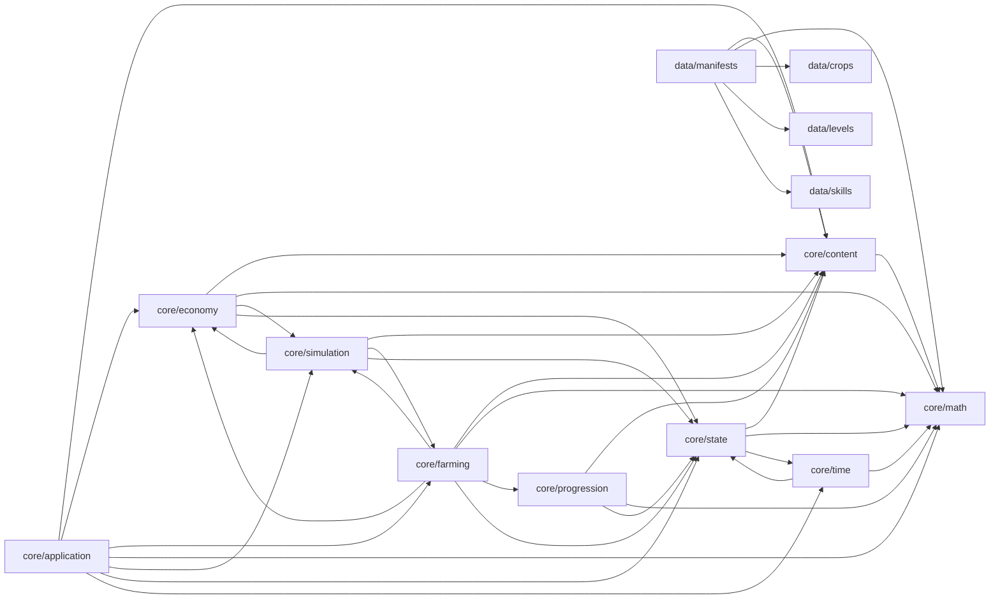

# M01 — Module dependency report and public API inventory

Generated by `tools/dependency_report.py`, a static scan of `idle_farmer/core` and `idle_farmer/data` that is independent of Godot. The enforcing check is `tests/architecture/test_core_dependencies.gd` (V09). Comments and string literals are ignored.

## References from core/data to classes outside core/data

**None.**

## Module dependencies

| Module | Depends on |
|---|---|
| `core/application` | `core/content`, `core/economy`, `core/farming`, `core/math`, `core/simulation`, `core/state`, `core/time` |
| `core/content` | `core/math` |
| `core/economy` | `core/content`, `core/math`, `core/simulation`, `core/state` |
| `core/farming` | `core/content`, `core/economy`, `core/math`, `core/progression`, `core/simulation`, `core/state` |
| `core/math` | — |
| `core/progression` | `core/content`, `core/math`, `core/state` |
| `core/simulation` | `core/content`, `core/economy`, `core/farming`, `core/state` |
| `core/state` | `core/content`, `core/math`, `core/time` |
| `core/time` | `core/math`, `core/state` |
| `data/crops` | — |
| `data/levels` | — |
| `data/manifests` | `core/content`, `core/math`, `data/crops`, `data/levels`, `data/skills` |
| `data/skills` | — |

## Public API inventory

Public functions only; names starting with `_` are internal. Signatures are copied from source.

### `CommitSink` (extends `RefCounted`) — `core/application/commit_sink.gd`

Uses: —

- `commit(prepared: Dictionary) -> String`
- `read_back() -> Dictionary`

### `GameController` (extends `RefCounted`) — `core/application/game_controller.gd`

Uses: AccountedInterval, CommandId, CommandResult, CommitSink, ContentRegistry, FailureCode, FarmSystem, GameCommand, GameState, IntegerMath, ManifestCatalog, MathResult, PlantingQuote, RawIntent, SimulationClock, SimulationEngine, SimulationEvent, StateChangeBatch

- `start(state: GameState, writer_epoch: String) -> PackedStringArray`
- `is_started() -> bool`
- `is_blocked() -> bool`
- `now_us() -> int`
- `snapshot() -> GameState`
- `accepted_log() -> Array[Dictionary]`
- `add_commit_listener(listener: Callable) -> void`
- `set_speed_multiplier(speed: int) -> bool`
- `reset_speed() -> void`
- `quote_plant(crop_id: String) -> PlantingQuote`
- `advance_active(real_us: int) -> String`
- `advance_suspended(real_us: int) -> String`
- `advance_offline(real_us: int) -> String`
- `submit_intent(intent: RawIntent) -> CommandResult`
- `reconcile() -> String`

### `RawIntent` (extends `RefCounted`) — `core/application/raw_intent.gd`

Uses: CommandId, EntityId, GameCommand, HarvestCropCommand, PlantCropCommand, PlantingQuote

- `static plant(p_intent_id: String, p_plot_id: int, quote: PlantingQuote) -> RawIntent`
- `static harvest(p_intent_id: String, p_plot_id: int, p_cycle_id: EntityId) -> RawIntent`
- `to_command(id: CommandId, accepted_time_us: int, accepted_order: int) -> GameCommand`

### `ContentManifest` (extends `Resource`) — `core/content/content_manifest.gd`

Uses: CropDefinition, LevelCurveDefinition, ResearchDefinition, SkillDefinition

- (data/constants only)

### `ContentRegistry` (extends `RefCounted`) — `core/content/content_registry.gd`

Uses: ContentManifest, CropDefinition, IntegerMath, LevelCurveDefinition, MathResult, ResearchDefinition, SkillDefinition

- `static build(manifest: ContentManifest) -> ContentRegistry`
- `is_valid() -> bool`
- `manifest_id() -> String`
- `crop_ids() -> PackedStringArray`
- `has_crop(crop_id: String) -> bool`
- `crop(crop_id: String) -> CropDefinition`
- `start_unlocked_crop_ids() -> PackedStringArray`
- `research(research_id: String) -> ResearchDefinition`
- `research_ids() -> PackedStringArray`
- `skill_ids() -> PackedStringArray`
- `skill(skill_id: String) -> SkillDefinition`
- `total_skill_point_capacity() -> int`
- `level_for_xp(xp: int) -> int`
- `threshold_for_level(level: int) -> int`
- `max_representable_level() -> int`
- `explicit_level_count() -> int`

### `CropDefinition` (extends `Resource`) — `core/content/crop_definition.gd`

Uses: —

- (data/constants only)

### `LevelCurveDefinition` (extends `Resource`) — `core/content/level_curve_definition.gd`

Uses: —

- (data/constants only)

### `ManifestCatalog` (extends `RefCounted`) — `core/content/manifest_catalog.gd`

Uses: ContentRegistry

- `register(registry: ContentRegistry) -> String`
- `is_supported(manifest_id: String) -> bool`
- `resolve(manifest_id: String) -> ContentRegistry`
- `supported_ids() -> PackedStringArray`

### `ResearchDefinition` (extends `Resource`) — `core/content/research_definition.gd`

Uses: —

- (data/constants only)

### `SkillDefinition` (extends `Resource`) — `core/content/skill_definition.gd`

Uses: —

- (data/constants only)

### `EconomicTransaction` (extends `RefCounted`) — `core/economy/economic_transaction.gd`

Uses: EntityId, PrimitiveReader

- `transaction_id() -> EntityId`
- `time_us() -> int`
- `type() -> String`
- `plot_id() -> int`
- `cycle_id() -> EntityId`
- `coin_delta() -> int`
- `xp_delta() -> int`
- `category() -> String`
- `content_version() -> String`
- `to_primitive() -> Dictionary`
- `static from_primitive(value: Variant) -> EconomicTransaction`

### `EconomySystem` (extends `RefCounted`) — `core/economy/economy_system.gd`

Uses: CropCycle, CropDefinition, GameState, IntegerMath, MathResult, PlantingQuote

- `static current_modifiers(_state: GameState) -> Dictionary[String, int]`
- `static quote_planting(crop: CropDefinition, manifest_id: String, modifiers: Dictionary[String, int]) -> PlantingQuote`
- `static harvest_reward(cycle: CropCycle) -> Array[int]`
- `static completed_cycle_profit(cycle: CropCycle) -> MathResult`

### `PlantingQuote` (extends `RefCounted`) — `core/economy/planting_quote.gd`

Uses: PlantCropCommand

- `matches(command: PlantCropCommand) -> bool`

### `FarmSystem` (extends `RefCounted`) — `core/farming/farm_system.gd`

Uses: CommandResult, ContentRegistry, CropCycle, CropDefinition, EconomicTransaction, EconomySystem, EntityId, EventScheduler, FailureCode, GameState, HarvestCropCommand, IntegerMath, MathResult, PlantCropCommand, PlantingQuote, PlotState, ProgressionSystem, ScheduledEvent, SimulationEvent, StateChangeBatch, XpGrant

- `static check_plant_target(state: GameState, registry: ContentRegistry, plot_id: int, crop_id: String) -> String`
- `static quote_for(state: GameState, registry: ContentRegistry, crop_id: String) -> PlantingQuote`
- `static plant(state: GameState, registry: ContentRegistry, scheduler: EventScheduler, command: PlantCropCommand) -> CommandResult`
- `static mark_mature(state: GameState, event: ScheduledEvent) -> SimulationEvent`
- `static harvest(state: GameState, registry: ContentRegistry, command: HarvestCropCommand) -> CommandResult`
- `static harvest_ready_cycle(state: GameState, registry: ContentRegistry, plot_id: int) -> StateChangeBatch`

### `IntegerMath` (extends `RefCounted`) — `core/math/integer_math.gd`

Uses: MathResult

- `static add(a: int, b: int) -> MathResult`
- `static sub(a: int, b: int) -> MathResult`
- `static mul(a: int, b: int) -> MathResult`
- `static floor_div(a: int, d: int) -> MathResult`
- `static ceil_div(a: int, d: int) -> MathResult`
- `static mul_div_floor(a: int, b: int, d: int) -> MathResult`
- `static mul_div_ceil(a: int, b: int, d: int) -> MathResult`
- `static apply_bp_floor(value: int, basis_points: int) -> MathResult`
- `static apply_bp_ceil(value: int, basis_points: int) -> MathResult`
- `static growth_us(base_us: int, reduction_bp: int, cap_bp: int) -> MathResult`
- `static next_increasing_increment(previous: int, growth_percent: int) -> MathResult`

### `MathResult` (extends `RefCounted`) — `core/math/math_result.gd`

Uses: —

- `static of(p_value: int) -> MathResult`
- `static failure() -> MathResult`

### `ProgressionSystem` (extends `RefCounted`) — `core/progression/progression_system.gd`

Uses: ContentRegistry, IntegerMath, MathResult, PlayerState, XpGrant

- `static get_level_for_xp(registry: ContentRegistry, xp: int) -> int`
- `static prepare_xp(player: PlayerState, registry: ContentRegistry, xp_delta: int) -> XpGrant`
- `static apply(player: PlayerState, grant: XpGrant) -> void`

### `XpGrant` (extends `RefCounted`) — `core/progression/xp_grant.gd`

Uses: —

- `levels_gained() -> int`

### `CommandReplayer` (extends `RefCounted`) — `core/simulation/command_replayer.gd`

Uses: CommandResult, FailureCode, GameCommand, GameState, ManifestCatalog, SimulationEngine, StateChangeBatch

- `static replay(initial: GameState, catalog: ManifestCatalog, log: Array[Dictionary], final_time_us: int) -> Dictionary`

### `CommandResult` (extends `RefCounted`) — `core/simulation/command_result.gd`

Uses: CommandId, EconomicTransaction, FailureCode, PrimitiveReader, SimulationEvent

- `static failed(code: String, detail: String, p_command_id: CommandId, p_state_sequence: int) -> CommandResult`
- `to_primitive() -> Dictionary`
- `static from_primitive(value: Variant) -> CommandResult`

### `EventPhase` (extends `RefCounted`) — `core/simulation/event_phase.gd`

Uses: —

- (data/constants only)

### `EventScheduler` (extends `RefCounted`) — `core/simulation/event_scheduler.gd`

Uses: CropCycle, GameState, PlotState, ScheduledEvent

- `push(event: ScheduledEvent) -> bool`
- `cancel(insertion_seq: int) -> bool`
- `size() -> int`
- `storage_size() -> int`
- `peek_time() -> int`
- `pop_next() -> ScheduledEvent`
- `pop_at(time_us: int) -> Array[ScheduledEvent]`
- `pending_in_order() -> Array[ScheduledEvent]`
- `static rebuild(state: GameState) -> EventScheduler`

### `FailureCode` (extends `RefCounted`) — `core/simulation/failure_code.gd`

Uses: —

- (data/constants only)

### `GameCommand` (extends `RefCounted`) — `core/simulation/game_command.gd`

Uses: CommandId, FailureCode, HarvestCropCommand, PlantCropCommand, PrimitiveReader

- `command_id() -> CommandId`
- `type() -> String`
- `accepted_time_us() -> int`
- `accepted_order() -> int`
- `envelope_failure(expected_save_id: String) -> String`
- `to_primitive() -> Dictionary`
- `static from_primitive(value: Variant) -> GameCommand`

### `HarvestCropCommand` (extends `GameCommand`) — `core/simulation/harvest_crop_command.gd`

Uses: CommandId, EntityId, GameCommand, PrimitiveReader

- `plot_id() -> int`
- `cycle_id() -> EntityId`
- `static from_args(id: CommandId, time_us: int, order: int, args: Dictionary) -> HarvestCropCommand`

### `PlantCropCommand` (extends `GameCommand`) — `core/simulation/plant_crop_command.gd`

Uses: CommandId, GameCommand, PrimitiveReader

- `plot_id() -> int`
- `crop_id() -> String`
- `manifest_id() -> String`
- `seed_cost() -> int`
- `growth_us() -> int`
- `gross_coins() -> int`
- `xp() -> int`
- `static from_args(id: CommandId, time_us: int, order: int, args: Dictionary) -> PlantCropCommand`

### `ScheduledEvent` (extends `RefCounted`) — `core/simulation/scheduled_event.gd`

Uses: CropCycle, EntityId, EventPhase

- `static for_maturity(cycle: CropCycle) -> ScheduledEvent`
- `key() -> Array[int]`
- `precedes(other: ScheduledEvent) -> bool`

### `SimulationEngine` (extends `RefCounted`) — `core/simulation/simulation_engine.gd`

Uses: CommandId, CommandResult, ContentRegistry, EventScheduler, FailureCode, FarmSystem, GameCommand, GameState, HarvestCropCommand, ManifestCatalog, PlantCropCommand, ScheduledEvent, SimulationEvent, StateChangeBatch

- `initialize(state: GameState, catalog: ManifestCatalog) -> PackedStringArray`
- `is_initialized() -> bool`
- `registry() -> ContentRegistry`
- `current_time_us() -> int`
- `validate_state() -> PackedStringArray`
- `get_state_snapshot() -> GameState`
- `get_next_event_time() -> int`
- `advance_to(target_us: int) -> StateChangeBatch`
- `submit_command(command: GameCommand) -> CommandResult`

### `SimulationEvent` (extends `RefCounted`) — `core/simulation/simulation_event.gd`

Uses: EntityId, PrimitiveReader

- `to_primitive() -> Dictionary`
- `static from_primitive(value: Variant) -> SimulationEvent`

### `StateChangeBatch` (extends `RefCounted`) — `core/simulation/state_change_batch.gd`

Uses: EconomicTransaction, FailureCode, SimulationEvent

- `changed() -> bool`
- `append(other: StateChangeBatch) -> void`

### `CanonicalCodec` (extends `RefCounted`) — `core/state/canonical_codec.gd`

Uses: IntegerMath, MathResult

- `static encode(value: Variant) -> PackedByteArray`
- `static is_encodable(value: Variant) -> bool`
- `static digest(value: Variant) -> String`
- `static decode(bytes: PackedByteArray) -> Dictionary`

### `CommandId` (extends `RefCounted`) — `core/state/command_id.gd`

Uses: PrimitiveReader

- `is_valid() -> bool`
- `equals(other: CommandId) -> bool`
- `to_primitive() -> Dictionary`
- `static from_primitive(value: Variant) -> CommandId`

### `CommandReplayState` (extends `RefCounted`) — `core/state/command_replay_state.gd`

Uses: CommandId, PrimitiveReader

- `is_stale_epoch(command_id: CommandId) -> bool`
- `is_duplicate(command_id: CommandId) -> bool`
- `cached_result(command_id: CommandId) -> Dictionary`
- `record_success(command_id: CommandId, result_primitive: Dictionary) -> void`
- `start_epoch(new_epoch: String) -> void`
- `validate() -> PackedStringArray`
- `to_primitive() -> Dictionary`
- `static from_primitive(value: Variant) -> CommandReplayState`

### `CropCycle` (extends `RefCounted`) — `core/state/crop_cycle.gd`

Uses: EntityId, IntegerMath, MathResult, PrimitiveReader

- `stage_at(time_us: int) -> int`
- `validate() -> PackedStringArray`
- `to_primitive() -> Dictionary`
- `static from_primitive(value: Variant) -> CropCycle`

### `EntityId` (extends `RefCounted`) — `core/state/entity_id.gd`

Uses: PrimitiveReader

- `is_valid() -> bool`
- `equals(other: EntityId) -> bool`
- `key() -> String`
- `to_primitive() -> Dictionary`
- `static from_primitive(value: Variant) -> EntityId`
- `static nullable_to_primitive(id: EntityId) -> Variant`

### `ExtensionState` (extends `RefCounted`) — `core/state/extension_state.gd`

Uses: PrimitiveReader

- (data/constants only)

### `GameSettings` (extends `RefCounted`) — `core/state/game_settings.gd`

Uses: PrimitiveReader

- `validate() -> PackedStringArray`
- `to_primitive() -> Dictionary`
- `static from_primitive(value: Variant) -> GameSettings`

### `GameState` (extends `RefCounted`) — `core/state/game_state.gd`

Uses: CanonicalCodec, CommandReplayState, ContentRegistry, CropCycle, CropDefinition, EntityId, ExtensionState, GameSettings, IntegerMath, MathResult, PlayerState, PlotState, PrimitiveReader, TimeAnchor

- `static new_game(p_save_id: String, player_id: String, writer_epoch: String, created_utc_us: int, registry: ContentRegistry) -> GameState`
- `plot(plot_id: int) -> PlotState`
- `unlocked_plot_count() -> int`
- `is_crop_available(crop_id: String, registry: ContentRegistry) -> bool`
- `available_crop_ids(registry: ContentRegistry) -> PackedStringArray`
- `allocate_entity_id() -> EntityId`
- `allocate_insertion_sequence() -> int`
- `validate(registry: ContentRegistry) -> PackedStringArray`
- `to_primitive() -> Dictionary`
- `gameplay_primitive() -> Dictionary`
- `metadata_primitive() -> Dictionary`
- `gameplay_digest() -> String`
- `metadata_digest() -> String`
- `digest() -> String`
- `clone() -> GameState`
- `static from_primitive(value: Variant) -> GameState`

### `PlayerState` (extends `RefCounted`) — `core/state/player_state.gd`

Uses: ContentRegistry, IntegerMath, MathResult, PrimitiveReader, SkillDefinition

- `allocated_skill_points() -> int`
- `validate(registry: ContentRegistry) -> PackedStringArray`
- `to_primitive() -> Dictionary`
- `static from_primitive(value: Variant) -> PlayerState`

### `PlotState` (extends `RefCounted`) — `core/state/plot_state.gd`

Uses: CropCycle, PrimitiveReader

- `static row_of(id: int) -> int`
- `static column_of(id: int) -> int`
- `validate() -> PackedStringArray`
- `to_primitive() -> Dictionary`
- `static from_primitive(value: Variant) -> PlotState`

### `PrimitiveReader` (extends `RefCounted`) — `core/state/primitive_reader.gd`

Uses: —

- `ok() -> bool`
- `expect_only(allowed: PackedStringArray) -> void`
- `int_field(key: String) -> int`
- `string_field(key: String) -> String`
- `bool_field(key: String) -> bool`
- `dict_field(key: String) -> Dictionary`
- `array_field(key: String) -> Array`
- `nullable_field(key: String) -> Variant`
- `string_array_field(key: String) -> PackedStringArray`
- `int_map_field(key: String) -> Dictionary[String, int]`
- `absorb(nested_errors: PackedStringArray) -> void`
- `static plain(value: Variant) -> Variant`

### `TimeAnchor` (extends `RefCounted`) — `core/state/time_anchor.gd`

Uses: AccountedInterval, IntegerMath, MathResult, PrimitiveReader

- `credit(interval: AccountedInterval) -> bool`
- `observe_utc(utc_us: int) -> void`
- `validate() -> PackedStringArray`
- `to_primitive() -> Dictionary`
- `static from_primitive(value: Variant) -> TimeAnchor`

### `AccountedInterval` (extends `RefCounted`) — `core/time/accounted_interval.gd`

Uses: PrimitiveReader

- `validate() -> PackedStringArray`
- `to_primitive() -> Dictionary`
- `static from_primitive(value: Variant) -> AccountedInterval`

### `SimulationClock` (extends `RefCounted`) — `core/time/simulation_clock.gd`

Uses: AccountedInterval, IntegerMath, MathResult

- `get_simulation_time_us() -> int`
- `get_speed_multiplier() -> int`
- `set_speed_multiplier(speed: int) -> bool`
- `reset_speed() -> void`
- `advance_active(real_us: int) -> AccountedInterval`
- `advance_real_time(real_us: int) -> AccountedInterval`
- `advance_suspended(real_us: int) -> AccountedInterval`
- `advance_offline(real_us: int) -> AccountedInterval`
- `consume_observation(observation: Dictionary) -> Array[AccountedInterval]`

### `TimeProvider` (extends `RefCounted`) — `core/time/time_provider.gd`

Uses: —

- `get_utc_unix_time_us() -> int`
- `get_monotonic_time_us() -> int`
- `get_resume_elapsed_us() -> int`
- `observe_partition() -> Dictionary`

### `CropCatalogV1` (extends `RefCounted`) — `data/crops/crop_catalog_v1.gd`

Uses: —

- (data/constants only)

### `LevelCurveV1` (extends `RefCounted`) — `data/levels/level_curve_v1.gd`

Uses: —

- (data/constants only)

### `ContentM01V1` (extends `RefCounted`) — `data/manifests/content_m01_v1.gd`

Uses: ContentManifest, ContentRegistry, CropCatalogV1, CropDefinition, IntegerMath, LevelCurveDefinition, LevelCurveV1, ResearchDefinition, SkillCatalogV1, SkillDefinition

- `static build_manifest() -> ContentManifest`
- `static build_registry() -> ContentRegistry`
- `static research_id_for(crop_id: String) -> String`
- `static placeholder_stage_art(crop_id: String) -> PackedStringArray`

### `SkillCatalogV1` (extends `RefCounted`) — `data/skills/skill_catalog_v1.gd`

Uses: —

- (data/constants only)
