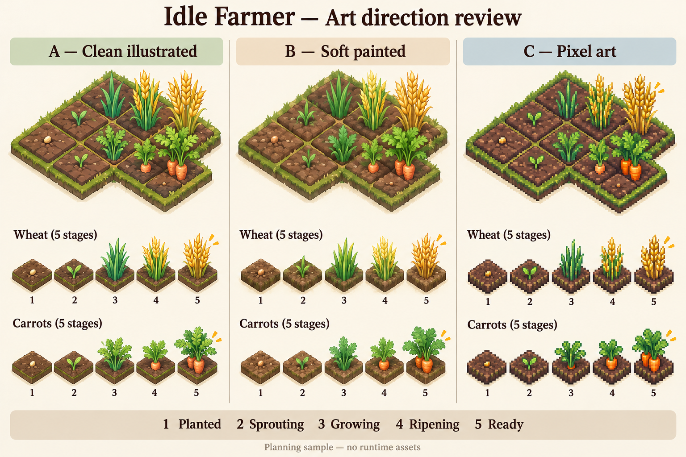

# Idle Farmer — Decision Register

> **Audit application A1 — 2026-10-28:** Approved audit selections 001–004 B, 005–006 A, 007 B, 008–009 A are synchronized as explicit clarifications/amendments below; see [Audit Decision Register](Audit_Decision_Register.md) and [correction changelog](../audit/round_01/Audit_Correction_Changelog.md). Original approval quotations/history and all original parent statuses remain unchanged: 23 Approved, DEC-001/014/023 Open with approved subparts, DEC-008 Deferred. No unreviewed artifact/provider/production result or final balance is approved.

Prepared: 2026-10-25 · Updated: 2026-10-28 · Revision: 15 (A1 audit corrections) · Planning only · Owner/approver: project owner

**Approval state — Groups1–6 + C1–C3 and H1–H2 synchronized, 2026-10-28:** Owner confirmed **“DEC-023 - agreed with option A.”** The Closeout C visual direction **Clean illustrated** is now Approved from column A of the planning comparison. H2 reference-target hardware, C2 contract content and earlier choices remain approved. Totals: **23 Approved, 3 Open, 0 Proposed, 1 Deferred**. DEC-023 retains approved protocol/hardware-target/style subparts; its parent stays Open for actual production configuration/assets/tuning and qualification. DEC-001 actual artifact/adoption verification and DEC-014 measured provider/API remain Open. No game code, installation or actual test/playtest pass is produced.

**Review closeout:** all 27 decision topics have been covered, with explicit approvals, DEC-008's recorded deferral and named implementation-stage obligations. There is no further style-approval group pending. Clean illustrated is binding in FRS §2.1/TRS §11.1 and affected plans; M04's art bible/production samples and M06's actual visual/audio/performance qualification remain future tasks. The H2 hardware envelope is selected, while actual installed configuration/OS/driver/results must still be recorded. A future change to an approved choice or provisional balance value requires the established change-control review.

## Authority, references and approval rules

The nine reviewed project references are:

- **FRS:** [IdleFarmer_Functional_v1.0.md](../requirements/IdleFarmer_Functional_v1.0.md), authoritative gameplay/scope.
- **TRS:** [IdleFarmer_Technical_v1.5.md](../architecture/IdleFarmer_Technical_v1.5.md), authoritative technical contracts.
- **RM:** [00_IdleFarmer_Master_Roadmap.md](../implementation/00_IdleFarmer_Master_Roadmap.md), implementation roadmap and original D-01–D-27 ambiguity list.
- **M01:** [Headless simulation foundation](../implementation/01_M01_Headless_Simulation_Foundation.md).
- **M02:** [Economy, skills, research and automation](../implementation/02_M02_Economy_Skills_Research_Automation.md).
- **M03:** [Saves, clock integrity and offline farming](../implementation/03_M03_Saves_Time_Offline_Farming.md).
- **M04:** [Visual farm, art, UI and audio](../implementation/04_M04_Visual_Farm_Art_UI_Audio.md).
- **M05:** [Contracts, statistics and complete progression](../implementation/05_M05_Contracts_Statistics_Complete_Progression.md).
- **M06:** [Validation, performance and Windows release](../implementation/06_M06_Validation_Performance_Windows_Release.md).

There is no file named `Implementation_Roadmap.md` in this checkout. RM above is the existing roadmap delivered in the previous planning task; no duplicate was created or silently substituted from another project. `DEC-001` maps to RM `D-01`, continuing one-to-one through `DEC-027` / `D-27`. Stable numbering preserves references while entries are grouped by decision deadline rather than numerical order.

FRS owns gameplay; TRS owns architecture. RM and milestone plans elaborate implementation but cannot override either specification. Section references are used where the specifications have no individual requirement ID. `M02-T07`, for example, identifies a task in the linked M02 plan. Existing `FR-*`, `ARCH-*` and `T-001`–`T-030` IDs retain their source meanings.

Status meanings:

| Status | Meaning |
|---|---|
| Open | A concrete selection or evidence is still missing; a recommended direction may exist. |
| Proposed | A reviewable recommendation exists but has no user approval. |
| Approved | The user explicitly confirmed the identified choice and scope; approval evidence is recorded. Twenty-three complete decisions currently, plus approved subparts of DEC-001 (policy + C1 named versions/target; artifact verification pending), DEC-014 (provider-selection procedure) and DEC-023 (qualification/sample-review protocol, H2 reference target and C3 Clean illustrated direction). DEC-008 is a confirmed Deferred parent. |
| Deferred | A postponement was explicitly recorded with revisit trigger and compatible scope. DEC-008 is Deferred with the explicit trigger “post-playtest scoped content proposal” and new approval before inclusion; other proposed deferrals stay Proposed. |

Entries without an explicit approval record retain **Approved by: —; Approved on: —; Confirmation: —; Source synchronization: not started**. The Group 1 entries record the project owner's 2026-10-26 confirmation; DEC-002/003/004/020 record the 2026-10-27 Group 2 approval/amendment and completed synchronization for their approved scope. DEC-007/009/010/011/012/025 record the 2026-10-27 Group 3 confirmation and completed synchronization. DEC-014/015/017/018/019/021/022 record the 2026-10-27 Group 4 confirmation with explicit partial-approval boundaries and completed source synchronization. DEC-008/023/024 record the 2026-10-27 Group 5 confirmation: one Deferred parent, one fully Approved and one Open with approved procedure. DEC-027 records the 2026-10-27 Group 6 confirmation and synchronized standalone delivery policy. C1 records approved DEC-001 named versions/target and DEC-002 increasing optionB; actual artifact/adoption verification remains open for DEC-001. C2 records the confirmed twelve-offer DEC-019 catalog/predicates/frozen rewards and completed source synchronization. Approval of a policy does not approve unnamed versions, prices, hardware, assets or new features. For compound decisions, record confirmed subparts separately; leave the parent Open/Proposed until its mandatory subparts are resolved. A recommendation must never become Approved merely because development begins or an option appears in a plan.

Importance: **Critical** threatens determinism, integrity or foundational contracts; **High** materially affects gameplay/economics, reporting or delivery feasibility; **Medium** affects UX, scope or manageable rework; **Low** is a late, reversible delivery preference. Urgency and importance are separate: a critical storage decision can be needed at M03 rather than before M01.

## Required review format for every remaining ambiguity

**User clarification, 2026-10-27:** apply all seven requirements below to **each ambiguity**, both in its detailed register entry and in every remaining user-facing approval presentation. A table of recommended defaults alone does not satisfy this format.

- Explain the issue and why it needs resolution.
- Identify the affected requirements and implementation milestones.
- Classify its importance: Critical, High, Medium, or Low.
- Identify the earliest milestone that requires the decision.
- Present reasonable options, with pros and cons.
- Recommend the best solution based on our current specifications.
- Explain the potential consequences of making the wrong decision.

Present architectural and foundational choices first; explain dependencies and approval boundaries. Give straightforward technical defaults a short rationale, and present gameplay/economic/UX and material technical alternatives clearly for the owner to choose. Record explicit partial approvals separately. This procedural clarification does not approve any remaining recommendation or reopen confirmed Groups1–6/C1–C2.

## Prioritized index and original-ID crosswalk

| Decision | RM ID | Subject | Importance | Earliest binding deadline | Status | Section |
|---|---|---|---|---|---|---|
| DEC-001 | D-01 | Toolchain, runner and SQLite integration | Critical | M01 artifact verification; SQLite before M03 | Open (names/target Approved; editor/templates/GUT artifacts Verified 2026-10-30; SQLite and export verification pending) | 1 |
| DEC-002 | D-02 | Through30 curve and increasing continuation | High | M01 curve; M03/M06 long-offline validation | Approved (development values provisional) | 1 |
| DEC-003 | D-03 | Initial coins and new-game state | Medium | M01 | Approved | 1 |
| DEC-004 | D-04 | Skill rank costs and prerequisite graph | High | M02 | Approved | 2 |
| DEC-005 | D-05 | Fixed-point units, rounding and minimum duration | Critical | M01 | Approved | 1 |
| DEC-006 | D-06 | Same-time phases and command ordering | Critical | M01 | Approved | 1 |
| DEC-007 | D-07 | Research slots and paid acceleration | High | M02 | Approved | 2 |
| DEC-008 | D-08 | Deferred optional upgrade families / Growth Booster | Medium | Excluded from v1; revisit after playtests | Deferred | 3 |
| DEC-009 | D-09 | Fertilizer optimization algorithm and guarantees | High | M02 | Approved | 2 |
| DEC-010 | D-10 | Reserves, defaults and fallback authorization | High | M02 | Approved | 2 |
| DEC-011 | D-11 | Level-9 versus level-15 budget controls | High | M02 | Approved | 2 |
| DEC-012 | D-12 | M02/M03/M05 advanced-automation staging | Medium | M02 | Approved | 2 |
| DEC-013 | D-13 | Credited-through UTC / active interval accounting | Critical | M01 contract; M03 reconciliation | Approved | 1 |
| DEC-014 | D-14 | Windows suspend-inclusive clock/provider | Critical | M03; interface reserved in M01 | Open (selection policy Approved) | 2 |
| DEC-015 | D-15 | Commit cadence and durability/performance tradeoff | Critical | M03 | Approved | 2 |
| DEC-016 | D-16 | Durable IDs and bounded replay protection | Critical | M01 IDs; M03 storage | Approved | 1 |
| DEC-017 | D-17 | Statistics timeline, windows and normalization | High | M03 accounting; M05 reporting | Approved | 2 |
| DEC-018 | D-18 | Session boundaries and utilization definition | Medium | M03 recording; M05 display | Approved | 2 |
| DEC-019 | D-19 | Twelve authored contracts, lifecycle and predicates | High | M03 schema; M05 implementation/evidence | Approved (initial content provisional) | 2 |
| DEC-020 | D-20 | Stable plot mapping and expansion purchase order | Medium | M01 IDs/layout; M02 purchase rule | Approved | 1 |
| DEC-021 | D-21 | Settings ownership and persistence | Medium | M03 schema; M04 playback | Approved | 2 |
| DEC-022 | D-22 | Early browser prototype versus future web scope | Medium | M03 probe scheduling; M01 boundary design | Approved | 2 |
| DEC-023 | D-23 | Reference hardware, art and performance qualification | High | M04 baseline/art bible; candidate inventory in M01 | Open (protocol, target and style Approved; production qualification pending) | 2 |
| DEC-024 | D-24 | Pacing and active-engagement evidence | High | M02 scenarios; M06 human evidence | Approved | 2 |
| DEC-025 | D-25 | Automation changes, respec, presets and rotation | High | M02 basics; M05 advanced behavior | Approved | 2 |
| DEC-026 | D-26 | Uncapped offline policy and finite integer limits | Critical | M01 arithmetic; M03 catch-up | Approved | 1 |
| DEC-027 | D-27 | Standalone Windows ZIP and later channels | Low | M03 dependency spike; M06 package | Approved | 3 |

Count: **27 decisions; 9 before-M01 entries, 16 later-milestone entries, 2 safely deferrable scope/delivery entries. Statuses: 3 Open, 0 Proposed, 23 Approved, 1 Deferred.** DEC-001 has Approved policy/named versions/initial target while actual artifact/adoption verification stays Open; DEC-014 procedure is Approved with actual provider/API evidence Open; DEC-023 qualification method, H2 target and C3 Clean illustrated direction are Approved with actual production configuration/assets/tuning and qualification still Open. DEC-019 lifecycle/schema and C2 exact authored content are now Approved; actual predicate/recovery/balance evidence remains future work. DEC-002's complete increasing continuation is now Approved provisional data, and DEC-008's explicit deferral is settled. Approval never manufactures empirical evidence.

## Review sequence and dependencies

Review in these batches, with the most important contracts first:

1. **Foundation, Group 1 — confirmed 2026-10-26:** DEC-001 policy, DEC-005, DEC-006, DEC-013, DEC-016, DEC-026. Approved engine/test/storage direction, exact arithmetic, deterministic order, interval ledger and replay/limit safety are synchronized. Exact dependency pins and empirical tests remain separate selections/evidence.
2. **Initial state and progression, Group 2 — confirmed/amended 2026-10-27:** DEC-003 zero/Empty start; DEC-020 amended 8×3 start and sequential fourth row; DEC-002 through-30 provisional development table only; DEC-004 one-point/minimum-rank/automation-chain policy. Beyond-30 was excluded from G2; C1 now separately approves increasing option B.
3. **Economy and farming authorization, Group 3 — confirmed 2026-10-27:** DEC-011 → DEC-010 → DEC-007 → DEC-009 → DEC-025 → DEC-012. The selected policies and provisional defaults are synchronized; actual tests and optimizer benchmarks remain future work.
4. **Durability, time and accounting, Group 4 — confirmed 2026-10-27:** DEC-014 → DEC-015, with DEC-017/018/019/021 and DEC-022. Approved policy is synchronized; exact provider/API evidence and authored contract content retain partial status.
5. **Content, performance and evidence, Group 5 — confirmed 2026-10-27:** DEC-023 qualification procedure Approved/actual selections Open; DEC-008 Deferred; DEC-024 combined economy/human evidence policy Approved. Sources/plans synchronized; actual hardware/art/results not invented.
6. **Late delivery, Group 6 — confirmed 2026-10-27:** DEC-027 standalone ZIP policy Approved; native/clean-user/update/save-preservation proof remains future M03/M06 work.
7. **Partial-decision closeout C1–C3 — confirmed through 2026-10-28:** C1 selects DEC-001 names/target and DEC-002 increasing optionB; C2 approves DEC-019 authored content; H2 selects the reference-target envelope and C3 approves Clean illustrated. Remaining obligations are DEC-001 actual artifact/adoption verification, DEC-014 measured provider/API and DEC-023 production configuration/assets/tuning/qualification. Settled choices need no repeat approval; actual integration/performance evidence remains future work.

Key dependency chains:

- DEC-005 + DEC-006 + DEC-016 → deterministic engine → DEC-009 allocator → DEC-015 durable batch.
- DEC-013 + DEC-014 + DEC-015 → exactly-once suspend/offline credit; DEC-026 applies throughout.
- DEC-002 + DEC-003 + DEC-004 + DEC-007 → valid DEC-024 pacing evidence.
- DEC-011 + DEC-010 + DEC-025 → authorized optimizer/retry/rotation behavior.
- DEC-015 + DEC-017 + DEC-018 + DEC-019 → durable historical reports and correct forecasts.
- DEC-001 + DEC-022 + DEC-023 → compatible renderer/native boundaries without a full web release commitment.

No circular approval dependency is required: decide the envelope/interface first, then the concrete policy/content, then benchmark and tune. Empirical results may reopen a decision with a recorded revision; they do not silently replace an approved choice.

## 1. Decisions required before M01 development

### DEC-001 — Reproducible toolchain, test runner and SQLite boundary

**Original:** D-01. **Status:** Open. **Importance:** Critical. **Type:** technical selection and evidence gate. **Earliest need:** before M01-T01; concrete SQLite addon before M03-T01 completes. **Affected:** M01–M06. **Depends on:** no other decision for policy; addon validation also uses DEC-015/022.

**Approval record:** Approved by project owner on **2026-10-26**, confirmation **“Approve Group 1.”** Selected **option A policy**: standard stable non-.NET Godot/matching templates, Compatibility baseline, GUT direction plus scenario harnesses, and evaluate isolated `2shady4u/godot-sqlite` first with required checks. Exact engine/templates/GUT/addon/native-library versions, checksums, license review and empirical integration are **not approved or verified**; parent status remains Open. **Source synchronization: complete for approved policy**, per the Group 1 inventory; implementation/evidence remains future work.

**C1 approval — named versions/target:** Owner on **2026-10-27**, confirmation **“DEC-001 - approved, DEC-002 - use option B.”** Select standard non-.NET Godot **4.7.2-stable**, matching standard **4.7.2-stable export templates**, **GUT v9.7.1**, evaluate **godot-sqlite v4.9** (reported bundled SQLite **3.51.0**), Compatibility and initial Windows **x86_64**. **Source synchronization: complete for selected names/target.** Parent remains Open only for actual artifact/full-commit/checksum/license inventory and native adoption/integration verification; these facts were not produced by a planning approval. No re-selection of the named baseline is required.

**M01-T01 artifact verification — 2026-10-30:** The project owner authorized acquisition and verification ("Yes, download all", 2026-10-29) and this record ("apply all 8 proposed changes", 2026-10-30). Verified against the C1 names, with no version substituted:

- **Editor:** `Godot_v4.7.2-stable_win64.exe.zip` SHA-256 `731980f9608d61333e5baf54a2ef17210acc7a538446c0cb9969f002aca1e953`; its SHA-512 matches the publisher `SHA512-SUMS.txt`. The extracted editor and console binaries have valid Authenticode signatures (Prehensile Tales B.V.). The editor reports `4.7.2.stable.official.ed1daf0bf`, matching tag `4.7.2-stable` commit `ed1daf0bf001b61586d9930840f2f1394092c079`.
- **Export templates:** `Godot_v4.7.2-stable_export_templates.tpz` SHA-256 `f298490b8d44d934be425a5a65a51bf15f422428b229a06a6e11d9ffea248011`; its SHA-512 matches the publisher manifest; `version.txt` = `4.7.2.stable`. The Windows x86_64 templates are inventoried with hashes; they are not installed and export is not exercised.
- **GUT v9.7.1:** tag commit `aeb5d4f3f7f0a6c9b5e178876d6c99b791fda605`, archive SHA-256 `14969aa46adc84aa08cdd21b9f6d1a64addd92ae60b36f02d0521ed305aa4086`, MIT license.
- **Licenses:** the engine license and third-party notice inventory are recorded.
- **Headless runner:** an empty suite, a passing suite and a deliberate failure exit as verified. The project runner adds zero-test, script-error and leak guards.

Evidence: [T01_Toolchain_Evidence.md](../../artifacts/M01/T01_Toolchain_Evidence.md) and [S0 evidence](../../artifacts/M01/evidence/S0/S0_Evidence.md).

**Subpart status:** artifact verification for the editor, the templates (package level) and GUT is **Verified**. The parent remains **Open** for godot-sqlite v4.9 native qualification (M03-T01) and an actual Windows export (M04/M06). Register counts are unchanged.

**Issue and why now:** C1 selects the editor/template/test/addon-evaluation versions and x86_64 target; exact artifact identity/fingerprint and adoption checks still remain. Typed APIs and export compatibility vary by release. The named SQLitev4.9 evaluation is approved, but no downloaded native artifact is verified or installed. A framework choice must not leak presentation/native dependencies into the core.

**Requirements:** TRS §§1.1,5,9.1–9.3,13,17; ARCH-001/002/004/006/007; FRS §§2,13–14. Godot/GDScript and offline/headless architecture are already requirements, not choices to reopen.

| Option | Advantages | Disadvantages |
|---|---|---|
| A. Pin one stable non-.NET Godot 4.x release, matching templates, compatible GUT release and Windows SQLite adapter | Repeatable GDScript workflow; reusable assertions; matches architecture | External dependency/license/package checks; exact compatible pins still needed |
| B. Same engine, small custom headless runner | Few dependencies; complete fixture control | Project must maintain assertion/reporting/discovery infrastructure |
| C. Follow latest engine/addon branches automatically | Rapid access to fixes | Reproducibility and save/export regressions; not recommended |

**Recommendation:** A. Standard Godot editor, Compatibility renderer baseline, typed GDScript, single-threaded authoritative kernel; GUT as the approved test-framework direction, with project-owned scenario harnesses. Evaluate `2shady4u/godot-sqlite` first behind SaveRepository; adopt only after WAL/FULL, consistent backup, Windows export, license and error-path checks. A framework may create a test harness SceneTree; the gameplay services must remain scene-independent.

**Approval boundary:** G1 policy and C1 named versions/initial target are approved. M01/M03 still record exact release URLs, full commits, SHA-256 values, publisher checks where available, complete licenses and actual parse/headless/export/WAL/FULL/backup/error results before adoption. These are verification obligations, not a request to choose the versions again. Tagged observations in the C1 record support the selection; no archive was installed/hashed here.

**Wrong-choice consequence:** incompatible exports, unrepeatable tests or a native dependency in forecasts/web core; major rework before reliable saves.

**Closure evidence:** named versions/checksums/licenses, headless runner failure exit, packaged adapter/backup smoke; no current implementation is authorized by approving the direction.

**After approval revise:** TRS §§1.1,9.2,13,17; RM §§3–4 D-01; M01-T01/T15; M03-T01/T02; M06-T11/T12. No gameplay FRS amendment needed for the toolchain itself.

### DEC-005 — Integer economics, rounding and minimum duration

**Original:** D-05. **Status:** Approved. **Importance:** Critical. **Type:** straightforward technical default. **Earliest need:** before M01-T04. **Affected:** M01–M06. **Depends on:** DEC-001 typed-integer conventions; paired with DEC-026.

**Approval record:** Approved by project owner on **2026-10-26**, confirmation **“Approve Group 1.”** Selected **option A**: checked signed 64-bit state, 10,000 basis points, whole coins/XP, integer microseconds, floor rewards, ceil fertilizer and growth duration, positive minimum 1 μs; safe representable results must survive large intermediates. Provisional gameplay coefficients/cap remain provisional. **Source synchronization: complete for this scope**; no application tests run.

**Issue and why now:** reward/cost rounding is partly specified, but growth duration rounding and minimum positive duration are not. Platform-dependent arithmetic would invalidate deterministic replay, profitability and long catch-up.

**Requirements:** FRS §§4.1,5.2,6.2–6.3; TRS §§3.2,4.4,14; T-001–004/021. Whole coins/XP and overflow checks are mandatory.

| Option | Advantages | Disadvantages |
|---|---|---|
| A. 10,000 basis points, signed checked 64-bit integers, microseconds; ceil duration | Matches source examples; never matures before exact duration; precise | Helpers required for multiply/divide without overflowing intermediates |
| B. Same units, floor/nearest duration | Simple; at most microsecond differences | Floors can mature early; nearest needs explicit tie rule |
| C. Floating-point money/timing formulas | Convenient implementation | Risks rounding drift and exact-value divergence; conflicts with integer economy direction |

**Recommendation:** A. Floor gross coins; ceil fertilizer cost; ceil effective duration to whole microseconds with a 1 μs safety minimum. Keep level/XP/currency/counts integer. Check every multiplication/addition and use quotient/remainder or equivalent safe calculation; do not reject a representable result merely because a naive intermediate would overflow. Preserve source additive bonuses and provisional 60% growth cap; approving units/rounding does **not** finalize balance coefficients/cap tuning.

**Wrong-choice consequence:** inconsistent cost/reward previews, zero-duration loops, overflow or Windows/web replay differences.

**Closure evidence:** exact Tomato+Basic result 41 fertilizer /337 gross /241 completed profit; boundary rounding, positive duration, cap and near-limit safe-arithmetic tests; partitioned advancement equivalence.

**After approval revise:** TRS §4.4; clarify rounding in FRS §6.3; RM §4 D-05; M01-T04/T09 and V05; M02-T02/T13; M03-T13; M06-T03/T05. Balance changes require their own approval under DEC-024.

### DEC-006 — Same-timestamp phases and player command ordering

**Current audit A1 clarification — 2026-10-28:** AUD-DEC-004 B / TRS §20.4: Accepted input and semantic confirmations. These selected corrections are approved and synchronized; apply their exact operative source rules and AV criteria. Prior dated approval quotations and unselected alternatives are retained as history; no game/runtime evidence is implied.

**Original:** D-06. **Status:** Approved. **Importance:** Critical. **Type:** technical tradeoff with visible gameplay effects. **Earliest need:** before M01-T06/T07. **Affected:** M01–M06. **Depends on:** DEC-005; command identities from DEC-016. Manual replant effects are DEC-025.

**Approval record:** Approved by project owner on **2026-10-26**, confirmation **“Approve Group 1.”** Selected **option A**: research-first due phases, complete farming batches before accepted serial manual commands, no retrospective pooling, reject malformed/stale/future player-time envelopes. DEC-025 lifecycle/replant choices were subsequently approved in Group 3. **Source synchronization: complete for this scope**; no application tests run.

**Issue and why now:** TRS defines sort fields and harvest-before-seed batches, but does not fully place research completions, input queues and command-generated retries. Different choices determine who can spend money first at an exact timestamp and whether a reset applies before maturity.

**Requirements:** FRS §§4.1,5.5,7.1,8–9; TRS §§4.1–4.3,6; T-005/008/020/021. Due scheduled events must precede commands at their timestamp.

| Option | Advantages | Disadvantages |
|---|---|---|
| A. Drain one deterministic due-event batch, then process commands serially | Matches TRS; explicit replay and atomic boundary | A due auto batch may spend before a manual command at the same time |
| B. Same serialized model, but complete research after harvest credits and before seed allocation | Preserves source due-event-before-command rule; keeps harvesting first | Different notification/retry phase contract; must specify research-dependent revalidation |
| C. Scene/frame callback order | Little initial infrastructure | Nondeterministic economic results; unacceptable |

**Recommendation:** A. Within a due timestamp: research completion → maturity/eligible auto-harvest → all harvest credits/XP/contract/accounting → collect replant/retry requests → reserve seeds → allocate optional fertilizer → create cycles/schedule future work. Then commands execute in controller acceptance sequence, each as its own atomic logical batch. A BatchHarvest command credits all its selected successful harvests before its own replant spending. Do not retroactively pool later input with an already processed auto batch. Coalesce zero-time retries and stop when no progress occurs. UI submits raw intent/confirmation terms; the controller drains due work and stamps current accepted time/order. Reject stale/future accepted envelopes without restamping replay; use semantic quotes under AUD-DEC-004 B / TRS §20.4. Engine replay uses the recorded accepted sequence. B is viable if preferred and tested; pooling due automatic work with later manual input would instead require a separate change to the source contract.

**Wrong-choice consequence:** spending races, nondeterministic save restore, research/skill timing exploits or infinite immediate retry loops.

**Closure evidence:** phase table, tied-event/research/manual/reset fixtures, reordered container test, queue reconstruction and no-partial-change rejection assertions.

**After approval revise:** TRS §§4.1–4.3,5; clarify simultaneous-batch scope in FRS §§7.1,9; RM §§3–4 D-06; M01-T06/T07/T13/T14; M02-T08/T09/T15; M03-T05/T16; M06-T03.

### DEC-013 — Credited-through anchor and elapsed interval ledger

**Current audit A1 clarification — 2026-10-28:** AUD-DEC-002 B / TRS §20.2: Commit outcome reconciliation. These selected corrections are approved and synchronized; apply their exact operative source rules and AV criteria. Prior dated approval quotations and unselected alternatives are retained as history; no game/runtime evidence is implied.

**Original:** D-13. **Status:** Approved. **Importance:** Critical. **Type:** foundational technical policy. **Earliest need:** M01 clock contract; full reconciliation before M03-T08. **Affected:** M01–M06. **Depends on:** DEC-005/006/026; concrete suspend observations are DEC-014; durability DEC-015.

**Approval record:** Approved by project owner on **2026-10-26**, confirmation **“Approve Group 1.”** Selected **option A**: bounded accounted-interval ledger, separate real/simulation/debug time, real elapsed high-water advancement and atomic state/anchor/ledger commit, including the documented forward-on-restart and future-anchor-after-rollback consequences. DEC-014 provider measurement remains Open. **Source synchronization: complete for this scope**; no empirical timing tests run.

**Issue and why now:** confusing simulated time, observed UTC and credited real elapsed time can multiply offline time by debug speed or credit sleep twice. A UTC high-water anchor is not a trusted clock or a command to copy current wall time into saves.

**Requirements:** FRS §§9.1,12–13; TRS §§7.1–7.4,8–9; T-013–017/019/021. Preserve already earned progress; no mandatory external time service.

| Option | Advantages | Disadvantages |
|---|---|---|
| A. Accounted real intervals plus persisted high-water UTC anchor | Follows offline-first policy; testable against fake clocks | Requires persisted segment/reconciliation metadata |
| B. Same separate-clock policy with compact per-session baselines/counters instead of an interval ledger | Smaller metadata model | Suspend, wall restoration and recovery correctness are harder to inspect/prove |
| C. Use wall-clock deltas live, online authority or arbitrary interval clamps | Superficially simple or resistant to some manipulation | Conflicts with the established live-monotonic/offline-first/uncapped requirements |

**Recommendation:** A. During play, simulation advances by active monotonic delta × debug rate, while anchor advances by actual accounted real elapsed only. Suspended/closed portions contribute at 1×. On restart, positive UTC−anchor is honored after validation; negative is zero additional offline time, preserving anchor and state. State, interval metadata and anchor commit together. Never re-add time already included by a suspend-inclusive provider.

**Approved clock consequences (Group 1):** a live forward wall edit does not speed live crops, but its positive UTC difference can be honored on a subsequent restart under the existing policy. After a rollback, the high-water anchor may remain ahead of displayed UTC, temporarily giving zero extra offline time until UTC passes it. These are policy consequences, not promises to detect intentional clock changes. Do not silently rebase the anchor backward or cap a large interval to hide them.

**Wrong-choice consequence:** lost or duplicated production, 60× sleep rewards, negative progress, destructive clock recovery or false anti-tampering claims.

**Closure evidence:** written active/forward/backward/restoration/save/restart traces; e.g. 10 seconds active at 60× plus one-hour sleep yields 4,200 simulated seconds, with sleep credited once. Provider-specific proof follows DEC-014.

**After approval revise:** clarify ledger/edge cases in TRS §§7–8,9.4; clarify user-facing clock consequences in FRS §9.1 without changing offline-first principles; RM D-13; M01-T08; M03-T07–T09/T12/T14/T16; M06-T05 and recovery documentation.

### DEC-016 — IDs, idempotency and bounded replay history

**Current audit A1 clarification — 2026-10-28:** AUD-DEC-001 B / TRS §20.1: Recovery identity and authoritative timeline; AUD-DEC-002 B / TRS §20.2: Commit outcome reconciliation; AUD-DEC-004 B / TRS §20.4: Accepted input and semantic confirmations. These selected corrections are approved and synchronized; apply their exact operative source rules and AV criteria. Prior dated approval quotations and unselected alternatives are retained as history; no game/runtime evidence is implied.

**Original:** D-16. **Status:** Approved. **Importance:** Critical. **Type:** technical integrity tradeoff. **Earliest need:** M01-T06 IDs; durable protocol before M03-T04/T05. **Affected:** M01–M06. **Depends on:** DEC-006; repository contract DEC-001/015.

**Approval record:** Approved by project owner on **2026-10-26**, confirmation **“Approve Group 1.”** Selected **option A protocol**: profile/writer-UUID-epoch/increasing-counter IDs, startup/recovery epoch retirement, durable success high-water, unchanged rejected gameplay and bounded cached results without restoring old command eligibility. Cycle/claim guards remain required. **Source synchronization: complete for this scope**; no crash/replay tests run.

**Issue and why now:** UUIDs alone do not prevent repeat rewards, and keeping every transaction forever conflicts with bounded history. Pruning a deduplication row while still accepting that old command would allow replayed spending/claims.

**Requirements:** FRS §§10–11,13; TRS §§3.1,4.1,9.2–9.4,10; T-018–020/028/029.

| Option | Advantages | Disadvantages |
|---|---|---|
| A. Per-profile monotonic command sequence, persistent success high-water and bounded result cache | Bounded storage; old accepted commands permanently rejected | Requires one serialized writer; stale/out-of-order commands cannot be accepted later |
| B. UUID commands with permanent processed-key table | Easy arbitrary retry lookup | Grows without bound unless a safe expiry protocol is added |
| C. Expire arbitrary UUID keys after a fixed period | Small ledger | Unsafe if old command remains otherwise valid; not recommended |

**Recommendation:** A. Command identity is save/profile ID, writer epoch and increasing in-epoch counter. Establish a fresh UUID writer epoch once during owned-profile startup and persist it before accepting commands; generate the token outside the core and inject fixed tokens in deterministic fixtures. After crash/recovery, retire old epochs, never reuse them as the current input session. Controller accepts commands serially. For the current epoch, a counter at/below committed success high-water is duplicate/stale and has no economic effect; above it is validated normally. A successful transaction advances high-water atomically with outcome. A rejected command does not change gameplay state/counters; a later successful higher counter permanently retires earlier gaps. Cache recent response details for convenience; evicted successes and commands from retired epochs still cannot execute again. Counter issuance is controller metadata, not a gameplay mutation. A new epoch prevents restart from reusing an ID issued before a rejected/uncommitted command; backup restoration also creates a fresh epoch.

Full dynamic identities `(save_id, injected startup allocation namespace, checked numeric counter)` never reuse for new outcomes; the fresh writer UUID supplies the namespace, existing IDs stay unchanged and numeric scheduler order is preserved (AUD-DEC-001 B). a harvest requires its currently active unconsumed cycle. Claims require a currently accepted completed unclaimed contract instance; closed/unknown old IDs are rejected, not recreated from the command. Lifetime accounting retains totals, not infinite event detail. Separate debug profiles and exclusive ownership remain mandatory. State the retry contract clearly: an evicted command may return DUPLICATE/STALE rather than its original full response.

**Wrong-choice consequence:** replayed harvests/contract rewards, divergent retries after crash, unlimited database growth or reuse of an old identity for a new purchase.

**Closure evidence:** before/after-commit crash, lost-response retry, pruned-cache retry, out-of-order command, crash before first successful command in an epoch, backup-restored epoch, stale closed claim and two-process tests with bounded ledger growth. Old-epoch retries return cached status or stale/duplicate, never a re-executed purchase.

**After approval revise:** TRS §§3.1,4.1,9.2–9.4,10; FRS §13 only if explaining externally visible retry behavior; RM D-16; M01-T05/T06/T11; M03-T03–T05/T10; M05-T04/T06/T07; M06-T04. Retain source no-duplicate-reward requirements.

### DEC-026 — Uncapped offline progress versus finite numeric representation

**Original:** D-26. **Status:** Approved. **Importance:** Critical. **Type:** technical limit with important recovery behavior. **Earliest need:** before M01-T04; catch-up behavior before M03-T13. **Affected:** M01–M06. **Depends on:** DEC-005; full path DEC-013/015.

**Approval record:** Approved by project owner on **2026-10-26**, confirmation **“Approve Group 1.”** Selected **option A**: checked finite representation, no arbitrary offline cap/silent saturation, preserve prior complete checkpoint/anchor on genuinely unrepresentable output and present recoverable diagnostic. Safe representable arithmetic and normal long-offline scenarios must succeed. **Source synchronization: complete for this scope**; no application tests run.

**Issue and why now:** no artificial offline cap does not make signed 64-bit timestamps/balances infinite. A valid duration can produce an unrepresentable reward total, or a multiplication can overflow even though its final divided result would fit.

**Requirements:** FRS §§6.3,9,9.1,13; TRS §§3.2,4.4,7.2,8,14; T-015/019/029.

| Option | Advantages | Disadvantages |
|---|---|---|
| A. Checked 64-bit state, safe arithmetic and recoverable failure for truly unrepresentable results | Matches source types and testability; no invented reward/time cap | Cannot represent mathematically unlimited future currency/time |
| B. Custom arbitrary-precision arithmetic/serialization | Much larger economic range | Major cross-platform/math/save complexity, not justified by current catalog |
| C. Clamp elapsed time or saturate coins | Easy to keep running | Discards eligible progress and violates no-cap/no-silent-loss principles |

**Recommendation:** A. Honor all valid representable intervals/results; algebraically aggregate and chunk computation where safe. Detect actual limits before application. On a truly unrepresentable result, retain the complete prior checkpoint, do not advance credited anchor or publish partial rewards, and expose a recoverable diagnostic requiring a deliberate recovery/version decision. Do not silently wrap, saturate or impose a days/earnings limit. A changed numeric representation later would require an explicit schema/content migration decision.

**Approved boundary (Group 1):** this approval freezes a finite-representation error policy, not a hidden gameplay cap. Clarify in TRS what cannot be represented; do not claim this handles literally infinite elapsed time. For current content, 30-day/year scenarios must succeed, not use this exception as a performance escape.

**Wrong-choice consequence:** negative balances, zero-duration loops, false saved progress, duplicate retry income or silently discarded offline earnings.

**Closure evidence:** max-safe arithmetic with representable quotients, checked counter/timestamp additions, simulated overflow fault preserving checkpoint/anchor, and successful long-duration reference cases.

**After approval revise:** TRS §§3.2,4.4,7.2,8,14; FRS §13 recoverable error wording if needed, preserving §9 no-cap policy; RM D-26; M01-T04; M03-T08/T13–T15; M06-T05/T06.

### DEC-003 — Initial balance and new-game state

**Original:** D-03. **Status:** Approved. **Importance:** Medium. **Type:** gameplay/economy choice. **Earliest need:** before M01-T03. **Affected:** M01–M06 progression/save fixtures. **Depends on:** DEC-020 plot identity; pacing assessment DEC-002/024.

**Approval record:** Approved by project owner on **2026-10-27**, confirmation **“The rest of Group 2 - approved.”** Selected option A: zero coins/XP/points, Empty starting plots, Wheat sole initial unlock and no granted/preplanted progression, interpreted with amended DEC-020's 8×3 start. **Source synchronization: complete for this scope**; application validation remains future work.

**Issue and why now:** starting money/plot occupancy were unspecified before Group 2. The owner selected the zero/Empty baseline; granting starter money or preplanting would now be a change to the approved economy/fixture contract.

**Requirements:** FRS §§1.1,3,4.1,5.1; TRS §§3.1–3.4; FR-FARM-01; T-001.

| Option | Advantages | Disadvantages |
|---|---|---|
| A. Start with zero coins, empty plots and Wheat eligible | No invented bonus; free Wheat guarantees a path forward | First coins require planting/waiting/harvesting |
| B. Fixed coin grant | Can speed first purchase/research | New balancing amount and early-game pacing impact |
| C. Preplanted crops or starter upgrades | Immediate visible activity | Unspecified initial progression/cycle timing; more assumptions |

**Recommendation:** A, now approved: start at level 1, XP/coins/unallocated and allocated points zero; 24 unlocked Empty plots in 8×3, eight Locked in row 4; Wheat is the sole start unlock with no separate research purchase, and no upgrades/running or completed post-start research/active contracts. Do not preplant or select a paid crop. FRS §3 now defines this baseline explicitly.

**Wrong-choice consequence:** divergent save fixtures, inability to reproduce progression times, or unintended early purchases that invalidate the 3–5-hour evidence.

**Closure evidence:** new-game snapshot and normal Wheat-only path to first earnings/research without free fixture unlocks.

**After approval revise:** FRS §§3,4.1,5.1 initial-state wording; TRS §3 defaults; RM D-03; M01-T03/V01; M02-T17; M03-T03/T12; M04 startup preview; M05-T14; M06-T09.

### DEC-020 — Fixed eight-column plot IDs and sequential fourth-row unlocking

**Original:** D-20. **Status:** Approved. **Importance:** Medium. **Type:** data identity plus gameplay/UX. **Earliest need:** M01-T03/T05 geometry/invariants; M02-T03 purchases; M04 presentation. **Affected:** M01–M06. **Depends on:** DEC-003 initial state; source level/coin gates retained.

**Approval record:** Approved by project owner on **2026-10-27**, with an explicit amendment to the prior option A proposal: initial **8×3**, fixed eight-column geometry, and **“Enforce sequential unlocking, i.e. no holes between unlocked plots.”** The fourth row starts Locked/disabled for farming and gradually unlocks. This supersedes the earlier starting geometry/column-expansion map and any-eligible purchase suggestion. **Source synchronization: complete for amended scope**; no application code/tests or migrations run.

**Issue and why now:** the user's amended geometry removes the need to change width or map side columns during expansion. Stable IDs, exactly 24 initially unlocked plots and sequential fourth-row purchase guards must agree across state validation, UI, saves and tests. An old any-eligible purchase rule would permit the holes the user explicitly prohibited.

**Requirements:** FRS §3 / FR-FARM-01/02/06/07 and **FR-FARM-08**; TRS §§3.1–3.3,4.1,4.3,9.3–9.4,11.1. Expansion cost/level bands remain unchanged and provisional.

| Option | Advantages | Disadvantages |
|---|---|---|
| A. User-amended fixed eight-column map, 8×3 start and sequential row-4 unlocks | One simple row-major map, contiguous unlock prefix, exact user intent | Purchase order must be enforced in core/UI/recovery rather than left to level/cost checks |
| B. Any eligible row-4 plot purchasable | Position choice | Superseded: allows unlock holes and conflicts with this explicit amendment |
| C. Change width or renumber IDs during expansion | Convenient ad hoc view math | Breaks persistent ownership; rejected |

**Recommendation:** apply approved amended A. Rows 1–3 contain IDs 1–8, 9–16 and 17–24 (all initially Empty/unlocked); row 4 contains IDs 25–32 (initially Locked). Coordinates always use eight columns. For N unlocked plots, 24≤N≤32, the unlocked set is exactly 1..N and only N+1 may be bought. Unlock row 4 in order 25→26→…→32, left to right, with each existing level and coin cost also required. Failure charges/unlocks nothing; no relayout or ID renumbering.

“No holes” applies to unlock status, not crops: the player may leave any unlocked plot Empty. This purchase order does not decide seed/fertilizer spending priority, reserve inheritance or other budget policies (subsequently approved separately in Group 3).

**Wrong-choice consequence:** out-of-order free/paid unlocks, shifted crop/stat ownership, invalid saves or a UI contradicting the user's requested initial geometry.

**Closure evidence:** future new-game map/count checks; all eight next-ID purchases; reject 27 while N=24 even at high level/wealth; failed 25 cannot make 26 eligible; no ID/cycle shift; no-prefix-hole snapshot validation; valid scattered planting remains allowed. Total expansion cost stays 34,500 provisional coins.

**After approval revise:** FRS §3/FR-FARM-01/02/08 and acceptance checklist; TRS §§3.1–3.3,4.1,4.3,5,9.3–9.4,11.1,15,17,19; RM D-20/coverage; M01-T03/T05; M02-T01/T03/T05; M03-T03/T04/T10/T16; M04-T03/T08/T10; M05 snapshot/preset/forecast checks; M06-T03/T04/T08/T13.

### DEC-002 — Complete XP curve and approved increasing continuation

**Current audit A1 clarification — 2026-10-28:** AUD-DEC-003 B / TRS §20.3: Immutable supported progression manifests. These selected corrections are approved and synchronized; apply their exact operative source rules and AV criteria. Prior dated approval quotations and unselected alternatives are retained as history; no game/runtime evidence is implied.

**Original:** D-02. **Status:** Approved. **Importance:** High. **Type:** progression/economy choice, provisional development data. **Earliest need:** M01 curve/point implementation; full production beyond30 before M03/M06 qualification. **Affected:** M01–M06. **Depends on:** DEC-003 initial state, DEC-004 points/prerequisites and DEC-024 final evidence.

**Approval record:** G2 (2026-10-27, “The rest of Group 2 - approved”) adopted unchanged source anchors plus integer-linear missing thresholds through30. **C1 confirmation, 2026-10-27: “DEC-001 - approved, DEC-002 - use option B.”** Owner selects **increasing option B**, superseding the recommendation of constant-increment option A. **Source synchronization: complete** in FRS §5.1.1/TRS C1 and corresponding plans. Both table and continuation remain provisional for final balance; no actual game tests have run.

**Issue and resolution:** the original table ended at level30/520,000 XP while earned/offline XP and skill-point progression needed defined continuation. C1 now resolves that design choice without a hidden cap or lost XP.

**Requirements:** FRS §§5.1,5.1.1,12.1,16; TRS §§3.2,5,14,17; T-010/021/029. One unallocated point per gained level and all original levels1–30 remain unchanged.

| Option | Pros | Cons / outcome |
|---|---|---|
| A. Constant57,500-XP increment after30 | Simple closed-form lookup, minimal new coefficient | Not selected; later point progression remains constant effort |
| **B. Increasing increment — selected** | Increasing effort per level, open-ended progression, exact integer recurrence | Adds provisional10% coefficient and per-step rounding tests; actual pacing needs evidence |
| C. Level30 cap with bankedXP | Finite point budget | Not selected; stops levels/points and may prevent all ranks without respec |

**Approved solution:** T(30)=520,000; I(31)=57,500; I(L)=ceil(I(L−1)×110/100) for L≥32; T(L)=T(L−1)+I(L) for L≥31. Round every increment before accumulating. Exact examples:31=577,500;32=640,750;33=710,325;34=786,858;35=871,045;40=1,436,418. The safe equivalent I+ceil(I/10) avoids false intermediate overflow. Retain all XP and one point for every crossed level, including surplus after all defined nodes/ranks; no auto-spending/new tiers/prestige are introduced. Final retuning requires recorded approval/version handling and immutable-cycle preservation.

**Recommendation:** implement the user's selected option B as the source-of-truth development baseline. Earlier option A recommendation is historical only; never fall back to it to finish tests or force pacing.

**Wrong-choice consequence:** incorrect thresholds/points, discarded XP, hidden caps, invalid long-offline results or unapproved pacing changes.

**Closure/validation evidence:** all unchanged1–30 thresholds; below/at/above31–35; exact per-step ceiling versus a rounded final closed form; multi-level/retained-surplus points; active/60×/offline equivalence; lossless persistence and production30-day/year cases. A hypothetical next threshold beyond int64 must not reject valid current XP; genuinely unrepresentable state updates retain DEC-026 checkpoint recovery. Test cases are planned, not passed.

**Revised source targets:** FRS §§5.1,5.1.1,12.1,16; TRS §§3.2,5,14,17; RM D-02; M01-T03/T04/T12/T14; M02-T04/T17; M03-T03/T12/T13; M04-T11; M05-T13/T14/T15; M06-T05/T06/T09. Exact changed-file/task inventory is in the C1 synchronization record.

## 2. Decisions required before later milestones

### DEC-004 — Skill rank prices and prerequisite graph

**Current audit A1 clarification — 2026-10-28:** AUD-DEC-003 B / TRS §20.3: Immutable supported progression manifests; AUD-DEC-006 A / TRS §20.6: Required equipment purchase guards. These selected corrections are approved and synchronized; apply their exact operative source rules and AV criteria. Prior dated approval quotations and unselected alternatives are retained as history; no game/runtime evidence is implied.

**Original:** D-04. **Status:** Approved. **Importance:** High. **Type:** gameplay/progression. **Earliest need:** before M02-T01/T04. **Affected:** M02–M06; M01 points/curve fixtures. **Depends on:** DEC-002; interactions with DEC-011/025.

**Approval record:** Approved by project owner on **2026-10-27**, confirmation **“The rest of Group 2 - approved.”** Selected option A: one skill point/rank/node; preceding growth/profit tier needs rank ≥1 plus source level gate; automation requires the immediately preceding listed node. This does not finalize provisional effects/maxima/cap, prices or unspecified equipment unlocks. **Source synchronization: complete for this scope**; no application tests run.

**Issue and why it matters:** non-automation rank costs and precise branch prerequisites are open. Full prerequisite ranking can force points into already capped growth, while loose prerequisites can trivialize build decisions. Automation must still require exactly four points for basic continuous farming by level 7.

**Requirements:** FRS §§5.1–5.5,16; TRS §§3.5,5,17; T-008/010. Source level gates, rank maxima and provisional effects remain baseline data.

| Option | Advantages | Disadvantages |
|---|---|---|
| A. One point/rank; at least one rank in preceding growth/profit tier; linear automation prerequisites | Flexible builds; level gates retain pacing; avoids compulsory cap waste | Less point investment required to access later tiers |
| B. One point/rank; fully rank preceding growth/profit tier | Strong branch commitment; RM's initial proposal | Can force inefficient ranks; restricts hybrid builds |
| C. Escalating point costs / multiple cross-branch prerequisites | More tuning control | More rules and balance work; no source justification yet |

**Recommendation:** A. Require Faster Germination rank ≥1 for Improved Cultivation, and Improved Cultivation rank ≥1 for Climate Control, alongside their existing levels; mirror this for profit tiers. Each automation node requires the immediately preceding listed automation node, one point each, preserving four-point harvest+replant path at level 7. Keep listed rank maxima/effects and additive stacking, with provisional cap values until balance review. AUD-DEC-006 A now selects coins plus immediately preceding family rank only for every required equipment rank, with no additional player-level/research/skill/contract gate; record this complete manifest without changing provisional prices/effects.

**Difference from the earlier RM proposal:** the fully ranked prior-tier idea was never approved and is now superseded by approved option A's rank ≥1 prerequisite. Group 2 does not finalize existing provisional effects/maxima/cap, prices, final pacing or unspecified equipment unlock values.

**Wrong-choice consequence:** level-7 automation becomes unreachable, players waste points beyond growth cap, resets become mandatory or one branch dominates.

**Closure evidence:** acyclic prerequisite graph, every rank/level/cost boundary, four-node automation at level 7 with six earned points, respec/cap display and hybrid-build scenarios.

**After approval revise:** FRS §§5.2–5.4,16; TRS §§3.5,5,17; RM D-04; M02-T01/T02/T04/T05/T17; M04-T11; M05-T13/T14; M06-T09.

### DEC-007 — Research concurrency and bounded paid acceleration

**Current audit A1 clarification — 2026-10-28:** AUD-DEC-004 B / TRS §20.4: Accepted input and semantic confirmations. These selected corrections are approved and synchronized; apply their exact operative source rules and AV criteria. Prior dated approval quotations and unselected alternatives are retained as history; no game/runtime evidence is implied.

**Original:** D-07. **Status:** Approved. **Importance:** High. **Type:** economy/progression/UX. **Earliest need:** before M02-T07. **Affected:** M02–M06. **Depends on:** DEC-005/006; pacing DEC-002/024; proposed facilities DEC-008.

**Approval record:** Approved by project owner on **2026-10-27**, confirmation **“Approve Group 3.”** Selected **Option A: one active research project; one manual boost/project at ceil(original paid cost/2), remaining ceil(remaining_us/2), positive duration and no charge when no time is saved; persist boost-used and original paid/timing snapshots. Development coefficients remain provisional balance data.** **Source synchronization: complete for approved scope**; see the Group 3 inventory. Approval records planning policy, not implementation, integration results or measured performance.

**Issue and why it matters:** the original specifications did not definitively freeze one active project. Paid acceleration was in functional acceptance while its price/effect/limit were undefined; Group 3 now supplies the policy below. An interface with no approved executable policy cannot count as finished research acceleration.

**Requirements:** FRS §§4.1,8,15–16; TRS §§3.5,4.1,5,8; T-009. Research starts manually, continues offline, and never auto-starts the next project or changes planted crops.

| Option | Advantages | Disadvantages |
|---|---|---|
| A. One active project; one paid boost halves remaining time | Simple bounded action; clear preview; no instant completion | Coarse choice; less efficient near completion |
| B. One active project; selectable proportional time reduction with a savings cap | Flexible spending | More price/rounding/UI and exploit tests |
| C. Multiple active projects or unlimited instant completion | More throughput/control | Changes pacing/design; adds unspecified concurrency or unbounded bypass |

**Recommendation:** A, with **approved provisional development parameters**: one active project; at most one manually purchased boost/project. Let C be the research coin cost actually paid/snapshotted when the project started. Boost cost is `ceil(C/2)`; new remaining duration is `ceil(remaining_us/2)`, never zero. Disable/reject with no charge if rounding saves no time. Show exact charge/formula and saved-time/new-completion values explicitly as-of preview time; compute and return the exact half-remaining outcome at controller acceptance under AUD-DEC-004 B. Persist boost-used and original paid/timing snapshots; no automatic/offline boost purchase or retroactive repricing on content updates. Research continues normally without a boost. These approved development coefficients remain subject to later balance review.

For the current 800-coin Corn research: the boost costs 400 coins. With 20 minutes remaining it saves 10; with 10 minutes remaining it saves 5 for the same 400. This intentionally favors early boosting; the alternative proportional/time-priced policy offers more flexibility but needs a different approved formula/cap.

The player may prefer B for finer optimization; that choice requires a concrete formula/cap before M02 completion. Keep one project unless the user explicitly selects concurrency. An M02 fixture is infrastructure evidence; final acceptance requires the approved executable policy.

**Wrong-choice consequence:** research becomes a trivial buyout, a required coin sink, a duplicate-charge exploit or a blocker to early automation pacing.

**Closure evidence:** exact price/rounding/once-only boost, insufficient funds, completion-time boundary, duplicate command and offline rescheduled-completion tests.

**After approval revise:** FRS §8 formula/slot/limit and §16 open list; TRS §§3.5,4.1,5; RM D-07; M02-T07; M03-T03/T12; M04-T11; M05-T13/T14; M06-T03/T09.

### DEC-011 — Budget features at level 9 versus level 15

**Original:** D-11. **Status:** Approved. **Importance:** High. **Type:** gameplay capability/UX. **Earliest need:** before M02-T01/T10. **Affected:** M02–M06. **Depends on:** DEC-004; informs DEC-010/009/025.

**Approval record:** Approved by project owner on **2026-10-27**, confirmation **“Approve Group 3.”** Selected **Option A: owned level-9 Smart node unlocks all three modes plus reserve/percentage; owned level-15 enhanced node adds custom priorities and optional seed protection using the same reserve, initially Off. Fixed fertilizer requires no Smart node; all plots initially equal priority.** **Source synchronization: complete for approved scope**; see the Group 3 inventory. Approval records planning policy, not implementation, integration results or measured performance.

**Issue and why it matters:** FRS simultaneously gives Budget Protection at 9, configurable 0–100% discretionary spending, and enhanced controls at 15. Delaying all configuration until 15 contradicts the level-9 mode; giving custom priorities at 9 removes the enhanced node's role.

**Requirements:** FRS §§5.4,7.1–7.2; TRS §§3.5,6; fixed fertilizer without Smart is explicitly required.

| Option | Advantages | Disadvantages |
|---|---|---|
| A. Level 9: optional-fertilizer reserve and percentage; level 15: custom priorities / seed reserve | Preserves both source abilities and useful distinction | UI must explain optional versus mandatory spending |
| B. Level 9 preset protection; level 15 all editable controls | Simpler early screen | Conflicts with source configurable percentage/basic reserve direction |
| C. All reserve/priority controls at level 9 | Powerful early optimization | Makes enhanced node ambiguous and changes stated gate |

**Recommendation:** A. Smart Fertilizer node unlocks all three modes and the basic optional-fertilizer reserve/0–100% Budget Protection percentage at 9. Enhanced Budget Management at 15 adds custom spending priorities and an optional “also protect this reserve from automated seed spending” toggle, initially Off, using the same farm reserve amount. Fixed recurring fertilizer remains usable without Smart. Before budget controls are unlocked, effective reserve is zero. Default plots have equal priority; ascending plot ID orders seed allocation and equivalent choices. Do not turn each default plot ID into a separate optimizer-priority group or add a Smart gate to fixed fertilizer.

**Wrong-choice consequence:** unavailable advertised mode, premature advanced spending control, confusing stalls or loss of an automation branch purpose.

**Closure evidence:** level/skill combinations 7/9/15, fixed fertilizer before Smart, preserved settings after reset with inactive capabilities, percent endpoints and advanced reserve rejection before 15.

**After approval revise:** clarify feature table in FRS §§5.4,7; TRS §6; RM D-11; M02-T01/T04/T10/T14; M04-T12; M05-T11/T12; M06-T03.

### DEC-010 — Shared reserve, discretionary budget, defaults and fallbacks

**Current audit A1 clarification — 2026-10-28:** AUD-DEC-004 B / TRS §20.4: Accepted input and semantic confirmations; AUD-DEC-005 A / TRS §20.5: Terminating seed/fixed-fertilizer replanning. These selected corrections are approved and synchronized; apply their exact operative source rules and AV criteria. Prior dated approval quotations and unselected alternatives are retained as history; no game/runtime evidence is implied.

**Original:** D-10. **Status:** Approved. **Importance:** High. **Type:** economic authorization/UX. **Earliest need:** before M02-T10–T15. **Affected:** M02–M06. **Depends on:** DEC-005/006/011; optimizer DEC-009; settings lifecycle DEC-025.

**Approval record:** Approved by project owner on **2026-10-27**, confirmation **“Approve Group 3.”** Selected **Option A: farm-wide reserve/percentage/seed-protection exception to inheritance, provisional reserve 0 and protection 25%, one final-plan batch cap after seeds and fixed fertilizer, accepted no-fertilizer fallback or uncharged stall. Confirmed direct manual farming may override once; automatic replant remains budgeted.** **Source synchronization: complete for approved scope**; see the Group 3 inventory. Approval records planning policy, not implementation, integration results or measured performance.

**Issue and why it matters:** default reserve/fallback are provisional; inherited per-plot settings share one wallet. Independent percentages/reserves cannot each promise control of the same coins. A fixed fertilizer selection is not permission to substitute another fertilizer or crop.

**Requirements:** FRS §§6.2,7.1–7.2,9; TRS §§4.2,6; T-005–007/023/024. Required seeds precede optional fertilizer; no negative balance or unauthorized purchase.

| Option | Advantages | Disadvantages |
|---|---|---|
| A. Farm-wide wallet reserve/percentage; crop/action/fertilizer/priority inherit plot > group > farm | Easy to understand; one budget cannot be promised twice | Requires explicit clarification that shared-wallet controls are not per-plot overrides |
| B. Inherit every budget field; conservative batch uses highest reserve / lowest applicable protection fraction | Preserves uniform override model; safe | One plot can restrict all others; surprising cross-plot effects |
| C. Allocate independent per-plot sub-wallets | Locally predictable | Introduces a new budgeting mechanic outside current scope |

**Recommendation:** A, explicitly approved as a narrowing of the original broad inherited-budget-field wording. Reserve defaults to **0 coins**, Budget Protection to **25%** (editable 0–100%). Reserve/percentage and the level-15 seed-protection toggle are **farm-wide shared-wallet controls**, not independent per-plot budgets. Crop, auto actions, fertilizer policy and eligible custom-priority fields still resolve Plot > Group > Farm. All plots default to equal priority; plot ID is the stable seed-order/solution tie-break. User may instead choose B for per-plot/group budget overrides; that requires a different shared-wallet conflict rule before implementation.

For A, the approved simultaneous-batch calculation is:

1. Credit the batch's harvests; reserve accepted required seeds before any optional spending. In the advanced seed-protection mode, paid automated seeds use at most max(0,W−R). Zero-cost seeds remain eligible even when the reserve exceeds the wallet; protection does not create funds or make free planting unaffordable.
2. Respect affordable explicitly fixed fertilizer rules first, in stable effective-priority/plot-ID order. A request that cannot be completed as authorized either uses its accepted no-fertilizer fallback or stalls with no charge; release failed reservations and deterministically replan before committing.
3. From the final feasible seed/fixed plan, let W be wallet after harvest credits, S accepted seed costs, R farm reserve, and F fixed fertilizer costs. Available optional funds before fixed spending are A=max(0,W−S−R); require F≤A. Remaining Smart funds are M=A−F.
4. Compute **one batch-wide Budget Protection ceiling** C=floor(M×percentage/100). Across all Budget Protection priority groups together, spending cannot exceed C, and all Smart spending together cannot exceed M. Never recompute 25% after each plot/group or treat C as a second wallet.
5. C is a spending ceiling, **not a reserved entitlement**: higher-priority other-mode groups may leave less available. DEC-009 defines their explicit order. Reconcile total charges to accepted planted cycles before the atomic commit.

Example: W=1,000, S=200, R=100, F=100 gives M=600 and a 25% protection ceiling of 150 coins for **all** Budget Protection choices combined. Other Smart modes can use remaining permitted funds; the reserve is never optional fertilizer money. If everyone uses Budget Protection, maximum optional fertilizer spending is the fixed 100 plus the protected Smart 150, leaving 550 wallet coins. These are illustrative numbers, not balance-table changes.

Default fallback offered for explicit acceptance: **plant selected crop without fertilizer if seed is affordable**. If declined and fixed fertilizer cannot be honored, stall that request without charging its seed/fertilizer. Release failed reservations and deterministically replan remaining requests before commit. A direct manual farming purchase may override protection only after its cost/ending balance is clearly confirmed; the normal explicit planting confirmation can serve as this one-time authorization, without a second recurring popup. Automatic replant after a manual harvest still follows automatic reserve rules. Reserve does not block Store, research, expansion or skill-reset purchases. Basic required automated seeds are unaffected unless the level-15 seed-protection toggle is enabled. No crop replacement is inferred.

**Wrong-choice consequence:** overspending, seed starvation, fallback surprises, inconsistent percentages or a misleading inherited setting with global side effects.

**Closure evidence:** exact/low/zero funds, reserve above wallet, 0/100% fractions, fixed-versus-Smart competition, declined fallback, released reservation and one-wallet 32-plot tests.

**After approval revise:** scope/calculation/fallback in FRS §§7.1–7.2; TRS §§3.5,6; RM D-10; M02-T10–T15; M03-T03/T11; M04-T09/T12; M05-T11/T12; M06-T03/T06. Do not alter source scope inheritance implicitly in code.

### DEC-009 — Smart Fertilizer solver and truthful optimization guarantees

**Current audit A1 clarification — 2026-10-28:** AUD-DEC-005 A / TRS §20.5: Terminating seed/fixed-fertilizer replanning. These selected corrections are approved and synchronized; apply their exact operative source rules and AV criteria. Prior dated approval quotations and unselected alternatives are retained as history; no game/runtime evidence is implied.

**Original:** D-09. **Status:** Approved. **Importance:** High. **Type:** technical/economic tradeoff. **Earliest need:** before M02-T13/T14. **Affected:** M02–M06. **Depends on:** DEC-005/010/011; benchmark environment DEC-023.

**Approval record:** Approved by project owner on **2026-10-27**, confirmation **“Approve Group 3.”** Selected **Option A: exact Pareto-pruned Maximum Profit and Budget Protection rate objectives within the remaining same-mode/same-priority funding group; deterministic marginal-ROI Capital Efficiency, required/fixed/custom-priority commitments first, equal-priority MP→CE→BP, one shared cap and stable ties. No automatic approximation fallback; benchmarks remain future evidence.** **Source synchronization: complete for approved scope**; see the Group 3 inventory. Approval records planning policy, not implementation, integration results or measured performance.

**Issue and why it matters:** Maximum Profit promises a batch objective while TRS permits a benchmark-justified approximation. There are up to four options for each of 32 plots; brute force across the whole farm is impractical, and a currency-indexed table can grow with an uncapped wallet. Profit-per-cycle alone is not incremental net profit/hour.

**Requirements:** FRS §§6.2–6.3,7.2; TRS §§4.4,6,14; T-023/024. None is always a candidate; no zero-cost ROI division; negative incremental-profit automatic choices excluded.

| Option | Advantages | Disadvantages |
|---|---|---|
| A. Exact multiple-choice allocation using Pareto pruning, tested by small brute-force oracle | Can prove Maximum Profit within defined batch; independent of raw wallet table size | Worst-case frontier growth; exact rational comparisons need careful arithmetic |
| B. Deterministically bounded search returning best feasible result plus proof/quality status | Predictable work; exact when proof completes | Must disclose unproven result and resolve maximum wording |
| C. Greedy ROI/rate selection for all modes | Fast and simple | Can miss global batch optimum; conflates modes if used indiscriminately |

**Recommendation:** A first, with deterministic work/frontier counters and measured 32-plot fixtures. Use exact small-batch enumeration as an oracle. Prune dominated choices and compare rates with safe integer/rational methods, not uncontrolled floats. If profiling shows unacceptable worst cases, return this decision for approval of B and revise the claimed guarantee; do not silently downgrade to greedy or hide a frame-stalling search.

Define objectives separately. Maximum Profit uses the exact batch solver to maximize sum of incremental net coins/hour under that group's available funds. Budget Protection uses the same rate objective within both its remaining shared ceiling C and remaining wallet funds (DEC-010). Capital Efficiency is a deterministic ROI preference: select affordable positive-profit purchases/upgrades by additional net profit / additional fertilizer cost, update that plot's remaining upgrade candidates, and do not claim a global optimum for this greedy mode. None has no ROI; Smart zero/negative-gain choices lose to None. Compare ratios/rates safely using the approved integer arithmetic contract.

Approved mixed-mode funding order: required seeds first; then explicitly fixed fertilizer; then Smart groups by user priority (highest first). At equal priority, mode order is **Maximum Profit → Capital Efficiency → Budget Protection**. Defaults give all plots equal priority, so a uniform-mode farm is solved as one batch, not 32 singleton budgets. Use lower spend and stable plot/fertilizer IDs for equivalent-rate solutions; Capital Efficiency ratio ties prefer higher additional net rate, then lower spend, then stable IDs. A group's allocation uses the remaining authorized funds; total Budget Protection spend across all groups shares the single batch cap C. This cap reserves no guaranteed money, and later groups can receive nothing. Custom priorities at level 15 can put a protection group earlier. This order is a material player choice, explicitly included in Group 3 approval; alternatives are protection-first or one global objective, requiring revised scope/guarantees.

The Maximum Profit optimum claim is limited to the relevant same-mode/same-priority group after required/fixed/higher-priority commitments, not the entire farm across conflicting player policies. If the exact strategy is not viable on 32 plots, bring option B back for explicit approval before production acceptance; do not silently approximate or impose a hidden runtime fallback.

**Wrong-choice consequence:** slow catch-up, biased/unrepeatable choices, incorrect ROI, overspending or UI claiming an optimum it does not provide.

**Closure evidence:** adversarial known-answer small batches, mixed effective durations/modes/priorities, deterministic ties, 32-plot frontier/runtime report and independently validated feasible allocation. Any approximation needs explicit observed error/guarantee documentation.

**After approval revise:** objective scope/guarantee in FRS §7.2; algorithm and limits in TRS §6; RM D-09; M02-T13–T15; M04-T12 labels; M05-T09/T14; M06-T03/T06. If A proves insufficient, do not treat fallback B as already approved.

### DEC-025 — Respec, enabling automation, presets and rotation timing

**Current audit A1 clarification — 2026-10-28:** AUD-DEC-004 B / TRS §20.4: Accepted input and semantic confirmations; AUD-DEC-007 B / TRS §20.7: Plot-group lifecycle and effective-plan consent. These selected corrections are approved and synchronized; apply their exact operative source rules and AV criteria. Prior dated approval quotations and unselected alternatives are retained as history; no game/runtime evidence is implied.

**Original:** D-25. **Status:** Approved. **Importance:** High. **Type:** gameplay authorization and lifecycle UX. **Earliest need:** before M02-T05/T08/T09; advanced details before M05-T11/T12. **Affected:** M02–M06. **Depends on:** DEC-004/006/010/011/020; storage DEC-015.

**Approval record:** Approved by project owner on **2026-10-27**, confirmation **“Approve Group 3.”** Selected **Option A: explicit new-loop/rearm/changed stalled-plan authorization, future-only presets/settings, disclosed ready-on-enable harvest, enabled auto-replant after manual or automatic harvest, inactive configuration after reset, successful-plant-only rotation, and eligible-subset manual batches committed coherently. Existing authorized loops resume without a new per-cycle/session prompt.** **Source synchronization: complete for approved scope**; see the Group 3 inventory. Approval records planning policy, not implementation, integration results or measured performance.

**Issue and why it matters:** current cycles are immutable, but rules do not fully specify ready-on-enable behavior, manual harvest replant, empty plots, restored skill settings or rotation cursors. An innocent configuration click must not authorize an unspecified purchase.

**Requirements:** FRS §§4.1,5.4–5.5,7,9; TRS §§3.3–3.5,4.3,6,8; T-006–008.

| Option | Advantages | Disadvantages |
|---|---|---|
| A. Explicit enable/apply authorization; future-cycle configuration changes | Predictable spending and snapshot safety | Requires clear preview/apply distinctions |
| B. All configuration changes immediately trigger farming on empty/ready plots | Fewer clicks | Can spend before user expects and silently restart after respec |
| C. Only future maturation events trigger newly enabled automation | Minimal immediate work | Ready crops may stay stuck after enable; awkward manual workaround |

**Recommendation:** A. Refund disables removed abilities immediately and retains their configuration as **inactive**. Rebuying a skill does not silently resume spending; require explicit enable/apply. Enabling Auto Harvest on an already-ready crop may harvest immediately after the command's due-event boundary, with that consequence shown. Enabled Auto Replant applies after a successful manual or automatic harvest using the same rule; Auto Harvest remains a separate ability. An empty plot requires explicit Plant/Apply-and-start authorization to initiate a paid first cycle, rather than a silent start from selecting a crop.

Presets apply only future settings; do not replace/reroll a growing cycle. Preview affected plot groups and recurring purchases. Rotation advances its cursor only after a successful planting of the current approved entry; insufficient funds or missing unlock leaves cursor/configuration and stalls. No fallback crop outside the approved sequence. Retries are event-driven/coalesced. Turning off harvesting stops future auto rewards but cannot undo already committed harvests.

Reopening resumes already authorized/enabled valid loops normally; no fresh permission is required each session or cycle. A previously authorized loop stalled for funds may retry under unchanged accepted rules. Starting a new paid loop on an Empty plot, changing a stalled loop's purchase plan, or rearming after respec requires explicit Plant/Apply-and-start authorization, not mere menu selection. Applying future settings to a growing plot explicitly authorizes those recurring future choices but does not reroll its current snapshot. A preset contains settings, not wallet/XP/research/unlocks, and can never bypass G2's sequential fourth-row purchases.

Approved manual batch semantics within this decision: skip ineligible members with per-plot reasons; execute authorized eligible members in stable order and commit the accepted subset as one coherent outcome. Each accepted planting remains all-or-nothing, and all its batch's successful harvests precede replant costs. A wholly invalid/rejected command or failed durable commit changes nothing. This resolves M02-T08's formerly open partial-selection handling, not a license for partial save/charge.

**Wrong-choice consequence:** unapproved spending, reset/rebuy surprising reactivation, stale-ready crops never harvested or skipped rotation entries after a failed transaction.

**Closure evidence:** enable/disable at maturity, manual harvest with replant, reset/rebuy during growth, empty plot apply, unaffordable rotation and save/offline retry at cursor boundary.

**After approval revise:** FRS §§5.4–5.5,7,9; TRS §§3.3–3.5,4.3,6,8; RM D-25; M02-T05/T08–T10/T15; M04-T08/T12; M05-T11/T12/T15; M06-T03/T04.

### DEC-012 — Advanced automation staged across M02, M03 and M05

**Current audit A1 clarification — 2026-10-28:** AUD-DEC-007 B / TRS §20.7: Plot-group lifecycle and effective-plan consent. These selected corrections are approved and synchronized; apply their exact operative source rules and AV criteria. Prior dated approval quotations and unselected alternatives are retained as history; no game/runtime evidence is implied.

**Original:** D-12. **Status:** Approved. **Importance:** Medium. **Type:** implementation scope and dependency sequencing. **Earliest need:** before M02 interface/schema freeze. **Affected:** M02–M06. **Depends on:** DEC-004/011/025; storage DEC-015/016.

**Approval record:** Approved by project owner on **2026-10-27**, confirmation **“Approve Group 3.”** Selected **Option A: M02 basic headless farming/Smart behavior and advanced interfaces/gates; M03 durable inactive/default advanced records; M05 complete advanced automation, presets, rotation and UI. Intermediate unimplemented commands remain unavailable; no release feature is cut.** **Source synchronization: complete for approved scope**; see the Group 3 inventory. Approval records planning policy, not implementation, integration results or measured performance.

**Issue and why it matters:** M02 lists automation broadly while M05 explicitly finishes presets/advanced rules. Treating all level-gated metadata as functioning features would produce false M02 completion; delaying their schema until M05 can break M03 saves.

**Requirements:** FRS §§5.4,7,9; TRS §§3.5,6,9.4,16 M02/M03/M05. All listed first-release features remain in scope.

| Option | Advantages | Disadvantages |
|---|---|---|
| A. M02 contracts/gates/basic behavior; M03 durable schema; M05 complete advanced behavior/UI | Follows specified milestone order; prepares saves without premature UI | Intermediate developer builds must show advanced operations unavailable |
| B. Implement all advanced behavior in M02 | Earlier headless feature coverage | Enlarges M02 and delays persistence/visual work |
| C. Ignore advanced schemas until M05 | Small early milestones | Greater migration/rework risk; weak handoff |

**Recommendation:** A. M02 implements auto-harvest/replant, fixed/Smart fertilizer and basic budget; defines preset/group/advanced-priority/rotation record contracts and unlock checks. M03 serializes valid inactive/default records and preserves unknown/compatible versions safely. M05 implements full preset CRUD/apply, seed reserve/custom priorities, approved rotation and their UI/recovery scenarios. Do not accept unimplemented commands or claim high-tier automation works in M02. Maintain real contract reward crash testing in M05; an M03 generic claim fixture is only a storage protocol test.

**Wrong-choice consequence:** milestone scope creep, lost settings during migrations, hidden placeholder behavior in release or gaps in crash/claim acceptance.

**Closure evidence:** cross-milestone contract/field checklist, explicit unavailable-command failures in intermediate builds and complete M05 behavior/recovery handoff.

**After approval revise:** TRS §16 milestone boundary descriptions and §9.4 reserved-record policy; RM §§2,4 D-12; M02-T10/T16/T18; M03-T03/T17; M04-T12/T18; M05-T06/T11/T12/T16; M06 evidence map. FRS gameplay scope stays unchanged.

### DEC-014 — Windows monotonic, sleep and hibernate observations

**Original:** D-14. **Status:** Open. **Importance:** Critical. **Type:** empirical platform selection. **Earliest need:** before finalizing M03-T07/T09; M01 only needs injectable active/suspended interface. **Affected:** M01 interface; M03–M06 behavior. **Depends on:** DEC-001/013; commits DEC-015.

**Approval record:** Approved by project owner on **2026-10-27**, confirmation **“Group4 approved as recommended.”** Selected **Option A if verified, otherwise isolated option B: measure Godot tick/lifecycle observations for duration and active/suspended partition; use the Windows adapter only where needed. No long-frame/focus heuristic or unverified timing claim. **Parent remains Open** for exact provider/API selection and empirical evidence.** **Source synchronization: complete for approved scope**, per the Group 4 inventory below. Approval is a documented planning choice, not implemented code, selected unnamed binaries or observed test success.

**Issue and why it matters:** the pinned Godot timing source's suspend behavior has not been measured here. Sleep-inclusive elapsed alone also does not identify how much was active at 60×. Inferring sleep from a long frame could misclassify a slow machine or debugger stop.

**Requirements:** FRS §9.1/12; TRS §§5,7.1–7.2,17; T-017. Suspended time is credited once at 1×; native calls stay in adapters.

| Option | Advantages | Disadvantages |
|---|---|---|
| A. Godot observations plus verified lifecycle notifications provide enough information | Least native code; easiest future portability | Only valid if measurement proves duration and partition semantics |
| B. Isolated Windows sleep-inclusive elapsed source plus reliable suspend/lifecycle partition | Can satisfy missing engine observations | Additional native packaging/maintenance and reboot limitations |
| C. Treat every large frame gap as sleep or use UTC difference alone | Simple fallback | Cannot reliably distinguish suspend/wall edit/slow active frame; not an acceptance solution |

**Recommendation:** measurement-first, A if proven; B only where needed, behind TimeProvider with fake equivalent. Measure active, sleep, hibernate, resumed-but-not-focused, process restart and reboot on the pinned Windows/Godot combination. Provider must expose accounted active/suspended observations sufficient for DEC-013, not just one raw elapsed counter. Foreground inactivity is an engagement metric, not necessarily OS suspension. No empirical result or exact native API is claimed selected yet.

If the platform cannot distinguish an interval reliably, record that as a validation gap and resolve provider/lifecycle design; do not quietly multiply it by debug speed or use wall-clock edits as authoritative live time. Its approved selection procedure is synchronized; parent remains Open until named provider/API review and actual observations identify a viable adapter.

**Wrong-choice consequence:** lost sleep growth, 60× suspended farming, double offline credit after crash or a Windows-only dependency leaking into headless core.

**Closure evidence:** measured source inclusion/resolution and notification traces, fake inclusive/exclusive provider tests, suspend→crash→reopen and 60× active/sleep example. No automated host clock changes.

**After approval revise:** TRS §§1.1,5,7.1–7.2,17; RM D-14; M01-T08 contract if needed; M03-T07–T09/T16; M06-T05/T12. FRS §9.1 remains the outcome contract, updated only for necessary user-facing limitations explicitly approved.

### DEC-015 — Save commit cadence, backup and failure policy

**Current audit A1 clarification — 2026-10-28:** AUD-DEC-001 B / TRS §20.1: Recovery identity and authoritative timeline; AUD-DEC-002 B / TRS §20.2: Commit outcome reconciliation. These selected corrections are approved and synchronized; apply their exact operative source rules and AV criteria. Prior dated approval quotations and unselected alternatives are retained as history; no game/runtime evidence is implied.

**Original:** D-15. **Status:** Approved. **Importance:** Critical. **Type:** durability/performance tradeoff. **Earliest need:** before M03-T05/T06. **Affected:** M03–M06; M01/M02 batching interfaces. **Depends on:** DEC-001/006/013/016; hardware evidence DEC-023.

**Approval record:** Approved by project owner on **2026-10-27**, confirmation **“Group4 approved as recommended.”** Selected **Option A: durable economic commands/coherent batches before success, SQLite WAL/FULL, 30-real-second time-only checkpoints; two validated recovery generations on initial 10-real-minute cadence after successful validated checkpoints, plus validated startup/load, pre-migration and successful clean shutdown. Never rotate corrupt/tentative copies over good backups; private catch-up commits once. Initial engineering settings still require measured qualification.** **Source synchronization: complete for approved scope**, per the Group 4 inventory below. Approval is a documented planning choice, not implemented code, selected unnamed binaries or observed test success.

**Issue and why it matters:** saving only periodically could expose rewards that later vanish or replay; committing every frame would add needless I/O. At 60×, timestamps and simultaneous automatic batches must stay coherent even if disk writes are expensive.

**Requirements:** FRS §13; TRS §§4.2,9.2–9.4,12,14,17; T-018–020/026–028. WAL/FULL are recommended initial settings; atomicity and honest save status are mandatory.

| Option | Advantages | Disadvantages |
|---|---|---|
| A. Durable economic commands/batches, 30-real-second time checkpoints, 10-real-minute backup rotation | Clear confirmed-progress contract; moderate background writes | Primary loss can require older backup recovery; latency needs measurement |
| B. Same economic durability, 10-second time checkpoints and one-minute backups | Fresher recovery points | More writes, backup churn and potential contention |
| C. Delayed economic acknowledgement/checkpoints or weaker sync | Less synchronous I/O | Changes confirmed-progress or power-loss contract; greater loss/replay risk |

**Recommendation:** A with SQLite WAL and FULL, two rotating recovery generations using consistent backup APIs, and exclusive profile ownership. Approved initial engineering cadence: rotate backups every **10 real minutes** after a successful validated checkpoint; also after validated startup/load, before migration and after successful clean shutdown. Never rotate an unvalidated, corrupt or tentative working copy over good recovery generations. These approved initial cadences require later measurement; a backup may be older than the primary. Each successful economic command and coherent auto batch is all-or-nothing with state/anchor/stats/claim metadata; publish success only after commit. Shutdown commits final accounted state. Time-only checkpoint interval is 30 **real**, not accelerated, seconds. On failure, stop irreversible commands, preserve last durable state and present retry/recovery/exit; cosmetic settings may stay locally changed with an unsaved indication.

During offline catch-up compute on a working copy, then commit one logical result+anchor checkpoint; do not fsync every historical cycle. Yield computation for responsiveness without exposing tentative rewards. Optimize payloads/indexes/backup scheduling before altering durability. SQLite documents that FULL in WAL adds a commit sync; NORMAL has a different power/system-failure durability tradeoff. [SQLite synchronous documentation](https://www.sqlite.org/pragma.html#pragma_synchronous). Consistent live backup techniques are documented separately. [SQLite backup API](https://www.sqlite.org/backup.html).

**Wrong-choice consequence:** visible but unsaved rewards, duplicate catch-up, excessive stalls or corrupt/incomplete backups.

**Closure evidence:** real COMMIT fault matrix, packaged WAL/FULL checks, lost reply recovery, valid rotating backups and frame/commit latency under 32 plots/60×.

**After approval revise:** TRS §§9.2–9.4,12,17; FRS §13 only for clarified failure/visibility wording; RM D-15; M03-T01/T05/T06/T10/T14/T15; M04-T13; M05-T06; M06-T04/T06/T07. Any later sync-mode relaxation reopens this decision.

### DEC-017 — Statistics timeline, rolling windows and 1× rates

**Original:** D-17. **Status:** Approved. **Importance:** High. **Type:** technical accounting plus UX. **Earliest need:** before M03-T11 records history; queries finalized by M05-T07. **Affected:** M03–M06, plus core event timestamps. **Depends on:** DEC-005/013/015/016; session details DEC-018.

**Approval record:** Approved by project owner on **2026-10-27**, confirmation **“Group4 approved as recommended.”** Selected **Option A: monotonic simulation history; last 60/1440 completed simulated-minute buckets with as-of label and separate live partial/current totals, explicitly accepting less than one simulated minute of lag. Initial retention 48 simulated hours/90 simulated days plus lifetime crop/plot totals; separate real/UTC/offline/debug segments, simulated-hour rates and isolated one-hour forecast.** **Source synchronization: complete for approved scope**, per the Group 4 inventory below. Approval is a documented planning choice, not implemented code, selected unnamed binaries or observed test success.

**Issue and why it matters:** simulated historic buckets, real UTC, debug speed and “last hour” can mean different intervals. Minute/hour aggregates alone cannot reconstruct arbitrary partial-bucket windows exactly. Changing the time basis later may make saved statistics irrecoverable.

**Requirements:** FRS §§11.1–11.3; TRS §§3.5,7,10; T-021/022/025/029. Offline activity belongs at when it occurred, not a single reopen payout timestamp.

| Option | Advantages | Disadvantages |
|---|---|---|
| A. Simulation-time production buckets; minute-aligned historical windows; separate real/UTC segments | Bounded data; consistent 1× productivity; easy offline aggregation | Windows need an explicit “through last completed minute” label |
| B. Same timeline plus bounded recent transaction detail for exact second-aligned rolling windows | Exact rolling hour/24-hour cutoffs | More storage/pruning/query and offline aggregation complexity |
| C. Reopen-time totals or real-hour denominator for accelerated production | Simple display | Misplaces history and inflates normalized debug rates; incompatible |

**Recommendation:** A. Keep immutable production timestamps on monotonic simulation timeline. Store real active/offline/debug segment metadata and UTC correspondence for display; wall edits do not rewrite past bucket keys. In normal 1× play/offline, simulation elapsed maps one-for-one to eligible elapsed time. Debug profiles label “last simulated hour/24 hours” and use simulated-hour denominators; optionally show actual real-time accrual separately, clearly labeled.

For rolling historical views use 60/1,440 completed minute buckets ending at the last completed simulated minute, label the as-of time, and show live current totals separately. This is the approved G4 clarification of source “last hour,” not an assumption that coarse buckets magically provide exact arbitrary-second windows. If exact rolling endpoints are desired, choose B before recording production history. Approved initial engineering retention: minute buckets 48 simulated hours, hour buckets 90 simulated days, lifetime crop/plot totals; prune detail without breaking active-cycle attribution or DEC-016.

Completed-cycle costs attach at harvest for operating profit, while seed/fertilizer cash flow stays at payment time. Forecasts advance a deep copy one simulated hour at 1×, with no live repository/settings/claim/stat side effect; simulated completions on the copy are allowed, live completions are not.

**Wrong-choice consequence:** debug-inflated rates, misleading offline charts, double-counted rollups, incorrect cost periods or permanently ambiguous saved history.

**Closure evidence:** plant-before/harvest-in-window case, exact aligned cutoffs, retention transitions, UTC jumps/debug segments, conservation of lifetime totals and clone-isolated forecast.

**After approval revise:** FRS §§11.1–11.3 labels/window resolution; TRS §§3.5,9.4,10; RM D-17; M03-T03/T11/T13; M05-T07–T10/T15; M06-T03/T05. Selecting B changes these tasks' data/storage scope.

### DEC-018 — Session start, utilization and idle denominators

**Original:** D-18. **Status:** Approved. **Importance:** Medium. **Type:** reporting/UX definition. **Earliest need:** before M03-T11; display before M05-T08. **Affected:** M03–M06. **Depends on:** DEC-017/020; engagement remains separate in DEC-024.

**Approval record:** Approved by project owner on **2026-10-27**, confirmation **“Group4 approved as recommended.”** Selected **Option A: process-session counters start after committed startup catch-up; separate startup offline report, Growing-only productive utilization over integrated unlocked capacity and separate instantaneous Growing+Ready occupancy. Disjoint Growing/Ready-waiting/Empty-not-stalled/Empty-stalled durations; Empty displayed total includes Stalled once.** **Source synchronization: complete for approved scope**, per the Group 4 inventory below. Approval is a documented planning choice, not implemented code, selected unnamed binaries or observed test success.

**Issue and why it matters:** including startup catch-up in “current session” makes an unopened farm appear productive during the new active session. Counting a ready crop as fully productive hides unharvested waiting. Plot expansion changes available-capacity denominators.

**Requirements:** FRS §§9,11.1–11.2; TRS §§3.5,10,14; T-025. No gameplay outcome changes are proposed here.

| Option | Advantages | Disadvantages |
|---|---|---|
| A. Session after catch-up; productive utilization = growing plot-time / unlocked plot-time | Explains actual growth versus idle/ready waiting; clean session comparison | Needs separate occupancy figure so ready plants remain visibly occupied |
| B. Session after catch-up; utilization = occupied growing+ready time / unlocked time | Matches RM's initial formula; simple | A farm left ready indefinitely can show 100% utilization despite no new production |
| C. Session includes startup catch-up | One launch report | Conflates closed activity with new session rates |

**Recommendation:** A. Start session counters only after successful startup catch-up commit and before active simulation; show startup offline report separately. Rolling/lifetime reports still include offline history. Track disjoint Growing, Ready-waiting, Empty-not-stalled and Empty-stalled plot-time; the instantaneous Empty total includes its Stalled subset and must not double-count it; productive utilization counts Growing only. Show instant occupancy=(Growing+Ready)/unlocked count as a separate existing-status summary. Integrate unlocked capacity over time, so newly purchased plots contribute only after purchase. Use simulated-time denominators for production metrics and avoid divide-by-zero for a new session/no unlocked capacity.

**Difference from RM:** D-18 proposed occupied-time utilization. A clarifies two concepts rather than treating Ready waiting as production. In-app OS suspension after session begins remains part of that process session but is labeled suspended/offline-like, never active-engagement time.

**Wrong-choice consequence:** inflated utilization or rates, contradictory plot breakdowns, changed denominators after expansion, or offline income misrepresented as new active play.

**Closure evidence:** exact state-duration ledger, ready crop left untouched, expansion mid-period, first-session zero-time report, startup catch-up and in-session suspend fixture.

**After approval revise:** FRS §11.1–11.2 definitions; TRS §§3.5,10; RM D-18; M03-T11; M05-T07/T08/T10; M06-T03/T05; no crop/coin mechanics change.

### DEC-019 — Approved authored contracts, predicates and lifecycle

**Current audit A1 clarification — 2026-10-28:** AUD-DEC-001 B / TRS §20.1: Recovery identity and authoritative timeline; AUD-DEC-002 B / TRS §20.2: Commit outcome reconciliation; AUD-DEC-003 B / TRS §20.3: Immutable supported progression manifests. These selected corrections are approved and synchronized; apply their exact operative source rules and AV criteria. Prior dated approval quotations and unselected alternatives are retained as history; no game/runtime evidence is implied.

**Original:** D-19. **Status:** Approved. **Importance:** High. **Type:** optional gameplay/content and durable lifecycle. **Earliest need:** M03 schema/generic protocol; M05 exact content implementation. **Affected:** M02 harvest metadata, M03 persistence, M05–M06 gameplay/qualification. **Depends on:** DEC-002/C1 claimXP, DEC-006/016 phase/replay safety, DEC-024 balancing and DEC-025 actual automatic-source semantics.

**Approval record:** G4 (2026-10-27) approved authored one-time lifecycle, provisional level7/three accepted-unclaimed slots and manual future-harvest/claim/abandon/reaccept rules. **C2 confirmation: “Closeout B option A - approved,” synchronized 2026-10-28.** Owner selects all twelve exact authored rows and shared eligibility/progress/frozen-reward rules reviewed in Closeout B. **Source synchronization: complete** in FRS §§10.1–10.4, TRS C2 and corresponding plans. Values are approved initial development content, still provisional for final balancing; no actual game test has run.

**Issue and resolution:** source families/lifecycle needed executable objectives, offer availability and exact rewards. C2 resolves that design/content gap; coding agents must use the approved data rather than invent generation, quantities, rewards or challenge semantics.

**Requirements:** FRS §§4.2,10,11.2,12.1; TRS §§3.5,4.1–4.2,5.1,8–10,15; T-011/018–020. Contracts remain optional with no currency/inventory/timer/mandatory progression dependency.

| Option | Pros | Cons / outcome |
|---|---|---|
| **A. Twelve authored offers — selected** | All four families at levels7/18/26, exact deterministic data/fixtures and middle-tier goals | Finite content and provisional bonus sizing need later human/economic evidence |
| B. Eight offers, omit all level18 rows | Smaller authored/test scope, still all four families | Not selected; removes middle-tier content |

**Approved solution:** FRS §10.2 is canonical for CON-Q01/Q02/Q03, M01/M02/M03, R01/R02/R03 and A01/A02/A03 with exact targets/levels/coin-XP rewards. Named target crops must be unlocked before acceptance; automation also requires owned AutoHarvest, not AutoReplant. Gross targets accept any crop without a design-reference research guard. Count one per harvested cycle, mixed AND, actual committed modified crop gross excluding claims and actual automatic-origin harvests only. Progress starts after acceptance in deterministic time/order, may count an earlier-planted crop harvested later, and may advance every independently matching accepted instance once per cycle. No inventory is consumed.

Keep manual acceptance/claim/confirmed abandonment, three accepted/unclaimed slots including completed, zero-progress fresh-instance reacceptance of unclaimed abandoned offers and one-time claimed-offer protection within the authoritative retained timeline. Older-backup rollback discards lost-branch credit and its claim flag together; newly allocated identities use the fresh namespace (AUD-DEC-001 B). Frozen accepted rewards never reprice from upgrades/current crop data/design references. Claim credits go through shared C1 increasing progression and remain separate from crop gross.

**Recommendation:** implement selected A as versioned provisional development content. The floor10%-of-baseline-gross/XP construction documents authored initial values only; it is not a runtime reward formula or final engagement proof. Any later retuning needs a new recorded data/version decision preserving accepted snapshots and closed offers.

**Wrong-choice consequence:** duplicate income/progress, manual harvest falsely meeting automatic objectives, retroactive credits, impossible eligibility or disproportionate bonuses turning optional contracts into pacing requirements.

**Closure/validation evidence:** all twelve exact definitions and all four families; below/at level/research/owned-skill guards; same-time order and pre-acceptance exclusions; one-cycle/batchN/mixed AND/actual gross/auto-source/concurrent objectives; manual claims with C1 XP/points; save/offline/forecast/content-change/crash/replay/abandon/reaccept and one-time eligibility. Generic M03 fixtures alone never satisfy real T-011; actual M05/M06 evidence remains future work.

**Revised source targets:** FRS §§10.1–10.4,15–16; TRS §§3.5,5.1,8–10,15–17; RM D-19; M02-T16/T18, M03-T03/T05/T12/T13/T17, M05-T01/T03–T06/T09/T14–T16, M06-T02–T04/T09/T14. Exact synchronization inventory follows the C2 review record.

### DEC-021 — GameSettings ownership and save placement

**Current audit A1 clarification — 2026-10-28:** AUD-DEC-002 B / TRS §20.2: Commit outcome reconciliation. These selected corrections are approved and synchronized; apply their exact operative source rules and AV criteria. Prior dated approval quotations and unselected alternatives are retained as history; no game/runtime evidence is implied.

**Original:** D-21. **Status:** Approved. **Importance:** Medium. **Type:** technical/UX default. **Earliest need:** before M03-T03; playback restore before M04-T14/T15. **Affected:** M01 record shape, M03–M06. **Depends on:** DEC-015; debug separation already required.

**Approval record:** Approved by project owner on **2026-10-27**, confirmation **“Group4 approved as recommended.”** Selected **Option A: profile-owned versioned GameSettings in checkpoint, restored before audio; independent normal/debug preferences. Cosmetic drafts apply immediately with unsaved indication on write failure, without economic acknowledgement; debug speed excluded and reset1× every launch. Existing numeric volume defaults remain provisional.** **Source synchronization: complete for approved scope**, per the Group 4 inventory below. Approval is a documented planning choice, not implemented code, selected unnamed binaries or observed test success.

**Issue and why it matters:** GameSettings is listed outside the root schema example. If saving it is left implicit, sound may start before preferences restore or normal/debug profiles may unexpectedly overwrite each other. Cosmetic immediacy is distinct from an economic durability acknowledgement.

**Requirements:** FRS §§2.2,12–13; TRS §§3.5,9.3–9.4,11.2; master D-21. Volumes/music switch persist, zero means mute, debug speed resets.

| Option | Advantages | Disadvantages |
|---|---|---|
| A. Profile-owned versioned GameSettings in same checkpoint | One validation/migration/atomic-save path; consistent profile separation | Debug and normal profiles may have different volume preferences |
| B. Application-wide atomic settings file separate from gameplay | One preference set across profiles; independent of game recovery | Extra locking/backup/write-failure path, especially with two profiles open |
| C. Store only in scenes/default project configuration | Minimal plumbing | Does not satisfy player preference persistence |

**Recommendation:** A. Explicit GameSettings record in logical SaveSnapshot; load before AudioManager playback. Initial source volumes remain provisional defaults, applied only on genuinely new profiles. Slider changes affect playback immediately; commit preferences through repository/settings path and show unsaved state if that commit fails. Do not roll economic state forward because a cosmetic edit was shown immediately. Exclude debug speed from persistence and reset it to 1× every launch. Keep normal/debug progress and settings distinct for v1; shared app-wide preferences could be a later deliberate migration.

**Wrong-choice consequence:** surprise loud startup audio, lost preferences, debug contamination or a failed settings write falsely presented as durable.

**Closure evidence:** zero mute and switch persistence before audio start, separate profiles, corrupt/missing settings validation/migration and storage-failure indicator without economic side effects.

**After approval revise:** TRS §§3.1/3.5,9.4,11.2; clarify ownership in FRS §§2.2,13; RM D-21; M01-T05; M03-T03/T06; M04-T14/T15/T17; M06-T08/T13.

### DEC-022 — Early browser proof versus future web release

**Original:** D-22. **Status:** Approved. **Importance:** Medium. **Type:** source-consistency/scope tradeoff. **Earliest need:** architecture boundary M01-T15; probe schedule before M03 completion. **Affected:** M01, M03–M06. **Depends on:** DEC-001/013/014/015; renderer qualification DEC-023.

**Approval record:** Approved by project owner on **2026-10-27**, confirmation **“Group4 approved as recommended.”** Selected **Option A: M01 boundary audit, required minimal Compatibility/GDScript boot/render/test snapshot storage/error/resume probe by end M03 (new M03-T18), M06 evidence review. No Windows SQLite in shared core, no automatic optional-P2 deferral, no full web release or unrun test pass implied.** **Source synchronization: complete for approved scope**, per the Group 4 inventory below. Approval is a documented planning choice, not implemented code, selected unnamed binaries or observed test success.

**Issue and why it matters:** TRS §§1.1/9.5 require an early minimal compatibility prototype and §15 lists T-030, while §16 calls web exploration future/P2. RM/M06 currently allow deferring the probe to optional M06 work. A whole browser release is excluded, but a small architecture test is not the same thing.

**Requirements:** FRS §14; TRS §§1.1,9.1,9.5,15 T-030,16 future/P2,17; ARCH-004/006.

| Option | Advantages | Disadvantages |
|---|---|---|
| A. Tiny probe at end of M03; full web release remains future | Honors early-risk wording; catches native import/serialization/lifecycle issues soon | Adds a small test-only browser adapter/spike before visual integration |
| B. Defer entire probe to optional M06/P2 as RM suggests | Least near-term work | Requires explicit amendment/exception for TRS early-prototype/T-030 wording |
| C. Build complete web port in v1 | Full browser proof | Outside required Windows release; major scope expansion |

**Recommendation:** A. M01 audits adapters; after M03 run a minimal Compatibility-rendered GDScript boot with test browser snapshot storage, unavailable-storage error and suspend/resume reconciliation, excluding Windows SQLite dependency. Record T-030 as pass only if its actual core/render/storage/resume assertions were exercised; record partial evidence honestly. Browser platform limitations may be nonblocking findings for Windows, but native leakage into the shared kernel must be fixed. Production browser storage/import/export/audio integration stays future/P2; do not require shipping a full web game for Windows release.

**Difference from RM:** recommend moving the existing optional late probe earlier, rather than silently deferring a source “must.” Godot's official web documentation supports the Compatibility renderer and single-thread-oriented export direction; browser behavior still needs actual tests. [Godot web export documentation](https://docs.godotengine.org/en/stable/tutorials/export/exporting_for_web.html).

**Wrong-choice consequence:** late discovery that native dependencies prevent core boot, misleading “web compatible” claims, or a full-port scope creep blocking Windows.

**Closure evidence:** explicit approved prototype scope/schedule, tiny probe results and T-030 status; no production web package required.

**After approval revise:** reconcile TRS §§1.1,9.5,15–16,17; FRS §14 only if clarifying prototype versus release wording; RM §§2,4 D-22,6; M01-T15; M03-T17 add probe handoff; M06-T02/T11/V09 replace optional-only wording. If B is chosen, record explicit approved exception and deferred test; never mark unrun T-030 passed.

### DEC-023 — Reference hardware, renderer and performance/asset qualification

**Original:** D-23. **Status:** Open. **Importance:** High. **Type:** performance/platform/visual evidence. **Earliest need:** candidate inventory in M01-T01; binding reference baseline before M04-T01, final matrix before M06-T01. **Affected:** M01 measurements, M03 performance, M04–M06. **Depends on:** DEC-001 renderer/version; solver DEC-009 and storage DEC-015 measured against it.

**Approval record:** Approved by project owner on **2026-10-27**, confirmation **“group 5 aapproved as recommended.”** Selected option A qualification/sample-review procedure: representative named Windows 11 baseline before M04, Compatibility/1080p/32-plot 1×/60× method and additional NVIDIA/AMD/Intel coverage; record exact machine/OS/driver/build and separate frame/compute/commit metrics. Review actual coherent sample/readability/provenance before bulk art; final audio tuning separate. **Parent remains Open** for actual hardware/art/assets/final tuning; no observed result or unseen asset is approved. **Source synchronization: complete for approved scope**, per the Group 5 inventory below. This is planning scope/policy approval, not implemented code, selected unnamed hardware/assets or empirical evidence.

**Hardware selection H1–H2 — 2026-10-28:** Owner first supplied Ryzen5 7600X3D,16+GB RAM,SSD and “Nvidia RTX 2800+,” then clarified **“GeForce RTX 2080 or better or any AMD videoboards with similar or higher specs.”** Record the reference-target envelope as AMD Ryzen5 7600X3D, RAM≥16 GB, SSD and GeForceRTX2080-or-better or AMD similar/higher specifications. GPU clarification is resolved; no new confirmation is needed for this envelope. Actual benchmark configuration (including concrete AMD equivalence, installed RAM/storage/OS/driver) and actual art/sample/assets/tuning remain pending. Preserve original Intel-compatible support/coverage; do not impose runtime hardware gating or claim universal performance. **Source synchronization complete for owner's target envelope** in FRS §2/TRS §14.1/RM D-23; parent stays Open for remaining selections/qualification.

**Visual-direction selection C3 — 2026-10-28:** Owner: **“DEC-023 - agreed with option A.”** This refers to Closeout C column A, **Clean illustrated**: crisp silhouettes, restrained outlines, simple smooth shading and natural greens/browns/golden Wheat. Style selection is Approved and synchronized in FRS §2.1/§16, TRS §11.1/§17/§19, RM D-23 and M04–M06. B/C remain unselected alternatives. The parent remains Open for actual production art-bible parameters/assets/tuning and qualification evidence, not another choice among these styles. Hardware-target approval and art-direction approval do not claim any production asset or benchmark is finished.

**Issue and why it matters:** 60 FPS and 30-day catch-up time are not measurable acceptance claims without named CPU/GPU/RAM/storage/OS/drivers. “NVIDIA where available” cannot mean NVIDIA-only. Source art direction required separate approval from renderer/hardware; C3 now selects Clean illustrated. Actual production-pipeline parameters, asset readability and audio/benchmark evidence still require their planned qualification.

**Requirements:** FRS §2 / FR-PLAT-01/02, FR-GFX-01–04; FRS §16 art decision; TRS §§1.1,11,14,17. 32 plots, 60×, 1080p; <3 ms simulation and 30 days <5 s remain provisional targets.

| Option | Advantages | Disadvantages |
|---|---|---|
| A. Named representative Windows 11 baseline; additional NVIDIA/AMD/Intel compatibility devices | Reproducible targets; broad vendor intent; realistic profiling | Hardware availability and coverage still need selection |
| B. High-end developer GPU only | Easy initial profiling | Can hide low-end stalls and vendor-specific visual failures |
| C. Promise universal Windows 11 performance | Simple marketing statement | Unsupported hardware claim; impossible evidence boundary |

**Recommendation:** A with Compatibility baseline from DEC-001, 1920×1080/60 FPS target, representative 32-plot normal/60× scenarios. Record CPU, GPU, RAM, storage, OS build, driver, engine/build/content/checksum and test setup. Measure frame distributions and compute/commit time separately. Stable 30-day <5 s is provisional, not guaranteed for every changing configuration; one-year test is exactness/boundedness with recorded time, not a five-second promise. Freeze actual reference SKU/configuration once available; no fictitious machine is named here.

**Linked production presentation action:** use approved C3 Clean illustrated direction in M04-T02's concrete art bible and small production proof set before bulk generation. Specify scale/angle/palette/lighting/outline/layer/transparency/import/atlas/wind parameters and validate five-stage readability/provenance at gameplay size. Review actual production assets and final audio/aggregation tuning in M04–M06. The planning board selects style; it is not a production sprite atlas, final UI font/ready glyph or a change to eight-column geometry. This is the existing DEC-023 action, not a 28th decision or a request to reapprove style.

**Wrong-choice consequence:** meaningless performance passes, late vendor incompatibility, asset rework, inaccurate minimum-system requirements or an unjustified launch block over a provisional threshold.

**Closure evidence:** record actual selected reference/coverage configurations and results, concrete production art bible/sample findings, all 75 stage assets/provenance/readability and final audio/aggregation tuning. Procedure, H2 hardware target and C3 Clean illustrated direction are Approved; parent remains Open for these production configuration/qualification obligations. No evidence is fabricated by approval.

**Source synchronization:** H2 target is recorded in FRS §2/TRS §14.1/RM D-23. C3 is incorporated in FRS FR-GFX-04/§2.1/§16; TRS §11.1/§17/§19; RM D-23; M04-T02/T05/T06/T18 and M04-V02/V15/acceptance; M05-T02; M06-T08. Earlier M01/M03 qualification duties remain unchanged. The C3 inventory below records exact revisions; subsequent production facts/results go into these sources and owning milestone evidence, not only this register.

### DEC-024 — Economic pacing and evidence of meaningful active engagement

**Current audit A1 clarification — 2026-10-28:** AUD-DEC-003 B / TRS §20.3: Immutable supported progression manifests; AUD-DEC-006 A / TRS §20.6: Required equipment purchase guards. These selected corrections are approved and synchronized; apply their exact operative source rules and AV criteria. Prior dated approval quotations and unselected alternatives are retained as history; no game/runtime evidence is implied.

**Original:** D-24. **Status:** Approved. **Importance:** High. **Type:** product/progression acceptance. **Earliest need:** before M02-T17 scenario design; human protocol before M05 completion, evidence in M06. **Affected:** M01–M06 data/scenarios, especially M02/M05/M06. **Depends on:** DEC-002/003/004/007/008/009/010/019; timing separation DEC-013/017.

**Approval record:** Approved by project owner on **2026-10-27**, confirmation **“group 5 aapproved as recommended.”** Selected option A: full-cost automated economy scenarios plus actual normal-speed human automation/post-automation engagement playtests. Initial provisional foreground+meaningful-input-within-five-real-minutes indicator supplemented by diaries; reading/planning is not a click quota. Record real/simulated/offline/debug provenance, actual human sample/duration/limits and met/missed/insufficient evidence. Preserve original goals/uncapped offline/optional contracts; no automatic tuning or new features. **Source synchronization: complete for approved scope**, per the Group 5 inventory below. This is planning scope/policy approval, not implemented code, selected unnamed hardware/assets or empirical evidence.

**Issue and why it matters:** headless automatic production can measure earnings and unlock time, but cannot establish 48 additional hours of human engagement. FRS §15's “automated balancing evidence” wording must be interpreted alongside its explicit active-play target, not used to claim engagement from accelerated elapsed time.

**Requirements:** FRS §§1,5.4,12.1,15–16; TRS §§7.1,14,16 M06. Offline rewards remain uncapped; contracts optional; no forced waiting/new gameplay added without approval.

| Option | Advantages | Disadvantages |
|---|---|---|
| A. Automated economy scenarios plus normal-speed human engagement playtests | Measures what each method can actually prove | Human validation takes real time and may expose insufficient content |
| B. Costed automated scenarios plus shorter normal-speed human pilots, with extended engagement qualification still pending | Earlier feedback and smaller initial participant commitment | Cannot close the additional 48-hour target until extended evidence exists; any release with insufficient evidence needs an explicit disposition |
| C. Force timing through offline caps, mandatory contracts or artificial waits | Could constrain progression | Violates scope/principles and obscures content problem |

**Recommendation:** A. Treat 3–5 active hours to focused four-node automation and ~48 additional engaging active hours as playtest/content goals, not a guaranteed delay for every strategy. Script focused-automation, mixed growth/profit, coin/XP, low/high reserve and active-only/mixed-offline strategies with all costs and manual decisions explicit. Use final no-contract progression as an independent scenario.

Record locally real open time, foreground time, simulated time, offline/suspended time and debug-accelerated time. Approved initial provisional engagement indicator: foreground with meaningful input/decision within the previous five real minutes, supplemented by human decision diaries (planning/reading is not judged by raw click count alone). Exclude closed/suspended/debug-time multiplication from active-hour claims. Define a varied human playtest sample and report its actual size/limitations; do not claim representative evidence if only a short developer session exists.

Review all provisional crop/seed/research/upgrade/plot prices, fertilizer coefficients, complete XP curve and cap/rank data under this evidence loop. Use versioned data changes, preserving existing cycle snapshots. If target is not supported, report content exhaustion/dominant strategy and request a product decision; no unapproved features or earnings reductions are authorized by this recommendation.

**Wrong-choice consequence:** false pacing claims, an idle production marathon mistaken for engagement, unnecessary nerfs or scope expansion that invalidates current specs.

**Closure evidence:** complete costed automated traces plus actual normal-speed and post-automation human findings, with clear target met/missed/insufficient-evidence disposition.

**After approval revise:** clarify FRS §§12.1,15 evidence distinction and §16 open metrics; TRS §14; RM D-24/validation protocol; M02-T17; M03 segment metadata; M05-T13/T14/T16; M06-T09/T10/V08. Keep original time goals unless the user explicitly approves a new target.

## 3. Decisions that can safely be deferred

These are deferrable **choices**, not permission to omit a required release deliverable. Current disposition is DEC-008 Deferred by G5 and DEC-027 Approved by G6, with its optional installer/signing separately selectable and Steam/cloud beyond v1; neither parent is Proposed. Historical review options below retain their dates/status evidence. The early browser-probe tension is handled in DEC-022, not hidden in this section.

### DEC-008 — Proposed extra equipment and Growth Booster scope

**Original:** D-08. **Status:** Deferred. **Importance:** Medium. **Type:** optional gameplay/economy scope. **Earliest impact:** M02-T06 must exclude the deferred families; M05-T02 audits that exclusion. A future inclusion waits for the approved post-playtest proposal/review trigger. **Affected:** M02–M06 if included. **Depends on:** DEC-007/009/024 if additions are considered.

**Approval record:** Approved by project owner on **2026-10-27**, confirmation **“group 5 aapproved as recommended.”** Selected option A: defer Seed Efficiency, Research Facilities and Growth Booster beyond current v1; no executable definitions, saleable placeholders or extra consumable slot. Retain Irrigation/Improved Soil, the four defined fertilizer choices and required DEC-007 research acceleration. **Revisit trigger: post-playtest scoped content proposal**, with complete definitions/impact review and explicit new approval before inclusion. **Source synchronization: complete for approved scope**, per the Group 5 inventory below. This is planning scope/policy approval, not implemented code, selected unnamed hardware/assets or empirical evidence.

**Issue and why deferrable:** Irrigation/Improved Soil and scaled yield fertilizer are specified, while Seed Efficiency/Research Facilities are proposed and Growth Booster has no defined price/effect/slot rule. Adding them now would require invented mechanics and invalidate optimizer/research assumptions. Their absence does not remove a confirmed required system.

**Requirements:** FRS §§6.1–6.2,16; TRS §§3.5,6,16 M05,17. Exactly one coin-yield fertilizer per cycle remains; no second slot is implied.

| Option | Advantages | Disadvantages |
|---|---|---|
| A. Defer all three proposed additions; ship specified upgrade/fertilizer families | No invented prices/rules; smaller tested economy | Fewer late-game investment choices until justified by evidence |
| B. Approve Seed Efficiency/Research Facilities with full tables before M05 | More investment decisions within proposed scope | Additional balances, migrations, research/seed snapshot effects |
| C. Add Growth Booster now | More consumable choice | Entire effect/price/slot/optimizer interaction still undefined |

**Recommendation:** A. Explicitly defer Seed Efficiency, Research Facilities and Growth Booster; retain Irrigation, Improved Soil and the four fertilizer choices. Data architecture may remain extensible, but no saleable placeholder, undisclosed effect or additional consumable slot. Revisit only if DEC-024 playtests identify a need and the user approves a complete definition and impact review. Required research acceleration in DEC-007 is not deferred with facilities.

**Wrong-choice consequence:** new mechanics disguised as implementation, unpredictable profitable seed discounts/boosters, a broken single-slot optimizer or unnecessary progression rework.

**Closure evidence:** user confirms included/deferred families, catalog validator excludes undefined saleable content, first-release acceptance still covers required equipment/fertilizer. Deferral is now explicitly confirmed, status Deferred, with trigger “post-playtest scoped content proposal”; a later inclusion needs new approval.

**After approval revise:** explicit future/deferred labels in FRS §§6.1–6.2,16; TRS §16 M05/§17 economic content; RM D-08; M02-T06/T18; M04-T10; M05-T02/T13/T14/T16; M06 scope inventory. Any later inclusion gets its own approved content tables and migration/test revisions.

### DEC-027 — Windows packaging and later distribution channels

**Original:** D-27. **Status:** Approved. **Importance:** Low. **Type:** delivery/UX. **Earliest need:** M06-T12; packaging dependency checks begin in M03-T01. **Affected:** M03 integration evidence, M06 distribution. **Depends on:** DEC-001/015/021/023 and a passing Windows export.

**Approval record:** Approved by project owner on **2026-10-27**, confirmation **“Group 6 approved as recommended.”** Selected **option A**: first-release versioned standalone ZIP/executable with required data/native dependencies/licenses/checksums; normal-user offline launch and separate per-user save preservation on application update/replacement/removal. Installer/signing stays optional by separate concrete selection; Steam APIs/cloud/storefront integration is deferred beyond v1. **Source synchronization: complete for approved delivery scope**, per G6 inventory. Actual architecture/dependency pins and packaged qualification remain separate; no release was created or published.

**Issue and why deferrable:** the source originally left installer versus standalone versus Steam open; G6 now selects standalone ZIP delivery. Picking a storefront now does not improve headless simulation and could bring online/cloud integration outside v1. Native SQLite packaging must still be checked early regardless of installer choice.

**Requirements:** FR-PLAT-01; FRS §§13–14; TRS §§9.2,16 M06,17. Per-user saves and offline/no-login play remain required.

| Option | Advantages | Disadvantages |
|---|---|---|
| A. Versioned standalone ZIP/executable package for first release | Simple repeatable export; no installer/store dependency | User handles extraction/shortcuts/update replacement |
| B. Conventional Windows installer alongside standalone build | Familiar install/uninstall shortcuts | Installer/signing/update/save-preservation tests and tooling |
| C. Steam-first release/integration | Established distribution/update channel | Store preparation and optional API/cloud work; not current core requirement |

**Recommendation:** A as the approved initial v1 distribution: a versioned standalone ZIP containing the executable and required packaged data/native dependencies. A conventional installer/signing is optional and requires a separate concrete selection/approval before implementing it; it is not a hidden prerequisite for the standalone release. Defer Steam APIs/cloud saves and storefront integration beyond v1 unless separately authorized. Save under per-user application data, not install directory; replacing/removing program files must not silently delete the farm. Record actual artifact architecture, native DLL placement, licenses and checksums; do not infer signing certificates or a purchased storefront account.

**Wrong-choice consequence:** packaging delays, missing DLLs, accidental save removal or online/store dependencies in a game intended to run offline.

**Closure evidence:** explicit package/installer selection before M06-T12 and clean account launch/update/save-preservation tests. Steam/cloud/storefront integration is explicitly deferred beyond v1 within this Approved policy; it is not a separate unresolved v1 feature. Actual package qualification remains scheduled for M06.

**After approval revise:** TRS §§16 M06,17 distribution row; FRS §14 future Steam wording only if scope changes; RM D-27; M03-T01 packaging spike; M06-T12–T15 and player save-location/recovery guide. No earlier gameplay-plan changes required.

## Approval and source-synchronization workflow

Approval changes only the explicitly named policy/parameter scope. A source already marked provisional remains provisional unless the user approves it as final. Every approved item must gain an approval date, user-confirmation reference/quotation, selected option/parameters, dependent decisions and source-sync checklist. Record separate subpart approvals where a decision bundles early and late work.

For each approved decision, use this sequence during the next authorized documentation update:

1. Record the user's exact scope in this register; leave unconfirmed alternatives/subparts Open/Proposed. If confirmation is ambiguous about a gameplay parameter or important tradeoff, do not infer its approval.
2. Use the entry's **After approval revise** list to prepare the exact FRS/TRS/RM/milestone edits. Gameplay definitions go in FRS, technical contracts in TRS; plans reference those decisions rather than create a competing rule.
3. Update affected source-of-truth sections and corresponding plan tasks/validations together. Preserve established document-version policy: the FRS retains v1.0 under its existing instruction while recording approved clarifications; follow agreed technical revision/version naming rather than silently replacing v1.5 or breaking companion links.
4. If an approval intentionally changes an existing confirmed requirement, identify the before/after behavior and all acceptance/migration effects explicitly. Do not label a contradiction “implementation detail.”
5. Replace obsolete RM D-xx assumptions with approved summary plus DEC reference; revise affected milestone prerequisites/acceptance and source test descriptions. Retain D→DEC mapping for traceability. This register records decisions; the specifications remain executable requirements for coding agents.
6. Check all links, versions, parameters, task dependencies and test oracles; record each changed file/section/task and remaining empirical evidence. Mark **Source synchronization complete** only after every required edit is done. An approved-but-unsynchronized item is not yet a clean implementation handoff.
7. Reopen or amend a decision explicitly if measurements contradict its assumptions; record previous approval and rationale. Do not downgrade durability, change optimizer guarantees or retune gameplay without the appropriate approval.

Groups1–6/C1–C3 and H1–H2 source synchronization is complete for each confirmed scope. FRS v1.0 is retained with dated clarifications; TRS v1.5 is retained with cumulative clarification revision C3 and §19 history, preserving companion links. DEC-002's beyond-30 option B and DEC-023's Clean illustrated direction are settled; actual artifact/provider/production qualification obligations remain Open. The changes below are planning documents only.

### Group 1 — approved foundation contracts

The project owner approved this group's recommended scope on 2026-10-26 with **“Approve Group 1.”** Established Godot/GDScript, offline-first play and scene independence remain unchanged. The table is the approval record, not a pending request to reapprove those choices.

| Decision | Approved scope | Unselected alternative / still reserved |
|---|---|---|
| DEC-001 | Stable pinned standard Godot 4.x + matching templates, Compatibility, compatible GUT, evaluate isolated godot-sqlite | Custom runner is viable; exact release/addon pins remain Open until named/verified; no installation now |
| DEC-005 | Basis points, checked 64-bit state, whole coins/XP, microseconds, ceil duration/minimum 1 μs | Floor/nearest duration if explicitly chosen; no change to provisional gameplay coefficients |
| DEC-006 | Due-event phases first, then serialized commands; research before harvest batch; atomic harvest→seed→fertilizer→plant | Research after harvest credits/before seeds is viable; pooling later manual input with due auto work would change the source contract |
| DEC-013 | Accounted real intervals + persistent high-water UTC; debug scales active simulation only; atomic anchor/state | Accept documented rollback/forward-on-restart consequences; no online clock/cap introduced |
| DEC-016 | Profile/writer-epoch/counter IDs, durable success high-water, stale rejection and bounded result cache | Permanent UUID ledger viable but unbounded; retired epochs and old successes stay non-executable after cache eviction |
| DEC-026 | Guard finite representation, preserve checkpoint on unrepresentable outcome; no arbitrary offline cap or silent clamp | Arbitrary-precision representation would need a separate cost/schema review |

Group 2 is now confirmed below, including the user's geometry/order amendment. Group 3's economy/farming authorization scope was subsequently explicitly approved below; its confirmation does not approve Group 4.

### Group 1 source synchronization record

**Completed 2026-10-26 for approved scope.** This is a record of documentation changes, not successful implementation, dependency verification, tests or measured performance.

| Document | Exact revised requirements/sections/tasks |
|---|---|
| FRS v1.0 | Dated Group 1 version clarification; §6.3 floor/ceil/microsecond rounding; §7.1 due/manual logical-batch boundary; §9 phase reference; §9.1 accounted intervals and accepted UTC consequences; §13 retry/epoch protection and recoverable finite-limit behavior |
| TRS v1.5 / G1 | Header and §19 dated clarification history; §1.1 standard Godot/templates/Compatibility/GUT/SQLite-candidate direction; §§3.1/3.2/3.5 state/replay/interval/limit records; §§4.1/4.2 command identities/replay/time envelope/phase order; §4.4 approved arithmetic and limit recovery; §5 injectable contracts; §7.2 interval ledger and clock consequences; §8 isolated catch-up/startup epoch; §§9.2/9.4 candidate/replay persistence/logical fields; §12.1 startup commit metadata; §13 tooling boundary; §14 safety target; §15 T-020 extension; §17 approved-versus-open risk rows |
| RM | Approval/date scope; current FRS/TRS SHA-256 fingerprints; §1 D→DEC mapping; §3 binding architecture contracts; §4 approval rules and D-01/05/06/13/16/26 summaries; §6 T-020 ownership/evidence; §8 explicit approval/handoff rules and added future validation references |
| M01 plan | Header/prerequisites as applicable; `M01-T01`, `M01-T04`, `M01-T05`, `M01-T06`, `M01-T07`, `M01-T08`, `M01-T09`, `M01-T11`, `M01-T13`, `M01-T14`, `M01-T15`, `M01-T16`; M01-V10 added; acceptance extends through V10 |
| M02 plan | Header/prerequisites as applicable; `M02-T01`, `M02-T02`, `M02-T07`, `M02-T08`, `M02-T09`, `M02-T11`, `M02-T13`, `M02-T15`, `M02-T16`, `M02-T18`; existing validation obligations clarified by the task constraints |
| M03 plan | Header/prerequisites as applicable; `M03-T01`, `M03-T02`, `M03-T03`, `M03-T04`, `M03-T05`, `M03-T06`, `M03-T07`, `M03-T08`, `M03-T09`, `M03-T10`, `M03-T11`, `M03-T12`, `M03-T13`, `M03-T14`, `M03-T15`, `M03-T16`; M03-V13 added; acceptance extends through V13 |
| M04 plan | Header/prerequisites as applicable; `M04-T01`, `M04-T08`, `M04-T09`, `M04-T11`, `M04-T13`, `M04-T17`, `M04-T18`; existing validation obligations clarified by the task constraints |
| M05 plan | Header/prerequisites as applicable; `M05-T03`, `M05-T04`, `M05-T06`, `M05-T07`, `M05-T09`, `M05-T13`, `M05-T15`, `M05-T16`; existing validation obligations clarified by the task constraints |
| M06 plan | Header/prerequisites as applicable; `M06-T01`, `M06-T02`, `M06-T03`, `M06-T04`, `M06-T05`, `M06-T06`, `M06-T11`, `M06-T12`, `M06-T14`, `M06-T15`; M06-V12 added |
| Decision Register | Revision 2 metadata/counts, five Approved parent decisions, DEC-001 Approved policy/Open pins, per-entry owner/date/confirmation/synchronization records, Group 1 history, Group 2 review scope and approval log |

At the G1 documentation revision there were **100 implementation task IDs** and **68 validation IDs**, including M01-V10, M03-V13 and M06-V12. The six-milestone sequence remained unchanged. No code, test result, installer, addon or native library was produced by this update. Existing source provisional balance values remain provisional. DEC-001 exact pins and DEC-014/023 empirical selections are not complete.

### Group 2 — approved initial state/progression with geometry amendment

**Confirmed 2026-10-27.** The user amended DEC-020 and approved the rest of this group's stated scope.

| Decision | Approved scope | Still excluded / superseded |
|---|---|---|
| DEC-003 | Zero coins/XP/points, level 1, 24 Empty start plots, Wheat sole start unlock, no extra progression grant | Starter money/preplanted farm not selected |
| DEC-020 | Fixed eight-column 8×3 start; row-4 IDs 25→32 unlock strictly in sequence with existing level+coin gates; no unlock holes | Old starting geometry/side-column expansion and any-eligible purchase suggestion superseded; planting gaps remain allowed |
| DEC-002, through-30 table only | Preserve source anchors and adopt integer-linear missing entries as provisional development data | At G2 beyond30 was unapproved; C1 now separately approves increasing option B. Final balance remains provisional. |
| DEC-004 | One point/rank/node; preceding growth/profit tier rank ≥1; immediate-predecessor automation chain plus existing levels | Full-tier prerequisite not selected; no final cap/effect/price/equipment-gate approval |

No game implementation follows automatically from approval.

### Group 2 source synchronization record

**Completed 2026-10-27 for approved scope.** The explicit DEC-020 amendment overrides the earlier proposal. No code, application saves, migrations, dependency installation or application test results were produced.

| Document | Exact revised sections/tasks |
|---|---|
| FRS v1.0 | G2 clarification; §3 FR-FARM-01/02 amended and FR-FARM-08 added, eight-column IDs/prefix/zero-Empty initial state; §4.1 Wheat start unlock; §5.1 complete 30-row provisional curve; §§5.2–5.4 one-point/minimum-rank/automation-chain rules; §12.1 development-data/beyond-30 boundary; §15 geometry acceptance; §16 resolved-versus-open list |
| TRS v1.5 / G2 | Header/cumulative revision; §§3.1–3.3 initial state, curve/points and fixed-map/prefix validation; §3.5 SkillState; §4.1 order failure code; §4.3 Locked→Empty transition; §5 purchase/progression contract; §§9.3–9.4 validation/fixture compatibility; §11.1 geometry/next-purchase UI; §15 T-001 and G2 cases; §17 risk rows; §19 dated G2 history |
| RM | Current G2 source hashes, approval scope, state/progression contract, D-02/03/04/20 dispositions, FR-FARM-08 coverage and future validation additions |
| M01 plan | G2 header/current approval boundary; `M01-T03`, `M01-T05`, `M01-T12`, `M01-T14`, `M01-T16`; affected acceptance/validation procedures |
| M02 plan | G2 header/current approval boundary; `M02-T01`, `M02-T03`, `M02-T04`, `M02-T05`, `M02-T17`, `M02-T18`; affected acceptance/validation procedures |
| M03 plan | G2 header/current approval boundary; `M03-T03`, `M03-T04`, `M03-T10`, `M03-T12`, `M03-T13`, `M03-T16`; affected acceptance/validation procedures |
| M04 plan | G2 header/current approval boundary; `M04-T01`, `M04-T03`, `M04-T08`, `M04-T10`, `M04-T11`, `M04-T18`; affected acceptance/validation procedures |
| M05 plan | G2 header/current approval boundary; `M05-T02`, `M05-T11`, `M05-T12`, `M05-T13`, `M05-T14`, `M05-T15`, `M05-T16`; affected acceptance/validation procedures |
| M06 plan | G2 header/current approval boundary; `M06-T02`, `M06-T03`, `M06-T04`, `M06-T06`, `M06-T08`, `M06-T09`, `M06-T13`; affected acceptance/validation procedures |
| Decision Register | Revision 3, per-decision approval records and DEC-020 amendment, partial DEC-002 status, counts/history and exact synchronization inventory |

Task identities remain **100 unique implementation IDs**. New future validation rows M01-V11, M02-V12 and M04-V12 bring the total to **71 validation IDs**. Early long-interval tests must declare their XP domain; controlled fixtures within the configured table are not validation of an unapproved production tail. At G2 full production beyond30 awaited continuation approval; C1 now provides the approved increasing option B for that qualification.

### Group 3 — approved economy and farming authorization

**Confirmed 2026-10-27, “Approve Group 3.” All six parent decisions are Approved.** FRS, TRS, roadmap and all six plans now contain the selected policies. The owner also required the complete seven-field review format for every remaining ambiguity.

The recorded **“Group 3”** approval selects the recommended option A policies and explicitly provisional defaults below, including the shared-wallet field-scope exception and mixed-mode priority order. It does not approve alternative solver B, any beyond-30 policy, optional additional equipment/consumables, exact dependency pins, unverified benchmarks or game implementation.

| Decision | Approved choice in this group | Unselected alternative / practical tradeoff |
|---|---|---|
| DEC-011 | Level 9: three Smart modes, reserve and 0–100% protection percentage. Level 15: custom priorities and optional seed-protecting toggle, Off by default, using the same reserve. Fixed repeat fertilizer needs no Smart skill. | Delay editable controls until 15 (conflicts with level-9 wording), or unlock advanced controls earlier (changes progression). |
| DEC-010 | Farm-wide reserve/percentage; reserve 0, protection 25% as provisional defaults. Crop/action/fertilizer/priority inheritance remains Plot > Group > Farm. Seeds → fixed fertilizer → Smart groups; accepted no-fertilizer fallback, otherwise stall with no charge. | Per-plot/group budget overrides offer flexibility but need a conflict rule and can make one plot restrict others. Farm-wide controls explicitly narrow current general inheritance wording and are reflected in the synchronized source amendments. |
| DEC-007 | One active research project. One optional boost/project at ceil(half the original cost paid); halve remaining time with integer ceiling. Preview/confirm; never instant or automatic. | Variable time-priced acceleration gives more flexibility and more price/cap/UI complexity. The fixed boost is less attractive late in a project. |
| DEC-009 | Exact Pareto-pruned solver for Maximum Profit; exact rate objective within the protection cap; ROI-ranked positive marginal purchases/upgrades for Capital Efficiency. Small exact test oracle; 32-plot benchmarks. No automatic approximation fallback. | Bounded approximation is faster/predictable but needs an approved guarantee/label change if exact solving proves too slow. |
| DEC-025 | Explicit start/rearm authorization, future-cycle settings, immediate ready harvest on explicit enable; auto-replant after manual or automatic harvest when enabled. Preserve inactive config after reset; successful-plant-only rotation; eligible-subset manual batches with per-plot errors. | Immediate starts from any setting edit are easier to click but risk unwanted spending. Requiring the whole selected batch to be eligible is stricter but more frustrating with independent plot timing. |
| DEC-012 | M02 basic headless farming/Smart rules and advanced interfaces/gates; M03 durable records; M05 complete presets/advanced budgets/rotation/UI. Unimplemented intermediate operations unavailable. | Build all advanced behavior in M02 (larger early scope), or defer schemas to M05 (migration/rework risk). |

#### Approved spending details

- All plots have equal priority initially; ID order resolves seed/tie ordering. Do not treat each default ID as a distinct priority group that prevents batch optimization.
- Explicit fixed fertilizer is funded before Smart choices, after seed commitments. At equal custom priority, Smart mode order is **Maximum Profit, Capital Efficiency, then Budget Protection**. Higher custom priorities precede lower ones.
- The protection percentage is computed **once** from funds above reserve after final seed and fixed-fertilizer planning. All protection groups share that cap; it is not multiplied/recomputed per group and does not reserve money against earlier groups.
- Example: 1,000 coins after harvests −200 seeds −100 reserve −100 fixed fertilizer leaves 600 available Smart coins. A 25% protection limit is **150 total** across all Budget Protection choices. Earlier other-mode spending can reduce actual affordable spend below 150.
- If fixed fertilizer cannot be afforded, planting without it needs accepted fallback consent. Otherwise that request stalls without seed/fertilizer charges. No crop substitution, independent sub-wallet, new currency or offline cap.
- Seed protection at 15 applies to automated seeds only when switched on; free seeds remain eligible even below the reserve. Before that, the reserve protects optional automated fertilizer. Direct manual farming overrides need displayed cost/ending-balance confirmation (the normal explicit confirmation may suffice), not a second recurring popup. Automatic replant after a manual harvest still uses automatic budgets. Store/research/expansion/reset purchases are not blocked by the farming reserve.

#### Research, lifecycle and scope notes

The Corn example is a 400-coin boost for research originally paid at 800 coins. It reduces 20 minutes remaining to 10, or 10 to 5 for the same charge. Approval accepts this provisional development policy, not final pacing; later numeric tuning needs a recorded balance change.

Already enabled, authorized loops resume offline/reopen normally. Explicit rearm applies to new purchase plans and refunded/rebought abilities, not every ordinary cycle. Ready-on-enable may immediately harvest, with the consequence shown before enable. Future settings/presets never modify a planted snapshot or buy a Locked plot. Rotation advances only on successful planting. Mixed valid/invalid batch selections process eligible members with clear skipped reasons; a failed economic/commit operation never partly charges.

Resolve DEC-011/010 before interpreting DEC-009's allocations, and DEC-025 before the staged advanced work in DEC-012. Research DEC-007 can be chosen independently. If an alternative changes a dependency, revise the affected proposal before treating it as a coherent approved combination.

Group 3 approval is recorded and synchronized below; Group 4 was subsequently explicitly approved and synchronized in its own dated record. No coding starts automatically.

### Group 3 source synchronization record

**Completed 2026-10-27 for the explicitly approved scope.** This is documentation synchronization, not implementation, test execution or performance evidence.

| Document | Exact revised sections/tasks |
|---|---|
| FRS v1.0 | G3 clarification; §§5.4–5.5 capability gates/reset lifecycle; §§7.1–7.3 farm-wide budget, final feasible plan/cap, mode objectives/order and manual authorization; §8 research slot/boost; §9.2 lifecycle/presets/rotation/batches; §11.3 forecast inputs; §13 persisted fields; §§15–16 acceptance and resolved/open items |
| TRS v1.5 / G3 | Header/§19 history; §§3.3/3.5 authorization, farm budget and research snapshot records; §§4.1–4.3 batches/lifecycle; §5 research/AutoSystem contracts; §§6.1–6.4 funding/optimizer/staging; §8 catch-up equivalence; §9.4 schema; §11 UI confirmation; §§15–17 validation/staging/resolved risks |
| RM | Current source SHA-256 fingerprints; G3 approval and architecture/lifecycle contracts; D-07/09/10/11/12/25 dispositions; validation inventory |
| M01 plan | `M01-T05`, `M01-T06`, `M01-T16`; approved constraints and affected validation/acceptance wording |
| M02 plan | `M02-T01`, `M02-T04`, `M02-T05`, `M02-T07`, `M02-T08`, `M02-T09`, `M02-T10`, `M02-T11`, `M02-T12`, `M02-T13`, `M02-T14`, `M02-T15`, `M02-T16`, `M02-T18`; approved constraints and affected validation/acceptance wording |
| M03 plan | `M03-T03`, `M03-T05`, `M03-T12`, `M03-T13`, `M03-T17`; approved constraints and affected validation/acceptance wording |
| M04 plan | `M04-T08`, `M04-T09`, `M04-T11`, `M04-T12`, `M04-T13`, `M04-T18`; approved constraints and affected validation/acceptance wording |
| M05 plan | `M05-T06`, `M05-T07`, `M05-T09`, `M05-T11`, `M05-T12`, `M05-T13`, `M05-T14`, `M05-T15`; approved constraints and affected validation/acceptance wording |
| M06 plan | `M06-T02`, `M06-T03`, `M06-T04`, `M06-T06`, `M06-T08`, `M06-T09`, `M06-T14`; approved constraints and affected validation/acceptance wording |
| Decision Register | Revision 5; six Approved parents, explicit confirmation/selected scope, updated counts/history, required seven-field review procedure and prepared unapproved Group 4 |

There remain **100 unique implementation task IDs** and now **76 unique validation IDs**, including added M02-V13, M03-V14, M04-V13, M05-V12 and M06-V13. Existing G1/G2 approvals and numeric source tables remain intact. G4 proposals have not been introduced into FRS/TRS or milestone requirements. Exact dependencies, platform observations, solver benchmarks, final balance and playtest evidence remain future work.

### Group 4 — approved time, durability and accounting review

**Confirmed 2026-10-27, “Group4 approved as recommended.”** Five complete decisions and the explicit DEC-014/019 policy subparts are approved. Source synchronization is complete below. Provider/API/evidence and exact authored contract content remain pending; no actual test result is inferred.

| Order | Decision | Approved review choice | Approval limit |
|---|---|---|---|
| 1 | DEC-014 | Measurement-first: verified Godot observations if sufficient; isolated Windows adapter otherwise | Approves evaluation/selection rule only; exact API and observed proof remain Open |
| 2 | DEC-015 | A: durable economic batches, WAL/FULL, 30-real-second time checkpoints, two backups on approved initial 10-real-minute cadence plus validated lifecycle points | Initial engineering defaults, subject to measured qualification; no relaxed durability |
| 3 | DEC-017 | A: simulation-time buckets, completed-minute hour/day windows, labeled as-of and separate live totals | Explicitly approves up to one simulated minute of historical-view lag; exact second-aligned B remains available |
| 4 | DEC-018 | A: session after startup catch-up, growing-time utilization and separate occupancy | Disjoint idle/stalled categories and capacity integrated since purchase |
| 5 | DEC-019 | A: authored one-time offers, manual lifecycle and future-event progress; level 7/three slots provisional | Lifecycle/schema only; authored quantities/challenges/rewards still require review; parent Proposed |
| 6 | DEC-021 | A: profile-owned versioned GameSettings restored before audio, explicit unsaved cosmetic state | Existing volume defaults remain provisional; no asset/music selection |
| 7 | DEC-022 | A: minimal browser compatibility probe by end M03; shared-core audit M01 | Prototype only; full browser release future/P2; no unrun test is passed |

Dependencies: DEC-013 → DEC-014 → DEC-015; DEC-015 + DEC-017 → DEC-018/019; DEC-015 → DEC-021; DEC-001 + DEC-014/015 → DEC-022. Data contracts can be defined before measurements, but provider, durability and compatibility evidence must be obtained in their owning milestones. The explicit Group 4 approval leaves DEC-014 Open for actual selection/evidence and DEC-019 Proposed for its exact content subpart.

### Group 4 source synchronization record

**Completed 2026-10-27 for approved scope.** Documentation only: no game code, test execution, selected native API or passed platform/performance result.

| Document | Exact revised requirements/sections/tasks |
|---|---|
| FRS v1.0 | G4 clarification; §2.2 profile-owned preferences; §9.1 provider selection procedure; §10 authored contract lifecycle/partial content boundary; §§11.1–11.3 timeline/windows/session/utilization/retention/forecast; §13 durability/settings; §14 M03 minimal probe; §§15–16 acceptance and remaining selections |
| TRS v1.5 / G4 | Header/§19 history; §1.1 approved cadence/probe; §§3.1/3.5 settings/contracts/accounting records; §§4.1/5 contract lifecycle/provider interface; §7.1 measurement-first procedure; §§9.2–9.5 durability/cadence/backups/schema/probe; §10 statistics contracts; §§11.2/12 settings-before-audio/session/lifecycle; §§14–17 test/staging/risk consistency |
| RM | Current source SHA-256 fingerprints; G4 approval/contracts; D-14/15/17/18/19/21/22 dispositions; M03 probe gate and T-030 ownership; current task/validation inventory |
| M01 plan | `M01-T05`, `M01-T08`, `M01-T15`, `M01-T16`; affected prerequisites/validation/acceptance wording |
| M02 plan | `M02-T13` None-wins-nonpositive wording aligned with approved G3; `M02-T16`, `M02-T18`; affected prerequisites/validation/acceptance wording |
| M03 plan | `M03-T01`, `M03-T03`, `M03-T05`, `M03-T06`, `M03-T07`, `M03-T09`, `M03-T10`, `M03-T11`, `M03-T12`, `M03-T13`, `M03-T14`, `M03-T15`, `M03-T16`, `M03-T17`; new `M03-T18` before existing T17 handoff; affected prerequisites/validation/acceptance wording |
| M04 plan | `M04-T13`, `M04-T14`, `M04-T15`, `M04-T17`, `M04-T18`; affected prerequisites/validation/acceptance wording |
| M05 plan | `M05-T01`, `M05-T03`, `M05-T04`, `M05-T05`, `M05-T06`, `M05-T07`, `M05-T08`, `M05-T09`, `M05-T10`, `M05-T15`, `M05-T16`; affected prerequisites/validation/acceptance wording |
| M06 plan | `M06-T02`, `M06-T04`, `M06-T05`, `M06-T07`, `M06-T08`, `M06-T11`, `M06-T14`; affected prerequisites/validation/acceptance wording |
| Decision Register | Revision 6; five complete approvals, two explicit partial approvals, exact owner confirmation, status counts/history, synchronization inventory and prepared unapproved Group 5 |

All previous task IDs are retained. New **M03-T18** executes the minimal probe before the existing **M03-T17** handoff; this dependency order preserves existing references. Inventory: **101 unique implementation task IDs** and **84 unique validation IDs**. Added validations: M01-V12, M03-V15/V16/V17, M04-V14, M05-V13/V14 and M06-V14. Actual provider/API selection, exact contract catalog and all empirical qualification remain pending as named above.

### Group 5 — approved content, qualification and evidence review

**Confirmed 2026-10-27, “group 5 aapproved as recommended.”** DEC-024 policy is Approved, DEC-008 is Deferred and DEC-023 remains Open with its qualification/sample-review procedure Approved. Exact machine/art/assets/tuning, sample execution and empirical results remain future selections/evidence. Source synchronization is complete below.

| Order | Decision | Confirmed choice | Remaining selection / approval boundary |
|---|---|---|---|
| 1 | DEC-023 | A: representative named Windows 11 baseline, Compatibility/1080p/32-plot 1×/60× protocol and additional NVIDIA/AMD/Intel compatibility coverage | Hardware models/configuration/OS/drivers and later art sample/audio tuning are not selected by protocol approval; parent stays Open |
| 2 | DEC-008 | A: explicitly defer Seed Efficiency, Research Facilities and Growth Booster; retain specified Irrigation/Improved Soil and None/Basic/Premium/Advanced fertilizer | Confirmed Deferred with trigger “post-playtest scoped content proposal”; required DEC-007 research boost remains in v1 |
| 3 | DEC-024 | A: complete costed automated economy scenarios plus normal-speed human engagement evidence; proposed five-real-minute recent meaningful-input indicator supplemented by diaries | Indicator is provisional telemetry, not a click quota; actual sample size and findings must be reported. No target/balance/features are changed by protocol approval |

**Hardware selection limitation:** a read-only hardware inventory attempt on 2026-10-27 returned Access denied for CPU/GPU/system/OS/storage queries. No reliable configuration was obtained and the resulting null/zero placeholders are discarded. No hardware, minimum specification or benchmark result is invented; the exact baseline is still pending for partial-decision closeout/before M04; policy approval did not select a machine. This does not block the completed Group 4 documentation.

**Linked art action within DEC-023:** before M04-T02 bulk asset production, review a coherent sample/art bible, five-stage readability and provenance; final audio/aggregation tuning is also evidence-driven. The confirmed protocol does not approve an unseen style/asset or require generating it in this planning phase. No new gameplay or 28th decision is introduced.

Dependencies: DEC-001 engine/renderer plus DEC-009/015 → DEC-023 benchmarks; DEC-008 bounds content before DEC-024 scenarios; DEC-002/003/004/007/009/010 and DEC-019 approved lifecycle/exact content → truthful DEC-024 progression reports. Human findings may motivate a separately reviewed content/balance change; no offline cap, mandatory contract or extra system is authorized.

### Group 5 source synchronization record

**Completed 2026-10-27 for explicitly approved scope.** No game implementation, numerical retuning, selected machine/artwork or successful benchmark/playtest result is claimed.

| Document | Exact revised requirements/sections/tasks |
|---|---|
| FRS v1.0 | G5 clarification; §2 FR-GFX-03 and qualification/sample-review policy; §§6.1–6.2 explicit three-family deferral and no extra slot; §12.1 automated versus human evidence and provisional indicator/diary method; §14 deferred scope/revisit trigger; §§15–16 acceptance and remaining selections |
| TRS v1.5 / G5 | Header/§19 history; §3.5 executable catalog boundary; §11.1 baseline/sample qualification; §§14.1–14.2 benchmark/economy/human protocols and real-time indicator; §16 M02/M05/M06 and future scope; §17 named hardware/art/content risks |
| RM | Current source SHA-256 fingerprints; G5 approval/scope/evidence; D-08/23/24 dispositions; before-M04 baseline deadline and 101-task/88-validation inventory |
| M01 plan | `M01-T01`, `M01-T16`; affected prerequisites/acceptance/validation wording |
| M02 plan | `M02-T06`, `M02-T17`, `M02-T18`; affected prerequisites/acceptance/validation wording |
| M03 plan | `M03-T01`, `M03-T11`, `M03-T13`, `M03-T17`; affected prerequisites/acceptance/validation wording |
| M04 plan | `M04-T01`, `M04-T02`, `M04-T10`, `M04-T18`; affected prerequisites/acceptance/validation wording |
| M05 plan | `M05-T02`, `M05-T13`, `M05-T14`, `M05-T16`; affected prerequisites/acceptance/validation wording |
| M06 plan | `M06-T01`, `M06-T02`, `M06-T06`, `M06-T07`, `M06-T08`, `M06-T09`, `M06-T10`, `M06-T15`; affected prerequisites/acceptance/validation wording |
| Decision Register | Revision 7; DEC-008 Deferred with trigger, DEC-024 Approved, DEC-023 approved protocol/Open selection, exact owner confirmation, status counts/history, synchronization and prepared unapproved Group 6 |

Existing **101 unique implementation task IDs** are preserved. Added M02-V14, M04-V15, M05-V15 and M06-V15 bring the inventory to **88 unique validation IDs**. They are future catalog/qualification/evidence checks, not executed tests. All original numerical source tables and prior approved architecture/geometry/economics remain intact.

### Group 6 — approved Windows delivery review

**Confirmed 2026-10-27, “Group 6 approved as recommended.” DEC-027 is Approved.** The selected standalone policy is synchronized below; actual package/architecture/dependency and clean-user evidence remain future work.

- **Approved A:** first-release standalone versioned ZIP/executable package with required data/native libraries/licenses/checksums, normal-user offline launch and per-user saves outside program files.
- **Alternative B:** conventional installer alongside the same standalone build; familiar shortcuts/uninstall, but additional tooling, signing decision and install/update/save-preservation qualification.
- **Alternative C:** Steam-first distribution; channel/update convenience, but store preparation and integration scope would need explicit review; no login/cloud dependency may be inferred.
- Preserve farm data when replacing/removing application files; verify clean-user launch/update/recovery and packaged SQLite early in M03, with final distribution in M06.
- The G6 confirmation selects the initial package policy and defers Steam/cloud/storefront integration beyond v1. It does not publish/upload a release, select an installer/signing certificate/store account or claim a passing export. An optional later installer needs explicit selection before its implementation.

**Dependencies:** DEC-001 exact engine/templates/native pins, DEC-015 durability, DEC-021 per-user/profile settings, DEC-023 actual target hardware and a passing packaged Windows export. Native dependency packaging is checked in M03-T01 regardless of the final container.

**Current next step:** C1 names/target/increasing progression and C2 exact contract content are approved below. Obtain actual DEC-001 artifact verification, DEC-014 provider/API evidence and DEC-023 hardware/art/assets/tuning; do not reapprove the settled catalog. Keep planning choices separate from future evidence and do not call all 27 parents Approved merely because each topic was discussed.

### Group 6 source synchronization record

**Completed 2026-10-27 for approved delivery policy.** No dependency installation, application code, installer, ZIP artifact, export test or publication is performed.

| Document | Exact revised requirements/sections/tasks |
|---|---|
| FRS v1.0 | G6 clarification; §14 standalone ZIP/dependencies/licenses/checksums, normal-user offline launch/update/removal and per-user save preservation; §15 delivery acceptance |
| TRS v1.5 / G6 | Header/§19 history; §9.2 packaged dependencies/per-user saves; §16 M06 standalone deliverable; §17 distribution policy |
| RM | G6 approval note/current source hashes, D-27 disposition, actual-versus-approved delivery evidence and unchanged 101-task/88-validation inventory |
| M01 plan | G6 delivery note only; no core gameplay task or scope change |
| M02 plan | G6 delivery note only; no core gameplay task or scope change |
| M03 plan | `M03-T01`, `M03-T17` and affected existing validation/acceptance wording |
| M04 plan | G6 delivery note only; no core gameplay task or scope change |
| M05 plan | G6 delivery note only; no core gameplay task or scope change |
| M06 plan | `M06-T12`, `M06-T13`, `M06-T14`, `M06-T15` and affected existing validation/acceptance wording |
| Decision Register | Revision 8; DEC-027 Approved with exact confirmation, 21 Approved/3 Open/2 Proposed/1 Deferred counts, G6 inventory/history and unapproved partial-closeout proposals |

All **101 implementation task IDs and 88 validation IDs** are preserved. Existing M06-V10 now explicitly checks ZIP launch/update/removal save safety; no redundant new check or game test execution is claimed. Optional installer/signing is not a v1 launch blocker, and no Steam/cloud/storefront implementation is inferred.

### Approved closeout C1 — exact toolchain and increasing progression

**Confirmed 2026-10-27: “DEC-001 - approved, DEC-002 - use option B.”** DEC-001 current-baseline optionA names/target and DEC-002 increasing optionB are approved and synchronized. Alternative tables retain review history; no unselected option is binding. Actual artifact/integration verification remains pending; DEC-002 final balance and empirical qualification remain provisional.

#### DEC-001 remaining subpart — exact versions and initial Windows target

**Review state:** optionA named versions/target Approved; parent Open for actual artifact/adoption verification. **Importance:** Critical. **Earliest need:** editor/templates/GUT/target selection before M01 project implementation; SQLite/native integration before M03. **Affected milestones:** M01–M06. **Affected requirements:** TRS §§1.1,5,9.1–9.3,13,17; ARCH-001/002/004/006/007; FRS §§2,13–14.

**Issue and resolution need:** stable Godot/Compatibility/typed GDScript/GUT/native adapter direction is already approved, but concrete releases and initial architecture are unnamed. Reproducible parsing/tests/export and packaged SQLite need compatible fixed artifacts rather than a moving latest branch.

| Remaining option | Exact proposal | Pros | Cons |
|---|---|---|---|
| A — recommended current stable set | Standard non-.NET Godot **4.7.2-stable**, standard **4.7.2-stable export templates**, **GUT v9.7.1**, evaluate **godot-sqlite v4.9** with its reported **SQLite 3.51.0**; initial Windows **x86_64** editor/export/native target, Compatibility renderer | Current stable engine; tagged GUT mapping for 4.7.x; recent maintained SQLite candidate; explicit reproducible target | Native v4.9 reports build against Godot 4.7.1, so actual 4.7.2 export/WAL/backup compatibility still needs proof; Windows ARM64 is not qualified by this choice |
| B — older matched stable set | Standard **4.6.3-stable** editor/templates, **GUT v9.6.1**, evaluate **godot-sqlite v4.8**; same initial Windows x86_64/Compatibility target | Maintainer version mapping and SQLite release explicitly name the 4.6 branch/4.6.3; viable alternative if A fails qualification | Older engine branch; would still require the same actual parse/headless/export/durability evidence |

**Approved selection and rationale:** A as explicit version/initial-target choices, with no floating dependency upgrades. Keep GUT in the development/test harness and native SQLite behind SaveRepository; retain native-free shared core and separate browser probe. Do not fall back to B or another framework silently. Additional Windows ARM64/native targets require explicit selection and matched-library qualification; this is not a claim that all Windows devices are x86_64.

**Primary-source verification, read 2026-10-27:** [Godot 4.7.2 archive](https://godotengine.org/download/archive/4.7.2-stable/) lists standard Windows and export-template releases. [GUT v9.7.1 tagged compatibility table](https://raw.githubusercontent.com/bitwes/Gut/v9.7.1/README.md) maps 9.7.1 to Godot 4.7.x, while 9.6.1 maps to 4.6.x; [tagged plugin metadata](https://raw.githubusercontent.com/bitwes/Gut/v9.7.1/addons/gut/plugin.cfg) confirms the version. [godot-sqlite v4.9](https://github.com/2shady4u/godot-sqlite/releases/tag/v4.9) reports Godot 4.7.1/SQLite 3.51.0; [v4.8](https://github.com/2shady4u/godot-sqlite/releases/tag/v4.8) reports Godot 4.6.3. [Godot 4.6.3 archive](https://godotengine.org/download/archive/4.6.3-stable/) confirms B's release. The GUT generic latest/documentation labels can point at a different maintained branch; use tagged compatibility/metadata rather than assuming latest means 4.7 compatibility. These observations establish candidates, **not empirical integration**.

**Artifact/evidence boundary:** no release archive has been downloaded or hashed here. M01/M03 must record exact artifact URLs/full commit identities, SHA-256 fingerprints, publisher-manifest checks where available and full packaged license inventory, then run actual headless failure-exit/parse, Windows export, WAL/FULL, consistent backup/error/one-writer checks. Tagged GUT and plugin license files identify MIT ([GUT](https://raw.githubusercontent.com/bitwes/Gut/v9.7.1/addons/gut/LICENSE.md), [godot-sqlite](https://raw.githubusercontent.com/2shady4u/godot-sqlite/v4.9/LICENSE.md)); this does not verify the complete future binary/license inventory. C1 records selected names/target as approved; unnamed artifact identities/checksums and successful integration remain separately pending, and no install/game code is authorized by the planning review.

**Wrong-choice consequences:** incompatible typed APIs/test parsing, missing or mismatched native libraries, failed exports, unrepeatable builds or native imports leaking into forecasts/web core.

**Dependencies and follow-up revisions:** DEC-015 durability and DEC-022 browser boundaries constrain adoption; DEC-023 must qualify actual hardware. After approval revise TRS §§1.1,9.2,13,17, RM D-01, M01-T01/T15, M03-T01/T02 and M06-T11/T12; update DEC-001 approval subparts without marking future evidence passed.

#### DEC-002 remaining subpart — progression beyond level 30

**Review state:** increasing optionB Approved as provisional development data; parent Approved. **Importance:** High. **Earliest need:** before any production progression/offline test crosses level 30, with final progression closure by M05-T13. **Affected milestones:** M01–M06. **Affected requirements:** FRS §§5.1,12.1,16; TRS §§3.2,5,14,17; T-010/021/029.

**Issue and resolution need:** the approved table stops at level 30/520,000 XP while offline progression is uncapped and every gained level grants one skill point. A missing continuation would block ordinary long-interval qualification or tempt a hidden XP/level cap.

| Remaining option | Explicit behavior | Pros | Cons |
|---|---|---|---|
| A — unselected linear continuation | For every level L≥31, cumulative threshold = **520,000 + (L−30) × 57,500 XP**; grant one point per gained level and bank unused points | Preserves the final through-30 marginal step; minimal new balancing invention; simple exact integer lookup and large offline advancement; no terminal level cap | Later levels eventually provide points after all existing nodes/ranks are filled; pacing needs normal-speed review |
| B — Approved increasing continuation | First post-30 increment 57,500; each later increment is ceil(previous increment ×110/100); retain one point per gained level | Increasing effort per level; preserves open-ended progression | Adds a new provisional 10% growth coefficient and more threshold/overflow tests; can slow point progression without adding content |
| C — explicit level-30 cap with banked XP | Keep accumulating XP but stop levels/point awards at 30 | Finite point budget/content scope | Changes the uncapped-level interpretation; may leave some ranks unattainable without respec and needs explicit XP/point/UI policy |

**Final owner selection:** **B**, replacing the earlier recommendation A. Approved recurrence: first increment57,500, then ceil(previous×110/100) at each level, adding the rounded increment to previous cumulativeXP. Examples:31=577,500;32=640,750;35=871,045. All levels1–30/gates stay unchanged; retain XP, one point per gained level and unused surplus, with no new skill/crop tier/prestige/auto-spending. Final retuning requires separate recorded approval. Full source/plan synchronization is complete in C1; actual progression tests remain future work.

**Wrong-choice consequences:** lost XP, incorrect point totals, softlocks, unrealistic long-offline tests or pacing changes hidden inside a level lookup. A finite integer representation remains governed by approved DEC-026 recovery; it is not a gameplay cap.

**Validation and dependencies:** below/at/above level30/31/32/35 thresholds, multi-level awards, retained unused points after all defined nodes/ranks, active/60×/offline equivalence, near-limit safe integer calculations and real released-content 30-day/year cases. DEC-004 fixes one-point costs/prerequisites; DEC-024 owns later economic/human evidence, and DEC-019 rewards must use the same progression system.

**Follow-up source revisions after approval:** FRS §§5.1,12.1,16; TRS §§3.2,5,14,17; RM D-02; M01-T03/T12, M02-T04/T17, M03-T12/T13, M05-T13/T14 and M06-T09/T10. Approval of a provisional continuation does not finalize balance or claim progression tests passed.

### Remaining partial decisions — explicit follow-up inventory

| Existing decision | Already approved | Still needed / next review | Binding deadline |
|---|---|---|---|
| DEC-001 | C1 exact version/evaluation names, Compatibility and x86_64 approved | Actual artifact/full-commit/checksum/license inventory and integration evidence; no re-selection of versions | M01 setup; M03 native adapter |
| DEC-002 — resolved design | Through30 + C1 increasing optionB Approved provisional data | Actual validation/final balance only; no pending continuation choice | M01 implementation, M03/M06 qualification |
| DEC-019 — resolved design | Lifecycle + C2 all12 exact authored rows/guards/rewards Approved provisional data | Actual implementation/qualification/final balance only; no remaining catalog choice | M05 implementation; M06 qualification |
| DEC-023 | Representative baseline/vendor/sample-review method; H2 hardware target and C3 Clean illustrated direction | Actual machine configuration, production art-bible/sample/assets/tuning qualification; do not repeat denied inventory, invent results or reopen selected style | Baseline/art bible before M04 bulk generation; final matrix M06 |
| DEC-014 | Godot-first/native-if-needed active/suspended measurement procedure | Actual M03 pinned-engine/Windows traces and named provider/API evidence; not an approval question that can replace measurements | M03-T07/T09, final M06 time qualification |

Verify C1-selected DEC-001 artifacts before measuring DEC-014. Approved DEC-002 optionB now enables honest production/offline and DEC-019 reward tests; hardware/art and authored content reviews use concrete proposals rather than blanket approvals. Already approved procedures need no repeated approval merely to carry out their future authorized milestone work. Planning-only scope still excludes game implementation in this conversation.

### Closeout C1 source synchronization record

**Completed 2026-10-27:** owner **“DEC-001 - approved, DEC-002 - use option B.”** Selected version names/initial target and increasing continuation are requirements; no archive download/hash/license inventory, installed dependency, game code, actual test or migration has been produced.

| Document | Exact revised requirements/sections/tasks |
|---|---|
| FRS v1.0 | C1 clarification; §2 FR-PLAT-01 initial Windowsx86_64; §5.1.1 approved per-step increasing continuation/vectors/point retention; §12.1 pacing boundary; §14 named toolchain/architecture; §16 actual artifact/final-balance obligations |
| TRS v1.5 / C1 | Header/§19 history; §1.1 exact editor/templates/GUT/native evaluation/target and artifact boundary; §3.2 progression; §5 safe recurrence/cache/level-difference/representation oracles; §9.2 native adoption; §15 continuation cases; §17 approved names/curve versus pending verification |
| RM | C1 approval/source hashes, D-01/02 disposition, safe increasing recurrence/point contract and 101-task/91-validation inventory |
| M01 plan | `M01-T01`, `M01-T03`, `M01-T04`, `M01-T12`, `M01-T14`, `M01-T15`, `M01-T16`; related current prerequisites/validation/acceptance wording |
| M02 plan | `M02-T04`, `M02-T17`, `M02-T18`; related current prerequisites/validation/acceptance wording |
| M03 plan | `M03-T01`, `M03-T03`, `M03-T12`, `M03-T13`, `M03-T17`; related current prerequisites/validation/acceptance wording |
| M04 plan | `M04-T01`, `M04-T11`, `M04-T18`; related current prerequisites/validation/acceptance wording |
| M05 plan | `M05-T13`, `M05-T14`, `M05-T15`, `M05-T16`; related current prerequisites/validation/acceptance wording |
| M06 plan | `M06-T01`, `M06-T02`, `M06-T05`, `M06-T06`, `M06-T09`, `M06-T11`, `M06-T12`, `M06-T15`; related current prerequisites/validation/acceptance wording |
| Decision Register | Revision9; C1 confirmations, DEC-002 Approved optionB instead of recommendationA, DEC-001 approved names/target with artifact verification Open, updated counts/history and unapproved exact contract-data review |

All **101 implementation task IDs** remain unchanged. New M01-V13, M03-V18 and M06-V16 bring future validation IDs to **91**. Existing levels1–30, crop/research/fertilizer/expansion/skill numerical data are preserved; the initial platform row and new post30 data reflect the explicit selections.

**Arithmetic preparation only:** exact integer documentation calculations verify optionB levels31–40 and equivalence of ceil(p×110/100) with p+ceil(p/10), including the int64 next-threshold boundary. These calculations are not Godot/game/offline test results.

### Approved closeout C2 — twelve authored contracts (Closeout B / DEC-019)

**Review state:** optionA explicitly Approved by owner: **“Closeout B option A - approved.”** Synchronized 2026-10-28 as C2. All twelve rows and shared predicates/frozen rewards are binding initial provisional development content. G4 optional/manual/three-slot/one-time/offline lifecycle remains intact; actual code/recovery/balance evidence remains unverified.

**Importance:** High. **Earliest need:** M05-T01/T03 exact content, while M03 retains the already approved generic schema. **Affected milestones:** M02 committed-harvest metadata, M03 persistence, M05 content/UI and M06 qualification. **Requirements:** FRS §§4.2,10,11.2,12.1; TRS §§3.5,4.1–4.2,5,8–10,15; T-011/018–020. **Dependencies:** approved DEC-002 optionB handles claimXP, DEC-016 handles once-only outcomes, DEC-024 governs later balancing and DEC-025 supplies actual automatic-harvest semantics.

**Issue and why it needs resolution:** lifecycle alone does not define executable objectives, availability predicates or exact coin/XP rewards. Inventing these during coding would create unreviewed progression/economic rules and ambiguous tests. All four required contract families need concrete authored data before their features can be accepted.

| Option | Proposed content | Pros | Cons |
|---|---|---|---|
| A — Approved | Twelve one-time offers below: one of each family at levels7/18/26, with the listed fixed initial rewards and availability/predicate rules | Explicit coverage of all four families and early/middle/late goals; independent deterministic fixtures and no generation mechanic | Finite content and provisional reward sizing still need human/economic evidence; twelve definitions to maintain |
| B | Eight offers, retaining only the level7 and26 rows and the same predicates/rewards for those rows | Smaller authored/test scope with all four families represented | No middle-tier offers; fewer optional decisions; engagement still unproven |

**Approved selection:** A, adopting the table and shared rules as **provisional development content**. Any later numeric retuning requires a recorded data/version review; this is not final 48-hour engagement proof or an authorization to make contracts mandatory.

| Stable offer ID | Family | Minimum level | Objective after acceptance | Coin reward | XP reward |
|---|---|---:|---|---:|---:|
| CON-Q01 | Quantity | 7 | 96 Wheat harvests | 153 | 57 |
| CON-Q02 | Quantity | 18 | 48 Grapes harvests | 28,320 | 2,304 |
| CON-Q03 | Quantity | 26 | 96 Saffron harvests | 96,000 | 10,560 |
| CON-M01 | Mixed | 7 | 48 Wheat AND 24 Carrots harvests | 163 | 57 |
| CON-M02 | Mixed | 18 | 24 Grapes AND 24 Coffee harvests | 24,720 | 2,952 |
| CON-M03 | Mixed | 26 | 24 Vanilla AND 48 Saffron harvests | 106,800 | 9,840 |
| CON-R01 | Gross revenue | 7 | 8,640 gross crop coins | 864 | 224 |
| CON-R02 | Gross revenue | 18 | 377,600 gross crop coins | 37,760 | 3,072 |
| CON-R03 | Gross revenue | 26 | 1,568,000 gross crop coins | 156,800 | 12,160 |
| CON-A01 | Automation | 7 | 48 automatically harvested Corn cycles | 528 | 153 |
| CON-A02 | Automation | 18 | 48 automatically harvested Coffee cycles | 21,120 | 3,600 |
| CON-A03 | Automation | 26 | 48 automatically harvested Vanilla cycles | 117,600 | 9,120 |

**Approved shared availability and progress rules — included in selected optionA:**

- Board still starts at level7; an offer also requires its listed minimum level. Quantity/mixed/automation offers require all named target crops unlocked by level+completed research before acceptance. Gross-revenue offers count any eligible crop and do **not** require their design-reference crop researched.
- Automation offers additionally require ownership of Auto Harvest at acceptance; Auto Replant is not required. Count only harvests actually initiated by automatic harvesting, not a manual harvest on a plot with automation enabled. Reset/disable pauses future qualifying activity without erasing accepted progress; normal approved lifecycle/rearm rules apply.
- A successful harvested crop cycle counts **one** for quantity objectives, independent of coin/yield bonuses. Batch harvest of N distinct eligible cycles counts N. Mixed rows require **both** target counts, recorded independently; no inventory/consumption mechanic is introduced.
- Revenue counts actual committed crop gross after crop modifiers, excluding claims and all other credits/debits. The thresholds above are fixed authored data, not a per-player recalculation.
- Only events after the acceptance command's committed simulation timestamp/sequence boundary count; a crop planted earlier may count when actually harvested afterward. Pre-acceptance historic rewards cannot be credited retrospectively.
- An event may advance every accepted contract it independently satisfies, once per contract/cycle; it does not consume a shared harvested-crop inventory. Active/completed-unclaimed instances still occupy the approved three slots.
- Snapshots freeze the exact accepted definition/reward. Claim manually once; confirmed abandon gives no reward/refund and reaccepting an unclaimed offer creates a new zero-progress instance. Claimed one-time offers never repay. No repeat generator, refresh currency, deadline, contract chain or auto-claim is added.

**Transparent reward construction, design-time only:** each listed coin reward is floor(10% of the named reference activity's unmodified base gross), XP reward floor(10% of its unmodified baseXP). Quantity/mixed/automation rows use their target harvests; revenue rows use the reference activity below only to author a fixed reward. This authors approved initial values within the source's approximate5–12% activity-equivalent balancing idea, not a promised percentage of net profit or a runtime reward formula. Do not reprice accepted contracts after upgrades, crop-data changes or this reference calculation.

| Offer | Baseline reference activity from FRS §4.2 | Base gross reference | Base XP reference |
|---|---|---:|---:|
| CON-Q01 | 96 × Wheat | 1,536 | 576 |
| CON-Q02 | 48 × Grapes | 283,200 | 23,040 |
| CON-Q03 | 96 × Saffron | 960,000 | 105,600 |
| CON-M01 | 48 × Wheat + 24 × Carrots | 1,632 | 576 |
| CON-M02 | 24 × Grapes + 24 × Coffee | 247,200 | 29,520 |
| CON-M03 | 24 × Vanilla + 48 × Saffron | 1,068,000 | 98,400 |
| CON-R01 | 32 × Tomatoes | 8,640 | 2,240 |
| CON-R02 | 64 × Grapes | 377,600 | 30,720 |
| CON-R03 | 64 × Vanilla | 1,568,000 | 121,600 |
| CON-A01 | 48 × Corn | 5,280 | 1,536 |
| CON-A02 | 48 × Coffee | 211,200 | 36,000 |
| CON-A03 | 48 × Vanilla | 1,176,000 | 91,200 |

**Wrong-choice consequences:** disproportionate coin/XP bonuses, offers unavailable or impossible for their tier, manual actions falsely meeting automation challenges, retroactive/duplicate progress or contracts becoming necessary to reach core progression targets.

**Required future validation:** unique offer/instance/claim IDs and all12 exact definitions; level/research/AutoHarvest acceptance guards; count one per distinct qualifying cycle; mixed AND conditions; actual modified gross excluding claims; post-acceptance timing; same event across independently accepted objectives; completed-unclaimed slot use; save/offline/clone/crash/replay/abandon/reaccept and one-time claimed-offer persistence. Reconcile exact frozen coin/XP rewards through approved optionB progression, including multi-level/unspent points. Keep a full no-contract strategy and disclose pacing/engagement evidence honestly.

**C2 source synchronization targets (completed for approved content):** FRS §10 exact authored table/predicates and §16 resolved-content boundary; TRS §§3.5,5,8–10,15; RM D-19; M02-T16 metadata if needed, M03-T03/T05 schema tests, M05-T01/T03–T07/T14/T15 and M06-T03/T04/T09. The approved table/guards are now canonical in FRS §§10.2–10.4 with corresponding TRS/plan updates. No application code or test result is produced.

### Closeout C2 source synchronization record

**Completed 2026-10-28:** owner **“Closeout B option A - approved.”** All twelve exact offers and their shared rules are approved initial provisional development content. No GDScript application code, data resources, actual migration or game tests were generated or run.

| Document | Exact revised requirements/sections/tasks |
|---|---|
| FRS v1.0 | C2 clarification; §§10.1–10.4 canonical lifecycle, twelve offer IDs/levels/goals/coin-XP values, acceptance/progress predicates and fixed design-reference rationale; §15 acceptance; §16 content gap resolved |
| TRS v1.5 / C2 | Header/§19 history; §3.5 ContractState; §5.1 typed definitions/guards/atomic evaluation/acceptance ordering; §8 offline aggregation; §9.4 snapshots/schema; §10 claim accounting/forecast; §§15–17 real contract cases/staging/resolved risk |
| RM | C2 approval/current source hashes; D-19 Approved catalog/rules; 101-task/92-validation inventory and actual-versus-approved evidence boundary |
| M01 plan | `M01-T05`, `M01-T16`; affected prerequisites/current constraints/validation wording |
| M02 plan | `M02-T16`, `M02-T18`; affected prerequisites/current constraints/validation wording |
| M03 plan | `M03-T03`, `M03-T05`, `M03-T12`, `M03-T13`, `M03-T17`; affected prerequisites/current constraints/validation wording |
| M04 plan | `M04-T18`; affected prerequisites/current constraints/validation wording |
| M05 plan | `M05-T01`, `M05-T03`, `M05-T04`, `M05-T05`, `M05-T06`, `M05-T09`, `M05-T14`, `M05-T15`, `M05-T16`; affected prerequisites/current constraints/validation wording |
| M06 plan | `M06-T02`, `M06-T03`, `M06-T04`, `M06-T09`, `M06-T14`; affected prerequisites/current constraints/validation wording |
| Decision Register | Revision10, DEC-019 Approved with exact owner confirmation, 23 Approved/3 Open/0 Proposed/1 Deferred counts, C2 review/history/synchronization and remaining facts/evidence |

All existing **101 implementation task IDs** are preserved. Added **M05-V16** brings planned validations to **92 unique IDs**. The new static contract catalog exactly matches the reviewed twelve rows and design references; unrelated crop, XP, research, skill, expansion and fertilizer tables remain unchanged. These documentation checks are not proof of runtime predicates, saves or claims.

### Remaining facts and evidence — no new gameplay approval requested

| Existing decision | Already approved | Outstanding fact/evidence | Deadline / owner |
|---|---|---|---|
| DEC-001 — Open | Named Godot4.7.2/templates/GUT9.7.1/SQLite-v4.9 evaluation, Compatibility/Windowsx86_64 | Actual artifact URLs/full commits/SHA-256/license inventory and passing parse/headless/native/export/WAL/backup adoption evidence | M01 dependency setup; M03 native qualification |
| DEC-014 — Open | Godot-first/native-if-needed active/suspended selection method | Actual Windows/pinned-engine sleep/hibernate/restart traces and sufficient provider/API selection | M03-T07/T09; final M06 |
| DEC-023 — Open | Qualification method, H2 reference target and C3 Clean illustrated direction Approved | Actual machine/OS/driver, production art-bible parameters, sample/assets/readability/provenance and final audio/performance qualification | Baseline/art bible before M04 bulk generation; final coverage M06 |

**Owner input received H1–H2:** Ryzen5 7600X3D,16+GB RAM,SSD; clarified GPU **GeForce RTX2080 or better, or AMD similar/higher specifications**. The reference-target envelope is selected. Capture actual test-machine RAM/storage/OS/driver and measured performance later; concrete art/sample/assets/tuning review remains open. No repeated baseline-method or envelope confirmation is requested.

Art selection remains a concrete sample/provenance/readability review under the already approved procedure; no unseen style is marked Approved here. Artifact/provider checks need actual implementation-stage evidence, so a blanket planning approval cannot substitute for them. No new game feature, automatic approval, unrequested deferral or game implementation is introduced.

### Approved closeout C3 — Clean illustrated direction (DEC-023 art subpart)

**Review state:** option A explicitly **Approved** by owner on **2026-10-28**: **“DEC-023 - agreed with option A.”** Clean illustrated is selected from column A of the comparison below. H2 hardware target remains selected; actual production art-bible parameters, all 75 stage assets, benchmark configuration/results and final audio tuning remain future work. This resolves the existing linked DEC-023 style choice without adding a decision ID or gameplay feature.

**Importance:** High. **Earliest need:** M04-T02 before bulk asset generation. **Affected milestones:** M04 art/presentation, M05 full-catalog consistency and M06 visual/audio/performance qualification. **Requirements:** FRS §§2/2.1/16, FR-GFX-01/03/04; TRS §§11.1/14.1/17; M04-T02/T05/T06/T18.

**Issue and why resolution is needed:** one consistent art direction is required for development-generated isometric sprites and five readable stages across all15 crops. Style selection must be based on an actual sample before bulk production to limit inconsistent silhouettes, textures and stage markers.



| Option | Visual direction shown | Pros | Cons |
|---|---|---|---|
| A — Approved | **Clean illustrated**: crisp silhouettes, restrained outlines and simple smooth shading | Clear small-scale shapes and readable stage contrast; coherent target for a repeatable crop art bible | Outline weight and palette still need actual sprite-scale review across all crops |
| B — unselected | **Soft painted**: gentler edges and organic texture | Warm/cozy material treatment, natural farm character | Texture/soft edges can reduce small-scale clarity; consistency across generated batches needs care |
| C — unselected | **Pixel art**: deliberate discrete edges and limited palette | Distinct crisp retro presentation, strong icon-like shapes | Requires a consistent native pixel grid/scaling/animation approach; small stages need deliberate silhouette differences |

**Recommendation / approved selection:** A, Clean illustrated, as the binding direction for the subsequent art bible and crop/environment sample work. The board compares the same Wheat/Carrots content and stage categories rather than offering a different farm layout. Its small illustrative patches are not production atlas assets or geometry tests. Keep approved8-column geometry, independent growth, five stages and compatibility-oriented layered2D/2.5D presentation.

**Approval scope:** the owner selected A, Clean illustrated, for M04's concrete art bible/sample pipeline. B/C are not selected; no further style-choice approval is pending. Actual sprite scale/tile footprint/isometric angle/palette/lighting/layer separation/transparency/import/atlas/wind-animation implementation, all75 crop-stage assets and final audio/aggregation tuning still require their planned validation. The concept headings/typeface/illustrated ready marker are not automatically the final game UI. No new character, building, currency, mechanic or runtime image-generation dependency is introduced.

**Wrong-choice consequences:** costly bulk asset rework, inconsistent crop batches or indistinct maturity stages at gameplay size; aesthetic choice alone cannot prove60 FPS.

**Dependencies/validation:** preserve DEC-001 Compatibility/toolchain and H2 target; verify five stages at actual intended render scale, plot IDs/geometry separately, consistent depth/readability/provenance, alpha/layer/atlas behavior, wind and actual hardware frame distribution. M04 sample/readability review precedes bulk generation; M06 records actual performance/audio results. No GPU-equivalence or stage-performance claim is inferred from this static board.

**Source synchronization complete — C3:** FRS FR-GFX-04/§2.1/§16 now own the Clean illustrated functional direction; TRS §11.1/§17/§19 owns its production-pipeline/qualification contract. RM D-23, M04-T02/T05/T06/T18/V02/V15/acceptance, M05-T02 and M06-T08 incorporate that choice. The comparison/prompt/hash remain unchanged as selection evidence, not an approved final asset set.

### Closeout C3 source synchronization record

**Completed 2026-10-28 for explicitly approved direction only.** No game code, production asset generation, dependency installation, measured performance or game-test result is included.

| Document | Exact revised requirements/sections/tasks |
|---|---|
| FRS v1.0 | C3 approval note; FR-GFX-04 and §2.1 Clean illustrated direction/production review boundary; §16 item 6 no longer lists style choice as open |
| TRS v1.5 / C3 | Header and §19 cumulative clarification; §11.1 style/art bible/pipeline/validation; §17 target/style selections distinguished from actual configuration/results |
| RM | C3 approval/source fingerprints, D-23 disposition and current task/validation inventory |
| M04 plan | C3 note; M04-T02 art bible/production pipeline under selected style; T05/T06 asset batches; T18 approval/evidence boundary; V02/V15 readability and acceptance wording |
| M05 plan | C3 note; M05-T02 catalog/stage consistency against the selected style and M04 art bible |
| M06 plan | C3 note; M06-T08 actual visual/audio/vendor qualification against selected style |
| Decision Register | Revision14; C3 exact confirmation, DEC-023 approved style subpart, current index/queue/history/sync inventory; counts unchanged |

M01–M03 plans are unchanged by this visual-direction selection. All **101 implementation task IDs** and **92 validation IDs** are retained. Original gameplay catalogs, geometry, timekeeping/determinism/offline-first rules and Windows-first/web-compatible design are unchanged.

#### Comparison provenance and generation prompt

- Execution: built-in `image_gen` via the [imagegen skill](C:/Users/pslep/.codex/skills/.system/imagegen/SKILL.md), on2026-10-28.
- Input: text only; no third-party reference image or edit target.
- Saved planning artifact: `docs/decisions/visuals/Art_Direction_Comparison_v1.png` (1536×1024, opaque comparison sheet).
- SHA-256: `92F04DC1374A5C7EEAF01CE84785D09E36F1FC0935C99030688974499FC7C16F`. Workspace copy matches the original generated output. The image is not a production sprite pack.
- Model/seed/hidden generation parameters were not exposed by the built-in tool; no invented model identity is recorded.
- Visual inspection: three labeled style columns, five numbered Wheat and Carrots stages in each, correct stage legend and planning footer; no people/vehicles/new gameplay objects. A/B are deliberately close natural treatments, C is a visibly different pixel treatment. Actual gameplay-size tests remain future work.

Full prompt used:

```text
Use case: stylized-concept.
Asset type: one landscape art-direction comparison board for the planning phase of Idle Farmer, a Godot 2.5D isometric farming game.
Primary request: create a polished, readable comparison of THREE coherent raster-sprite art directions using exactly the same crop content, camera, scale, and gentle daylight in all columns. This is a planning illustration, not production sprites or a game screenshot.
Composition: warm neutral background, three equal clearly separated columns. Each column has its style title, a small isometric soil patch showing only Wheat and Carrots, then a five-sample Wheat progression row and a five-sample Carrots progression row. Use generous spacing, no overlapping samples or tiny cramped text.
Column A text: "A — Clean illustrated". Crisp silhouettes, restrained outlines, smooth simple shading, readable at small game size, natural greens/browns/golden wheat.
Column B text: "B — Soft painted". Soft hand-painted textures and gentle organic shapes, readable silhouettes, the same crop sizes and daylight, no photorealism.
Column C text: "C — Pixel art". Deliberate crisp pixel-art edges and limited palette, 16-bit-inspired isometric sprites, no blurry resampling.
Crop progressions: exactly five numbered examples per crop, left to right. Wheat: planted seeded soil mound, tiny two-leaf sprout, tall green growth, nearly mature yellow-green wheat heads, unmistakably golden ready wheat. Carrots: planted seeded soil, tiny sprout, leafy growth, ripening orange roots just showing in soil, unmistakably mature orange carrots with full green tops. Ready samples may have one small unobtrusive harvest-ready marker. Crops stay rooted in soil; no inventory piles.
Text at top, verbatim: "Idle Farmer — Art direction review".
Shared bottom legend, verbatim: "1 Planted   2 Sprouting   3 Growing   4 Ripening   5 Ready".
Small footer, verbatim: "Planning sample — no runtime assets".
Constraints: same isometric view and crop proportions in all columns; compare style only. These are small illustrative plot samples, NOT a proposal to change the approved 8-column farm layout. No people, animals, tractors, buildings, new crops, gameplay HUD, coin counts, currencies, decorative logos, watermarks, or named commercial-game imitation. Keep all headings and labels accurate and comfortably readable. Landscape 3:2 composition.
```

### Remaining review queue and completion rule

| Review stage | Topics |
|---|---|
| Groups 1–2 | Already reviewed: 8 complete Approved decisions; DEC-001 direction and DEC-002 through-30 table partially approved. Existing confirmations remain unchanged. |
| Group 3 | DEC-011/010/007/009/025/012 explicitly Approved and synchronized; cumulative 14 complete Approved decisions. |
| Group 4 | Confirmed: DEC-015/017/018/021/022 complete Approved; DEC-014 selection policy and DEC-019 lifecycle/schema partially Approved. Cumulative 19 complete Approved. |
| Group 5 | Confirmed: DEC-024 Approved; DEC-008 Deferred with explicit revisit trigger; DEC-023 protocol Approved/actual selections Open. Cumulative 20 complete Approved, 1 Deferred. |
| Group 6 | Confirmed: DEC-027 standalone ZIP delivery Approved. Cumulative 21 fully Approved, 1 Deferred; five parents retain named partial selections. |
| Final follow-up — C3 approved; implementation-stage obligations | C1 names/x86_64/increasing progression, C2 catalog/guards/rewards, H2 target envelope and C3 Clean illustrated direction are Approved. Remaining: DEC-001 actual artifact/commit/hash/license/adoption verification, DEC-014 measured provider/API and DEC-023 actual production configuration/art bible/assets/tuning/qualification. No further style review group pending; results are not invented. |

The stages cover all **27 unique DEC topics**, including explicit returns to partial approvals. “Reviewed” does not mean Approved or empirically tested. Finish with a per-topic outcome of explicit approval, an explicit deferral/revisit trigger, or a clearly named missing selection/evidence; do not silently mark Open facts complete. Integration/performance/playtest proof remains future implementation work. C1–C3 choices, H2 target and Groups1–6 confirmations/deferral are preserved; remaining actual artifact/provider/production configuration/assets/tuning/qualification obligations stay Open until obtained. Planning review is complete for the presented choices; implementation-stage facts are not silently passed.


### Approval log

| Date | Decisions / subparts | User confirmation | Status change | Source updates |
|---|---|---|---|---|
| 2026-10-26 | Group 1: DEC-001 policy; DEC-005/006/013/016/026 option A | Project owner: “Approve Group 1” | Five parents Proposed → Approved; DEC-001 remains Open with approved policy subpart; all other statuses unchanged | FRS/TRS/RM and M01–M06 synchronized per inventory above; exact pins/evidence remain open; no game implementation |
| 2026-10-27 | Group 2: DEC-003/004 option A; DEC-020 user-amended geometry/order; DEC-002 through-30 subpart only | Project owner: “Enforce sequential unlocking, i.e. no holes between unlocked plots.” and “The rest of Group 2 - approved” | DEC-003/004/020 → Approved; DEC-002 through-30 approved provisionally but parent Proposed for beyond-30; all other approvals/statuses unchanged | FRS/TRS/RM and all six plans synchronized per G2 inventory; 8×3→8×4 fourth row sequential; no game implementation |
| 2026-10-27 | Group 3: DEC-007/009/010/011/012/025 option A scope and provisional defaults | Project owner: “Approve Group 3.” | Six parents Proposed → Approved; cumulative 14 Approved, 3 Open, 10 Proposed | FRS/TRS/RM and M01–M06 synchronized per G3 inventory; no game implementation or application tests |
| 2026-10-27 | Required review format for remaining ambiguities | Project owner specified issue, requirements/milestones, importance, earliest need, options/pros/cons, recommendation and wrong-choice consequences | Procedural clarification only; no Group 4–6 or partial-closeout approval | Register procedure and prepared Group 4 updated; all future presentations must use the full format |
| 2026-10-27 | Group 4: DEC-015/017/018/021/022 full; DEC-014 selection policy and DEC-019 lifecycle/schema partial | Project owner: “Group4 approved as recommended” | Five parents Proposed → Approved; DEC-014 Open and DEC-019 Proposed with approved subparts. Cumulative 19 Approved, 3 Open, 5 Proposed | FRS/TRS/RM and M01–M06 synchronized per G4 inventory; required M03-T18 probe added; no application code or executed test result |
| 2026-10-27 | Group 5: DEC-024 option A; DEC-008 option A deferral; DEC-023 option A protocol only | Project owner: “group 5 aapproved as recommended” | DEC-024 Proposed → Approved; DEC-008 Proposed → Deferred; DEC-023 remains Open with approved protocol. Cumulative 20 Approved, 3 Open, 3 Proposed, 1 Deferred | FRS/TRS/RM and all six plans synchronized per G5 inventory; no numerical retuning or empirical result |
| 2026-10-27 | Group 6: DEC-027 option A | Project owner: “Group 6 approved as recommended” | DEC-027 Proposed → Approved; cumulative 21 Approved, 3 Open, 2 Proposed, 1 Deferred | FRS/TRS/RM and six plans synchronized per G6 inventory; no ZIP/export/publication performed; new closeout A proposals remain unapproved |
| 2026-10-27 | Closeout C1: DEC-001 names/initial target optionA; DEC-002 increasing optionB | Project owner: “DEC-001 - approved, DEC-002 - use option B” | DEC-002 Proposed → Approved; DEC-001 names/target Approved subparts with parent Open only for actual artifact/adoption verification. Cumulative22 Approved,3 Open,1 Proposed,1 Deferred | FRS/TRS/RM and six plans synchronized per C1 inventory; no artifact install/game code/test result; new DEC-019 catalog remains Proposed |
| 2026-10-28 | Closeout C2 / DEC-019 optionA | Owner: “Closeout B option A - approved” | DEC-019 Proposed → Approved; cumulative23 Approved,3 Open,0 Proposed,1 Deferred | FRS/TRS/RM and six plans synchronized per C2 inventory; twelve catalog rows/guards/rewards copied exactly; no application code or actual test result |
| 2026-10-28 | H1 partial DEC-023 reference target | Owner: “AMD Ryzen 5 7600X3D, 16+GB RAM, SSD, Nvidia RTX 2800+” | Supplied CPU/RAM/storage recorded; GPU model/“+” awaiting clarification; DEC-023 remains Open. Counts unchanged | FRS §2/TRS §14.1/§19 and RM D-23 synchronized; no GPU substituted, benchmark or art approval invented |
| 2026-10-28 | H2 / DEC-023 reference GPU clarification | Owner: “GeForce RTX 2080 or better or any AMD videoboards with similar or higher specs” | Target envelope supplied/clarified; parent remains Open for actual configuration/art/qualification, counts unchanged | FRS §2/TRS §14.1/§19/RM D-23 synchronized; no model-number ranking, runtime gating, benchmark or unseen art approval |
| 2026-10-28 | DEC-023 visual-direction sample review prepared (historical) | A/B/C not yet approved when comparison was prepared; superseded by C3 below | At preparation, parent Open and comparison Proposed; counts unchanged | Built-in image_gen created planning comparison PNG; workspace copy/prompt/hash recorded, no game code or production asset set |
| 2026-10-28 | Closeout C3 / DEC-023 visual direction option A | Owner: “DEC-023 - agreed with option A.” | Clean illustrated style subpart → Approved; parent Open for production configuration/qualification. Cumulative23 Approved,3 Open,0 Proposed,1 Deferred | FRS/TRS/RM and M04–M06 synchronized per C3 inventory; comparison retained unchanged; no production assets/game code/test result |

## Audit A1 synchronization record — 2026-10-28

The owner explicitly approved all nine choices in the separate audit register, then instructed applying every Approved resolution. Approval of AUD-DEC-001 B explicitly scopes older-backup claim permanence to retained history and introduces dynamic namespaces; AUD-DEC-004 B explicitly clarifies as-of research previews and the ending-balance minimum. AUD-DEC-006 A closes the previously unspecified required-equipment guards without finalizing balance. The remaining selections specify existing contracts and correct documentation evidence. Original DEC-001/014/023 evidence remains Open, DEC-008 remains Deferred; no Proposed/Deferred/Rejected option is implemented. Exact per-issue/file/section/test changes are in [Audit_Correction_Changelog.md](../audit/round_01/Audit_Correction_Changelog.md). All six milestones retain their task IDs and sequence; runtime validation remains future work.
